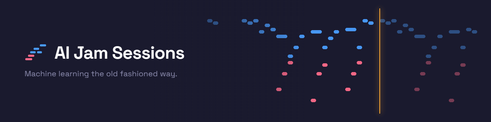
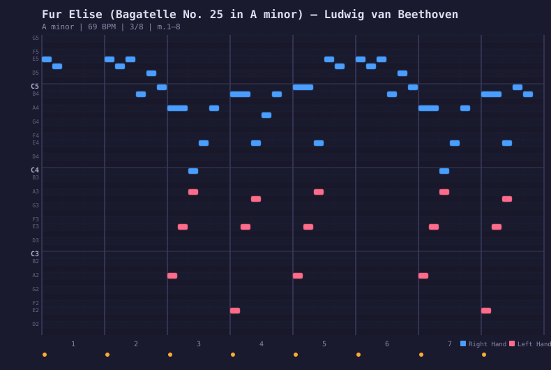
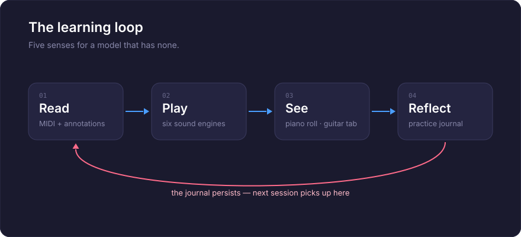

<p align="center">
  <a href="README.ja.md">日本語</a> | <a href="README.zh.md">中文</a> | <a href="README.es.md">Español</a> | <a href="README.md">English</a> | <a href="README.hi.md">हिन्दी</a> | <a href="README.it.md">Italiano</a> | <a href="README.pt-BR.md">Português (BR)</a>
</p>

<p align="center">
  
</p>

<p align="center">
  <em>Machine Learning the Old Fashioned Way</em>
</p>

<p align="center">
  An MCP server that teaches AI to play piano and guitar — and sing.<br/>
  109 annotated songs across 12 genres. Six sound engines. Interactive guitar tablature.<br/>
  A browser cockpit with vocal synthesizer. A practice journal that remembers everything.
</p>

<p align="center">
  <a href="https://github.com/mcp-tool-shop-org/ai-jam-sessions/actions/workflows/ci.yml"></a>
  <a href="https://codecov.io/gh/mcp-tool-shop-org/ai-jam-sessions"></a>
  <a href="https://www.npmjs.com/package/@mcptoolshop/ai-jam-sessions"></a>
  <a href="https://github.com/mcp-tool-shop-org/ai-jam-sessions"></a>
  <a href="https://github.com/mcp-tool-shop-org/ai-jam-sessions"></a>
  <a href="datasets/jam-actions-v0-public/README.md"></a>
  <a href="https://doi.org/10.5281/zenodo.20279918"></a>
</p>

---

## Écoutez d’abord : trois hymnes, chantés en rythme

**[Amazing Grace, America the Beautiful et le Battle Hymn of the Republic](https://mcp-tool-shop-org.github.io/ai-jam-sessions/#listen)**,
chaque couplet, chanté par une voix synthétique sur un arrangement de piano écrit pour chaque hymne. La page d'accueil les diffuse avec une partition 3D
qui suit la voix et les paroles, celles-ci s'allumant au fur et à mesure qu'elles sont chantées.

Chaque interprétation a été assemblée à partir de seize prises d’un chanteur dont l’interprétation est basée sur la partition :
- une prise par phrase, choisie par un auditeur local et un détecteur de hauteur ;
- placée sur la partition par décalage temporel, de sorte que rien à l’intérieur d’une phrase ne soit coupé ;
- vérifiée par deux instruments de mesure du tempo et deux détecteurs de hauteur ;
- validée à l’oreille, chaque problème étant marqué dans une évaluation qui le relie à sa cause.

Un test sonore avant chaque chanson mesure l’empreinte temporelle de la voix et indique le nombre de prises nécessaires pour la chanson.

Comment cela a été réalisé : [manuel → Voix](https://mcp-tool-shop-org.github.io/ai-jam-sessions/handbook/vocals/).

| | Amazing Grace | America the Beautiful | Battle Hymn |
|---|---|---|---|
| syllabes dans un rayon de 40 ms par rapport à la partition | 107/112 | 217/224 | 285/414 |
| notes dans un rayon de 50 cents | 135/140 | 218/224 | 368/424 |

Les notes pointées rapides du Battle Hymn sont laissées au rythme du chanteur, ce qui est la source de la plupart de ses erreurs de synchronisation.

La voix est synthétique : [SoulX-Singer](https://github.com/Soul-AILab/SoulX-Singer) (Apache-2.0), avec son propre timbre d'exemple,
sans imiter un chanteur réel. Les arrangements de piano ont été écrits pour ce projet par Kimi-K3 et sont dédiés au
domaine public (CC0). Les trois hymnes sont dans le domaine public.

## Qu'est-ce que c'est ?

Un piano et une guitare que l'IA apprend à jouer. Pas un synthétiseur, pas une bibliothèque MIDI, mais un instrument d'apprentissage.

Un LLM peut lire et écrire du texte, mais il ne peut pas vivre la musique comme nous. Pas d'oreilles, pas de doigts, pas de mémoire musculaire. AI Jam Sessions comble cette lacune en donnant au modèle des sens qu'il peut réellement utiliser :

- **Lecture** : véritable partition MIDI avec des annotations musicales approfondies. Pas d'approximations manuscrites, mais des données analysées, interprétées et expliquées.
- **Audition** : six moteurs audio (piano oscillateur, piano échantillonné, échantillons vocaux, tractus vocal physique, synthétiseur vocal additif, guitare modélisée physiquement) qui se diffusent via vos haut-parleurs, de sorte que les personnes présentes dans la pièce deviennent les oreilles de l'IA. Et maintenant, le modèle a ses propres oreilles, et ce, deux fois plus : il peut mesurer un enregistrement a posteriori (voir [Écoute](#écoute)) et il peut observer le groupe **pendant que la musique est encore en cours** (voir [L'ensemble en direct](#lensemble-en-direct)).
- **Vision** : une partition de piano qui rend ce qui a été joué sous forme de SVG, que le modèle peut relire et vérifier. Un éditeur interactif de tablatures de guitare. Un cockpit de navigateur avec un clavier visuel, un éditeur de notes à deux modes et un laboratoire d'accordage.
- **Mémorisation** : un journal de pratique qui persiste entre les sessions, de sorte que l'apprentissage s'accumule avec le temps.
- **Chant** : synthèse du tractus vocal avec 20 préréglages de voix, allant du soprano lyrique au chœur électronique. Mode de chant avec solfège, contour et narration syllabique. Et des chansons entières chantées au rythme du piano : un chanteur conditionné par la partition, piloté par l'arrangement de la chanson, assemblé phrase par phrase à partir de nombreuses prises et limité dans le temps (40 ms) et en hauteur (50 cents) avant que vous ne l'entendiez — voir [Chant](#chanter).

Chacune des 109 chansons est maintenant entièrement annotée : contexte historique, analyse structurelle barre par barre, moments clés, objectifs pédagogiques et conseils d’interprétation, dans les 12 genres. Une version antérieure de ce fichier README indiquait que les chansons brutes « attendaient que l’IA assimile les motifs, joue la musique et rédige ses propres annotations ». C’est exactement ce qui s’est passé : les annotations ont été rédigées par l’IA sur la base d’une analyse déterministe par chanson (accords, structure de répétition, limites des sections, tonalités vérifiées), limitées par une grille de qualité et vérifiées de manière contradictoire, affirmation par affirmation : les numéros de mesure, les fenêtres d’accords et les décomptes structurels sont tous vérifiés par rapport au MIDI réel avant que quoi que ce soit ne soit publié.

À partir de ce même travail, nous publions également **[jam-actions-v0](#ensemble-dentraînement)** — un ensemble de données public de 57 séquences d'utilisation d'outils MCP sur du piano classique réel. Il enseigne aux LLM à effectuer une *utilisation d'outils ancrée sur de la musique symbolique*, et pas seulement de la génération de texte, et est livré avec une porte de sortie à 7 axes qui distingue le « partage de preuves » du « partage parce que la tâche est triviale ». Voir [Ensemble de données d'entraînement](#ensemble-dentraînement) ci-dessous pour l'histoire complète.

## Écoute

Pendant longtemps, ce serveur pouvait produire du son, mais pas l’analyser. Le modèle jouait, un humain
écoutait, et le modèle se basait sur son avis. Cette lacune est désormais comblée.

Si vous le pointez vers un fichier WAV, il mesure ce qu’il contient. Pas en regardant une image et en devinant, mais en
faisant passer le signal à travers les mêmes types d’outils qu’il utilise déjà sur la partition :

- **`analyze_audio`** : débuts, le contour de la hauteur et le niveau. La hauteur est renvoyée sous forme de noms de notes avec
des déviations en cents, jamais sous forme de fréquences brutes. Le niveau signifie les nombres réels maintenant : BS.1770-4
loudness intégrée en LUFS, le pic d'échantillon en dBFS et un nombre d'échantillons écrêtés, plus un
test d'intégrité qui signale les pertes et les pics de bruit — la moitié du contrôle qualité du rendu qui concerne les clics et les défauts.
Une section « Équilibre » indique où se situe l'énergie, des basses profondes à l'air : la part de chaque bande par rapport au
bruit rose, la brillance et l'inclinaison.
- **`transcribe_audio`** : l'enregistrement sous forme de notes : hauteur, début, durée et la distance de chaque note
par rapport à la hauteur de concert.
- **`score_audio_take`** : évaluer une performance par rapport à une chanson de la bibliothèque **à l'oreille**. Il
transcrit l'enregistrement, le met en correspondance avec la partition et indique quelles notes ont été jouées, lesquelles ont dévié et lesquelles ont été manquées. Ensuite, `view_scored_piano_roll` trace le résultat sur la partition,
exactement comme il le fait pour une prise MIDI enregistrée. C'est ainsi que vous évaluez un instrument réel, une prise chantée ou tout ce pour quoi il n'y a pas de MIDI à enregistrer.
- **`view_spectrogram`** : voir le son. Un spectrogramme à Q constant avec un clavier de piano sur le
bord gauche, de sorte que la hauteur soit lisible en un coup d'œil, et les notes prévues de la chanson y sont tracées sur demande.
- **`check_loop_seam`** : évaluer un rendu en boucle où il se répète : le pas de la forme d'onde après
l'extrapolation de la pente de la queue, l'énergie en forme d'impulsion au niveau de la jonction et le changement de niveau sur
la couture. Une boucle parfaite en phase sonne bien, même lorsque l'échantillon limite brut saute.
- **`compare_balance`** : le timbre d'un rendu par rapport à une référence qui est censée être correcte,
bande par bande en dB. Un indice qui devrait sonner comme ses frères et sœurs, un nouveau rendu qui devrait correspondre à
la prise qu'il remplace. La loudness est annulée, de sorte que seul le timbre est comparé.

**Ce que cela ne vous dira pas.** L'image sert à trouver *où* quelque chose ne va pas ; chaque nombre
provient du traitement du signal, et non d'un modèle qui lit une image. Le transcripteur suit une
ligne à la fois, de sorte qu'un accord ou un mixage complet produira quelque chose de convaincant mais incorrect, et il le dit. La détection des débuts atteint environ F1 0,88 à l'état de l'art, de sorte qu'une note « manquée » peut être une note que le
transcripteur n'a pas pu entendre plutôt qu'une note que vous n'avez pas jouée — les outils incluent cette réserve dans leur propre sortie plutôt que de l'enfouir ici.

L’ensemble de la structure est indépendant : la transformation, le suivi de la hauteur, le détecteur de débuts de notes, le
décodeur WAV et l’encodeur PNG sont tous dans ce dépôt, et ils produisent des nombres identiques dans Node
et dans le navigateur.

## L’ensemble en direct

L’évaluation d’une écoute se fait une fois l’enregistrement terminé. Voici l’autre moitié : demander ce que chaque
instrument fait **en ce moment**, pendant l’exécution.

```
ensemble_now()
```

Il répond en indiquant les notes tenues de chaque instrument, la durée pendant laquelle chaque note a été tenue et l’accord combiné
dans l’ensemble. Pendant un duo, les deux voix sont signalées séparément, de sorte que vous pouvez voir le piano maintenir un accord de trois notes tandis que le synthétiseur porte la mélodie.

### Deux canaux, et le moins cher est le plus précis

C’est la partie qu’il faut comprendre, car elle détermine quel nombre il faut prendre en compte.

**Intention : ce que chaque moteur était censé jouer.** Lorsque le modèle est celui qui joue, il ne s’agit pas
d’une estimation. Un accord de piano n’est pas quelque chose à transcrire ; ce sont trois notes qui ont été envoyées. Les
notes sont exactes, libres et immédiates.

**Acoustique : ce qui est réellement produit.** Chaque moteur peut diriger sa sortie vers un bus d’analyse privé,
de sorte que chaque instrument est mesuré à la source, sans séparation ni ambiguïté. Ce canal est une
**vérification, pas une découverte** : c’est ainsi que vous apprenez qu’une voix s’est décalée, qu’une prise a été coupée ou qu’un moteur s’est arrêté tout en continuant à recevoir des notes.

Lorsque les deux sont en désaccord, il s’agit d’un fait concernant le rendu, et non d’une correction des notes.

### Ce que cela coûte

L’observation d’un instrument coûte environ **9 microsecondes par appel audio**, contre un bloc de 42,67 ms,
ce qui représente environ 0,02 % du budget audio, mesuré avec zéro échantillon perdu. Un instrument sans observateur attaché ne coûte rien du tout.

### Ce qu’il ne vous dira pas

Le canal acoustique est en retard, et indique de combien : environ 23 ms pour la hauteur et 70 ms pour un début de note confirmé, car un début de note ne peut être confirmé que lorsque l’audio qui le suit est arrivé. Les débuts de notes proches de cette limite sont supprimés plutôt que signalés et annulés ultérieurement.

Le suivi acoustique suit une ligne à la fois, il ne nommera donc pas les notes d’un accord, et il ne prétend pas le faire. Un accord qu’il ne peut pas résoudre est sa limitation connue, plutôt qu’une découverte, et l’ensemble reste silencieux à ce sujet au lieu de crier au loup à chaque accord joué par le piano.

## La partition de piano

La partition de piano est la façon dont l'IA voit la musique. Elle rend n'importe quelle chanson sous forme de SVG — bleu pour la main droite, corail pour la main gauche, avec des grilles de temps, des dynamiques et des limites de mesures :

<p align="center">
  
</p>

<p align="center"><em>Für Elise, measures 1–8 — the E5-D#5 trill in blue, bass accompaniment in coral</em></p>

Deux modes de couleur : **main** (bleu/corail) ou **classe de hauteur** (arc-en-ciel chromatique — chaque Do est rouge, chaque Fa# est cyan). Le format SVG signifie que le modèle peut à la fois voir l'image et lire le balisage pour vérifier la hauteur, le rythme et l'indépendance des mains.

## Le cockpit

Un studio de composition basé sur un navigateur qui se trouve dans ce dépôt à [`apps/cockpit`](apps/cockpit) — et qui fonctionne en direct sur **[mcp-tool-shop-org.github.io/ai-jam-sessions/cockpit](https://mcp-tool-shop-org.github.io/ai-jam-sessions/cockpit/)**. Pas de plugins, pas de DAW, pas d'installation ; tout reste dans votre navigateur (votre travail est automatiquement enregistré localement). Vous préférez le modifier ?

```bash
cd apps/cockpit && npm install && npm run dev   # Vite dev server, opens in your browser
```

- **Un piano à queue échantillonné par défaut** — le panneau de contrôle intègre un ensemble Salamander Grand réduit (90 fichiers OGG, 8 Mo) qui se charge lors de votre première interaction et est diffusé via la même chaîne de sortie que les voix du synthétiseur ; avant son chargement (ou hors ligne), les pianos à oscillateurs accordés couvrent de manière transparente. Échantillons de [Alexander Holm](https://freepats.zenvoid.org/Piano/acoustic-grand-piano.html), CC-BY 3.0.
- **Mode panneau — la salle d'écoute** — auditions comparatives aveugles par paires des sonorités du moteur de composition sur de véritables mélodies de bibliothèque : extraits de volume égal rendus hors ligne via le chemin de la voix réelle, essais aléatoires avec des tests de seuil cachés, classements Bradley-Terry avec intervalles de confiance bootstrap, et résultats honnêtes (PROVISOIRES jusqu'à ce que chaque paire atteigne son quota de votes ; NON INTERPRÉTABLES lorsque le seuil de discrimination n'est pas atteint). Un deuxième sous-mode exécute le même classement avec des juges LLM locaux, ainsi qu'un historique pour les deux types d'exécution et une vue de comparaison (Kendall τ + correspondance du classement du moteur) qui permet de déterminer si les pistes de substitution bon marché reflètent la vérité humaine.
- **Transport précis au rythme** — les notes sont synchronisées avec le temps musical, de sorte que le contrôle du BPM ajuste réellement le tempo de lecture ; une règle de temps avec clic pour effectuer des recherches, avec possibilité de faire glisser pour définir les **régions de boucle** ; défilement automatique qui suit la tête de lecture
- **Enregistrement avec activation** — jouez les touches du clavier QWERTY, le clavier à l'écran ou un appareil Web MIDI, et cela sera enregistré dans la partition : une mesure d'introduction, un enregistrement en boucle sur les cycles de boucle (ou en mode de remplacement), le timing brut de l'exécution est préservé dans une vue quantifiée, chaque passage est une unité unique qui peut être annulée
- **Annulation/rétablissement complet** — chaque modification, y compris Effacer et Importer, est réversible (Ctrl+Z), les gestes de glissement permettant de regrouper les actions comme le font les éditeurs classiques
- **Sélection multiple + presse-papiers** — sélection par rectangle sous un outil de sélection/dessin, clics avec modificateurs standard de la plateforme, copier/couper/coller à la tête de lecture, Dupliquer
- **Tactile + accessibilité** — événements de pointeur avec capture sur chaque surface, tapoter pour redéfinir la position comme alternative au glissement, édition des notes au clavier, superposition de partitions sans danger pour les daltoniens
- **Piano roll à double mode** — basculez entre le mode Instrument (couleurs des classes de hauteur chromatiques) et le mode Vocal (notes colorées en fonction de la forme des voyelles : /a/ /e/ /i/ /o/ /u/)
- **Clavier visuel** — deux octaves à partir de C4, mappé à votre clavier QWERTY. Cliquez ou tapez.
- **20 préréglages de voix** — 15 voix mappées Kokoro (Aoede, Heart, Jessica, Sky, Eric, Fenrir, Liam, Onyx, Alice, Emma, Isabella, George, Lewis, plus chœur et voix de synthé), 4 voix mappées sur le spectre, et une section de chœur synthétique
- **10 préréglages d'instruments** — les 6 voix de piano côté serveur plus synthé-pad, orgue, cloche et cordes
- **Inspecteur de notes** — cliquez sur n'importe quelle note pour modifier la vélocité, la voyelle et la sonorité
- **7 systèmes d'accordage** — tempérament égal, intonation juste (majeur/mineur), pythagoricien, tempérament à quart de comma, Werckmeister III, ou décalages personnalisés en cents. Référence A4 réglable (392–494 Hz).
- **Audit d'accordage** — tableau de fréquences, testeur d'intervalles avec analyse de la fréquence de battement, et exportation/importation de l'accordage
- **Importation/exportation de partitions** — sérialisez l'ensemble de la partition au format JSON et chargez-la à nouveau
- **API orientée LLM** — `window.__cockpit` expose `exportScore()`, `importScore()`, `addNote()`, `play()`, `stop()`, `panic()`, `setMode()` et `getScore()` afin qu'un LLM puisse composer, arranger et diffuser de manière programmatique

## La boucle d'apprentissage

<p align="center">
  
</p>

## La bibliothèque de chansons

109 chansons annotées dans 12 genres, créées à partir de fichiers MIDI réels. Chaque genre comporte un exemple annoté en profondeur, avec un contexte historique, une analyse harmonique par mesure, des moments clés, des objectifs pédagogiques et des conseils de performance (y compris des indications vocales). Ces exemples servent de modèles : l'IA en étudie un, puis annote les autres. L'exemple folk est **America the Beautiful** (Samuel A. Ward, 1882, domaine public) : un hymne en Fa majeur arrangé dans ce référentiel, mélodie F4–C5.

**Ce qui est inclus et ce que vous devez récupérer.** Les annotations sont les nôtres et sont incluses dans chaque chanson. Les fichiers MIDI ont été téléchargés à partir de sites MIDI publics lors de la création de la bibliothèque, et un audit de la provenance par fichier ([`docs/findings/library-provenance-audit.md`](docs/findings/library-provenance-audit.md)) a révélé que seulement 14 de ces téléchargements comportent une licence qui autorise la redistribution : les arrangements de Bernd Krueger sur piano-midi.de (CC-BY-SA-3.0-DE) et les versions du domaine public du projet Mutopia. Ces 14 fichiers se trouvent dans le package npm. Les 94 autres téléchargements ne le sont pas : leur `.json` est inclus, avec un bloc `provenance` indiquant la source, ses conditions et le SHA-256 du fichier, et `ai-jam-sessions library fetch --accept-source-terms` télécharge chacun d'eux à partir du site qui l'a publié, selon les conditions de ce site, en refusant tout fichier dont le hachage ne correspond plus à ce par rapport auquel les annotations ont été vérifiées. Douze fichiers qui se sont avérés être une œuvre différente de leur nom ont été mis en quarantaine, ce qui explique pourquoi cette bibliothèque téléchargée contient 108 chansons et non les 120 versions antérieures. **America the Beautiful** est la 109e chanson et le quinzième fichier MIDI inclus dans le package : l'arrangement a été réalisé ici et dédié au domaine public. Les versions antérieures à 2.6.0 contenaient les 120 fichiers MIDI ; c'était une erreur, et elle est corrigée ici plutôt que dissimulée.

| Genre | Exemple | Tonalité | Ce que cela enseigne |
|-------|----------|-----|-----------------|
| Blues | Le frisson s’est envolé (B.B. King) | Si mineur | Forme de blues mineur, appel et réponse, jeu en décalage par rapport au rythme |
| Classique | Für Elise (Beethoven) | La mineur | Forme de rondo, différenciation du toucher, discipline du pédalier |
| Film | Comptine d'un autre été (Tiersen) | Mi mineur | Textures arpégées, architecture dynamique sans changement harmonique |
| Folk | America the Beautiful (Ward) | Fa majeur | Harmonie d'hymne tonique-dominante, phrasé patriotique, mélodie en F4–C5 |
| Jazz | Autumn Leaves (Kosma) | Sol mineur | Progressions ii-V-I, notes de passage, rythmes swing, voicings sans fondamentale |
| Latin | The Girl from Ipanema (Jobim) | Fa majeur | Bossa nova, modulation chromatique, retenue vocale |
| New Age | River Flows in You (Yiruma) | Une tonalité majeure | Reconnaissance I-V-vi-IV, arpèges fluides, rubato |
| Pop | Imagine (Lennon) | Do majeur | Accompagnement en arpèges, retenue, sincérité vocale |
| Ragtime | The Entertainer (Joplin) | Do majeur | Basse « oom-pah », syncopes, forme à plusieurs sections, discipline du tempo |
| R&B | Superstition (Stevie Wonder) | Mi bémol mineur | Funk en seizièmes de note, clavier percussif, notes fantômes |
| Rock | Your Song (Elton John) | Mi bémol majeur | Ballade au piano, progression des voix, inversions, chant conversationnel |
| Soul | Lean on Me (Bill Withers) | Do majeur | Mélodie diatonique, accompagnement gospel, appel et réponse |

Les morceaux évoluent de **brut** (MIDI uniquement) à **annoté** à **prêt** (totalement jouable avec un langage musical). L’IA promeut les morceaux en les étudiant et en rédigeant des annotations avec `annotate_song`.

## Moteurs sonores

Six moteurs, plus un combinateur en couches qui exécute simultanément deux d’entre eux :

| Moteur | Type | Son |
|--------|------|---------------------|
| **Oscillator Piano** | Synthèse additive | Piano multi-harmonique avec bruit de marteau, inharmonicité, brillance modulée par la vélocité, polyphonie à 48 voix, image stéréo. Aucune dépendance. |
| **Sample Piano** | Lecture d’échantillons | Salamander Grand Piano — le vrai son. **Le moteur par défaut chaque fois qu’un pack est installé** (`samples/AccurateSalamander` ou `AI_JAM_SAMPLES_DIR`) ; le fichier tar npm reste sans échantillon, vous fournissez donc le téléchargement [Salamander](https://freepats.zenvoid.org/Piano/acoustic-grand-piano.html). La console du navigateur est livrée avec son propre pack réduit de 8 Mo (90 OGG, CC-BY 3.0 Alexander Holm) — aucune configuration sur le Web. |
| **Vocal (Sample)** | Échantillons avec transposition de hauteur | Tons de voyelles soutenus avec portamento et mode legato. |
| **Vocal Tract** | Modèle physique | Pink Trombone — onde glottale LF à travers un guide d’ondes numérique à 44 cellules. Quatre préréglages : soprano, alto, ténor, basse. |
| **Vocal Synth** | Synthèse additive | 15 préréglages de voix Kokoro avec mise en forme de formants, souffle, vibrato. Déterministe (générateur de nombres aléatoires avec amorçage). |
| **Guitar** | Synthèse additive | Corde pincée modélisée physiquement — 4 préréglages (dreadnought en acier, classique en nylon, jazz arche, douze cordes), 8 accordages, 17 paramètres réglables. |
| **Layered** | Combinateur | Combine deux moteurs et transmet chaque événement MIDI aux deux — piano+synthé, voix+synthé, etc. |

### Voix de clavier

Six voix de piano réglables, chacune étant ajustable par paramètre (brillance, durée, dureté du marteau, désaccord, largeur stéréo, etc.) :

| Voix | Caractère |
|-------|-----------|
| Concert Grand | Riche, ample, classique |
| Upright | Chaud, intime, folk |
| Electric Piano | Soie, jazz, son Fender Rhodes |
| Honky-Tonk | Désaccordé, ragtime, saloon |
| Music Box | Cristallin, éthéré |
| Bright Grand | Perçant, contemporain, pop |

### Voix de guitare

Quatre préréglages de voix de guitare avec synthèse de cordes modélisée physiquement, chacun avec 17 paramètres réglables (brillance, résonance du corps, position de pincement, amortissement des cordes, etc.) :

| Voix | Caractère |
|-------|-----------|
| Steel Dreadnought | Brillant, équilibré, acoustique classique |
| Nylon Classical | Chaud, doux, arrondi |
| Jazz Archtop | Doux, boisé, clair |
| Twelve-String | Scintillant, doublé, effet de chœur |

## Le journal de pratique

Après chaque session, le serveur enregistre ce qui s’est passé — quel morceau, quelle vitesse, combien de mesures, combien de temps. L’IA ajoute ses propres réflexions : ce qu’elle a remarqué, quels schémas elle a reconnus, ce qu’il faut essayer ensuite.

```markdown
---
### 14:32 — Autumn Leaves
**jazz** | intermediate | G minor | 69 BPM × 0.7 | 32/32 measures | 45s

The ii-V-I in bars 5-8 (Cm7-F7-BbMaj7) is the same gravity as the V-i
in The Thrill Is Gone, just in major. Blues and jazz share more than the
genre labels suggest.

Next: try at full speed. Compare the Ipanema bridge modulation with this.
---
```

Un fichier Markdown par jour, stocké dans `~/.ai-jam-sessions/journal/`. Lisible par l’homme, ajout uniquement. Lors de la prochaine session, l’IA lit son journal et reprend là où elle s’était arrêtée.

## Ensemble d’entraînement

**jam-actions-v0** — un ensemble de données public de traces d’utilisation d’outils MCP sur plusieurs tours, basé sur des fichiers MIDI de piano classique. Construit à partir de la même bibliothèque que ce serveur utilise pour l’enseignement, l’ensemble de données enseigne aux LLM comment effectuer une **utilisation d’outils basée sur des données sur de la musique symbolique** — et pas seulement de la génération de texte.

Chaque enregistrement associe une fenêtre de phrase de 4 mesures à une cible d’enseignement annotée et à une *trace cible* — une session étape par étape dans laquelle un assistant utilise les outils MCP ci-dessus (`get_events_in_measure`, `get_events_in_hand`, `count_distinct_pitch_classes` et le reste de la surface d’inspection MIDI à 9 outils) pour lire, analyser et discuter de la phrase.

| | |
|---|---|
| Version | **0.6.0 (2026-09-25) — version de correction** (voir ci-dessous) |
| Enregistrements | 57 (sous-ensemble public) : entraînement 45, test hors ensemble 12 (`clair-de-lune`) |
| Compositions | 4 œuvres pour piano classique : Bach BWV 846, Mozart K. 545 I, Beethoven « Für Elise », Debussy « Clair de Lune » |
| Source MIDI | piano-midi.de — arrangements de Bernd Krueger, chaque fichier portant le crédit de droit d’auteur de Krueger |
| Licence | CC-BY-SA-3.0-DE (arrangements) sur des compositions du domaine public |
| Où | [`mcp-tool-shop/jam-actions-v0`](https://huggingface.co/datasets/mcp-tool-shop/jam-actions-v0) on Hugging Face and on Zenodo; DOIs and citation in the [dataset card](datasets/jam-actions-v0-public/README.md) and [`CITATION.cff`](datasets/jam-actions-v0-public/CITATION.cff) |

**La correction 0.6.0.** Les versions 0.4.x et 0.5.x contenaient 115 enregistrements répartis sur 8 œuvres, toutes attribuées à Bernd Krueger. Cette attribution a été vérifiée par rapport aux pages des compositeurs sur piano-midi.de, et non par rapport aux fichiers. Lorsque la bibliothèque de chansons a été auditée à partir des octets MIDI, il s’est avéré que quatre de ces chansons — le Nocturne op. 9 n° 2 et le Prélude op. 28 n° 4 de Chopin, la « Pathétique » II de Beethoven et le « Träumerei » de Schumann — avaient été créées à partir de fichiers obtenus sur midiworld.com et bitmidi.com, sans licence d’arrangement établie. Leurs 58 enregistrements reproduisaient ces arrangements note pour note, de sorte que la version 0.6.0 les retire. Les 57 enregistrements restants sont identiques à ceux de la version 0.5.0. Veuillez ne pas redistribuer les enregistrements retirés des versions précédentes. Le compte rendu complet se trouve dans [`docs/findings/published-dataset-licence-audit.md`](docs/findings/published-dataset-licence-audit.md).

**Le contrôle de la preuve.** L’outil de création de paquets relit maintenant le bloc de provenance de la bibliothèque de chaque chanson — dérivé à nouveau des octets MIDI — et refuse tout enregistrement dont la chanson ne dispose pas d’une licence d’arrangement redistribuable, ou dont le hachage du fichier source diffère du fichier dont la preuve est fournie. Il fonctionne en mode sécurisé. Un test exécute à nouveau la même vérification sur chaque paquet publié, de sorte qu’un changement de provenance ultérieur fait passer la compilation au rouge pour les ensembles publiés.

**Contexte de qualité — le seuil de publication à 7 axes.** Le seuil de publication de l’ensemble de données distingue les résultats positifs basés sur des preuves des résultats saturés. Les axes 1 à 6 sont des critères bloquants (seuil absolu, marge composée, taux d’utilisation d’outils, correction après utilisation d’un outil, nombre d’interprétations erronées, seuil de la couche) ; l’axe 7 est une comparaison entre les données enrichies et les données non enrichies. Les verdicts enregistrés ont été mesurés sur les 115 enregistrements de la version 0.4.x et 0.5.x et restent reproductibles à partir de la balise `jam-actions-v0-0.5.0-cut-2026-07-11` ; ils n’ont pas été remesurés sur la version 0.6.0.

**Reproductibilité.** Un nouveau contributeur sur n’importe quelle plateforme (Windows natif, macOS, Linux, WSL) peut vérifier le paquet et le reconstruire :

```bash
git clone https://github.com/mcp-tool-shop-org/ai-jam-sessions.git
cd ai-jam-sessions && pnpm install
pnpm exec tsx scripts/verify-public-package-checksums.ts                        # every file accounted for
pnpm exec tsx scripts/package-jam-actions-public.ts --today 2026-09-25 --dry-run # evidence gate runs first
pnpm build && pnpm exec tsx scripts/verify-public-package-execution.ts
# → "VERDICT: PASS" — every frozen tool call replays live (needs an audio device)
```

`.gitattributes` fixe les fins de ligne LF pour `*.sha256` et l’arborescence du jeu de données public afin que le vérificateur de sommes de contrôle fonctionne sur toutes les plateformes.

**Historique du réglage fin.** Les affirmations de l’ensemble de données ont été testées avec des réglages fins préenregistrés, évalués par rapport à des références scellées. **v0** (les 78 pistes d’échantillons seules) a donné un résultat négatif honnête ([rapport](docs/finetune-arc-eval-report.md)) ; **v1** a amélioré l’assurance qualité basée sur l’outil de 0,202, mais n’a pas atteint la barre préenregistrée d’une seule victoire appariée ([rapport](docs/finetune-arc-v1-eval-report.md)) ; **B-1** a retesté les adaptateurs gelés v1 sur un groupe de 36 enregistrements : 0,678 → 0,890, 29/36 victoires appariées par rapport à la barre de 24/34 définie à l’avance ([rapport](docs/finetune-arc-v2-b1-eval-report.md)). Ces mesures sont enregistrées telles quelles. **Les adaptateurs eux-mêmes sont retirés** : leurs données d’entraînement comprenaient des enregistrements provenant des quatre chansons retirées, de sorte qu’ils ne peuvent pas être proposés dans le cadre des conditions de cet ensemble de données. Les adaptateurs entraînés uniquement sur du matériel dont la licence est claire sont publiés avec les ensembles de données `jam-actions-v1`.

> Les arrangements MIDI sont de Bernd Krueger (piano-midi.de), sous licence CC-BY-SA-3.0-DE. Les annotations, les pistes et les artefacts d’évaluation sont de l’équipe AI Jam Sessions, publiés sous la même licence afin de préserver la chaîne de partage de bout en bout. **Limite de la licence** : la licence MIT du dépôt couvre le code ; tout ce qui se trouve sous `datasets/` est sous licence CC-BY-SA-3.0-DE. Le corpus de travail à l’adresse `datasets/jam-actions-v0/` contient également des enregistrements qui ne sont pas publiés : deux œuvres dont la provenance n’a jamais été vérifiée (Gymnopédie n° 1 de Satie, Arabesque n° 1 de Debussy) et les quatre œuvres retirées dans la version 0.6.0 — voir [`datasets/jam-actions-v0/PROVENANCE-NOTE.md`](datasets/jam-actions-v0/PROVENANCE-NOTE.md).

### Le corpus acoustique

**jam-actions-acoustic-v0** — le complément des pistes ci-dessus, portant sur l’**audio** plutôt que sur la musique symbolique. 72 enregistrements, chacun associant un rendu synthétique délibérément perturbé d’une phrase du domaine public au verdict que les outils d’analyse renvoient réellement, de sorte que chaque étiquette est vérifiée par rapport à l’instrument et non uniquement par rapport à lui-même.

| | |
|---|---|
| Version | 1.1.0 (25/09/2026) — a retiré les 36 enregistrements de « Träumerei » de la version 1.0.x, dont le fichier source ne dispose pas d’une licence d’arrangement établie. |
| Enregistrements | 72 — 2 phrases (Bach, Für Elise) × 9 types de perturbations × 4 notes cibles |
| Mis de côté | par **phrase** (Für Elise), et non par enregistrement, de sorte qu’un jumeau perturbé de la même mélodie ne puisse pas être divulgué. |
| Classes | correspondance, échec/avertissement de la hauteur, échec/réussite du timing, note manquante, note supplémentaire, vibrato accordé, silence sans rien à évaluer |
| Audio | aucun n’est distribué — chaque enregistrement contient une recette déterministe et le SHA-256 de la forme d’onde qu’il produit |
| Schéma | `jam-actions-acoustic-v0/1.0.0` |

Deux des neuf classes sont là parce qu’un modèle naïf y répond avec confiance et de manière incorrecte : une note de vibrato dont le verdict correct est *accordée*, et le silence dont le verdict correct est *rien à évaluer*. Chaque seuil dont dépend le verdict est copié dans l’enregistrement, car les deux ont été modifiés une fois pendant la construction.

Le corpus peut être reproduit à partir de ce dépôt. Sa régénération produit tous les 79 fichiers publiés et un fichier `checksums.sha256` identique au niveau de l’octet, et un test confirme exactement cela sans écrire l’arborescence publiée.

**Une réserve, mesurée plutôt que supposée.** Chaque enregistrement contient `wav_sha256`, le hachage de la forme d’onde que sa recette produit, et le moteur de rendu appelle `Math.pow` et `Math.sin` une fois par échantillon. Il n’est pas nécessaire que ces valeurs soient correctement arrondies, et les résultats de V8 ont changé entre Node 22 et Node 24 : sur les 27 869 arguments distincts `Math.pow(2, x)` que le corpus original a évalués, 253 renvoient une valeur double différente. Presque tout cela disparaît avec une quantification sur 16 bits, mais **2 des 72 enregistrements** — les deux perturbations `extra` de Für Elise, dont le motif se trouve sur la note où le rapport de demi-ton lui-même diffère — ont un hachage différent sur Node 24. Tous les autres champs de chaque enregistrement sont reproduits sur n’importe quel moteur, et le dépôt teste ces deux affirmations séparément. Si vous effectuez un nouveau rendu et que vous constatez que ces deux éléments ne correspondent pas, c’est cela, et non un téléchargement corrompu. Rendre la forme d’onde portable au niveau des bits signifie remplacer les transcendantes, ce qui modifie tous les hachages et nécessite donc une nouvelle version du schéma.

### Créez le vôtre

L’échafaudage sur lequel ce corpus fonctionne est disponible pour vos propres expériences.
[`experiments/_template/`](experiments/_template/) est un exemple fonctionnel que vous pouvez copier : déclarez une tâche, et vous obtiendrez un formatage SFT, un score par classe, des références triviales par rapport à votre ensemble de verdicts déclaré et une vérification pour vous assurer qu’aucune unité de test ne chevauche la division.

Le [contrat](experiments/_template/README.md) est la partie qui vaut la peine d’être lue. La vérité terrain est constructible plutôt qu’écrite à la main, les étiquettes sont vérifiées par rapport à ce que les outils mesurent, vous divisez par l’unité qui présente des fuites, et vous signalez les références et le modèle de base à côté de tout résultat. Chacune de ces règles a un coût à apprendre.

## Installation

```bash
npm install -g @mcptoolshop/ai-jam-sessions
```

Nécessite **Node.js 22+** (v2.0.0 a augmenté le seuil avec `node-web-audio-api` 2.0). Pas de pilotes MIDI, pas de ports virtuels, pas de logiciels externes.

### Claude Desktop / Claude Code

```json
{
  "mcpServers": {
    "ai_jam_sessions": {
      "command": "npx",
      "args": ["-y", "-p", "@mcptoolshop/ai-jam-sessions", "ai-jam-sessions-mcp"]
    }
  }
}
```

### Docker

Chaque version inclut également `ghcr.io/mcp-tool-shop-org/ai-jam-sessions`, une image légère qui exécute le serveur MCP sur stdio. Il est important de savoir que `/data` est la mémoire : le journal, l’état du serveur, les morceaux des utilisateurs et tous les fichiers MIDI récupérés y sont stockés. Il est donc nécessaire de monter un volume, sinon le conteneur plantera.

```json
{
  "mcpServers": {
    "ai_jam_sessions": {
      "command": "docker",
      "args": ["run", "--rm", "-i", "-v", "ai-jam-data:/data", "ghcr.io/mcp-tool-shop-org/ai-jam-sessions"]
    }
  }
}
```

L’image contient les 14 fichiers MIDI redistribuables ; l’exécution de `library fetch --accept-source-terms` une seule fois à l’intérieur du conteneur place les 94 autres fichiers dans le volume. `docker compose up` fait de même avec un volume nommé, et `--profile ollama` ajoute un conteneur annexe Ollama. Détails, l’interface de ligne de commande à l’intérieur de l’image et ce qui n’y figure pas intentionnellement : [docs/docker.md](docs/docker.md). Exécution des évaluateurs affinés dans Ollama, avec le coût mesuré d’une base à 4 bits : [docs/ollama-adapters.md](docs/ollama-adapters.md).

## Outils MCP

56 outils et 4 modèles de requête répartis en huit catégories :

### Apprendre

| Outil | Fonctionnement |
|------|--------------|
| `list_songs` | Parcourir par genre, difficulté ou mot-clé |
| `song_info` | Analyse musicale complète : structure, moments clés, objectifs pédagogiques, conseils de style |
| `registry_stats` | Statistiques pour l’ensemble de la bibliothèque : nombre total de morceaux, genres, difficultés |
| `list_measures` | Notes, dynamiques et notes pédagogiques de chaque mesure |
| `teaching_note` | Analyse approfondie d’une seule mesure : doigté, dynamiques, contexte |
| `suggest_song` | Recommandation basée sur le genre, la difficulté et ce que vous avez déjà joué |
| `practice_setup` | Vitesse, mode et paramètres de voix recommandés, ainsi que la commande CLI pour un morceau |
| `compare_songs` | Reconnaissance de motifs intergenres : relations clés, similarité de hauteur/intervalle, formes partagées, liens pédagogiques |
| `annotation_progress` | Qualité de l’annotation des morceaux dans l’ensemble de la bibliothèque : scores, notes et suggestions d’amélioration |
| `server_info` | Version du serveur, statistiques de la bibliothèque, liste des moteurs, session active |

### Jouer

| Outil | Fonctionnement |
|------|--------------|
| `play_song` | Lecture via les haut-parleurs : morceaux de la bibliothèque ou fichiers .mid bruts. Quatre moteurs (piano, voix, tract, guitare), n’importe quelle vitesse, mode, plage de mesures, plus un métronome avec une fonction de pré-compte et un indicateur `record` qui enregistre la session pour l’évaluation. Les moteurs synthétiques et superposés ne sont accessibles que via la ligne de commande. |
| `stop_playback` | Arrêter |
| `pause_playback` | Mettre en pause ou reprendre |
| `set_speed` | Modifier la vitesse pendant la lecture (de 0,1× à 4,0×) |
| `playback_status` | Instantané en temps réel : mesure actuelle, tempo, vitesse, voix du clavier, état |
| `view_piano_roll` | Rendu au format SVG (couleur de la main ou arc-en-ciel chromatique des classes de hauteur) |
| `score_performance` | Évaluation d’un accompagnement MIDI : précision de la hauteur, synchronisation, exhaustivité, avec un retour d’information gradué |
| `mute_hand` | Couper ou rétablir le son de la main gauche/droite pendant la pratique : isoler une main à la fois |
| `detect_chord` | Nommer l’accord à partir d’un ensemble de notes MIDI actuellement jouées (par exemple, `[60,64,67]` → Do) |
| `preview_teaching_cues` | Afficher toutes les notes pédagogiques et les moments clés avant de jouer |

### Pratiquer

| Outil | Fonctionnement |
|------|--------------|
| `practice_loop` | L’exercice qu’un vrai professeur assignerait : répéter les mesures 5 à 8 plus lentement, et le tempo n’augmentera (+5 %) qu’après une exécution *parfaite* ; chaque exécution est enregistrée, évaluée et résumée. |
| `practice_status` | État de l’exercice : exécution actuelle, vitesse et diagnostic par mesure de la dernière tentative |
| `score_last_take` | Évaluer la dernière tentative enregistrée : précision de la hauteur, synchronisation, exhaustivité, verdicts par note |
| `view_scored_piano_roll` | La partition annotée que tout professeur utilise : la partition de piano superposée aux verdicts par note dans une palette sans danger pour les daltoniens (plein = correct, en pointillés = synchronisation, ✕ = manquant) |

### Chanter

| Outil | Fonctionnement |
|------|--------------|
| `sing_along` | Texte chantable : noms de notes, solfège, contour ou syllabes. Avec ou sans accompagnement de piano. |
| `ai_jam_sessions` | Générer un bref aperçu d’une improvisation : progression d’accords, contour de la mélodie et indications de style pour une réinterprétation |
| `verify_harmony` | La porte de vérification de la boucle de création : une réharmonisation proposée est vérifiée par les propres outils déterministes de la plateforme : fidélité de l’accord (le moteur d’accord doit détecter chaque accord prévu), consonance de la mélodie (ton/tension/chromatisme), fluidité de la voix de basse, appartenance à la tonalité |
| `auto_reharmonize` | La boucle de création en une seule étape : un modèle local propose une réharmonisation, la porte déterministe de `verify_harmony` vérifie chaque sonorité, le meilleur des n résultats est sélectionné jusqu’à ce qu’une interprétation vérifiée soit renvoyée |
| `compose_panel` | Exécuter le panneau de composition de la fluidité vocale sur n’importe quel morceau : quatre systèmes réalisent des accompagnements, un juge LLM inter-famille aveugle les classe, agrégation de Bradley-Terry : avec une porte de discrimination qui annule les exécutions non interprétables (signal directionnel uniquement, jamais un score de qualité). S’exécute pendant des minutes et diffuse des notifications de progression pendant son fonctionnement. |

**Un morceau entier sur le temps : la voie vocale.** N’importe quel morceau peut comporter une voix chantée réelle qui se superpose au piano.
- **Le chronomètre.** Un chronomètre de partition (`scripts/build-score-clock.mjs`) dérive la hauteur, le début et la durée de chaque syllabe à partir de l’arrangement du morceau, sur la propre ligne de temps du lecteur.
- **Le test sonore.** Avant qu’un morceau ne soit rendu, la même voix chante une phrase de calibration de seize mots au tempo du morceau (`scripts/soundcheck.py`). Son empreinte temporelle, par groupe de consonnes et pour les notes longues par rapport aux notes courtes, indique de combien de tentatives le morceau aura besoin et quels mots sont risqués, avant que du temps GPU ne soit consacré au morceau lui-même.
- **Le chanteur.** Un chanteur conditionné par la partition ([SoulX-Singer](https://github.com/Soul-AILab/SoulX-Singer), Apache-2.0) rend seize prises à partir de ce chronomètre, localement ou sur un GPU loué via offrig.
- **La sélection.** `scripts/sing_clock.py --by-phrase --warp` sélectionne une prise par phrase. Un transcript local et une hauteur FCPE décident, et la phrase est déformée dans le temps pour s’adapter à la partition.
- **Les portes.** **Synchronisation :** un détecteur d’énergie, vérifié par un aligneur vocal forcé, place chaque voyelle dans les 40 ms. **Hauteur :** FCPE, avec pYIN qui relit ce qu’il signale, place chaque note dans les 50 cents.
- **L’oreille.** La revue d’écoute (`scripts/review_marks.py`) permet à une personne d’appuyer sur **M** chaque fois que quelque chose ne sonne pas bien, avec une catégorie et une note. Le rapport retrace chaque marque à sa prise, à son joint et aux portes, et l’évalue en fonction du niveau de l’examinateur : l’oreille d’un auditeur détermine *où* cela ne sonne pas bien, tandis que le fait de nommer *ce qui* ne va pas a plus de poids pour les personnes ayant une formation. Il s’exécute comme une page d’écoute locale et comme un mode d’examen dans le cockpit, avec des sessions enregistrées et un seul niveau sonore pour chaque clip. Itinéraire, leviers et reçus : [manuel → Voix](https://mcp-tool-shop-org.github.io/ai-jam-sessions/handbook/vocals/), [`docs/vocal-clock.md`](docs/vocal-clock.md) ; la recherche derrière les choix : [`docs/vocal-singing-study-2026-09.md`](docs/vocal-singing-study-2026-09.md).

### Guitare

| Outil | Fonctionnement |
|------|--------------|
| `view_guitar_tab` | Afficher des tablatures de guitare interactives au format HTML — édition par clic, curseur de lecture, raccourcis clavier |
| `list_guitar_voices` | Préréglages de sonorité de guitare disponibles |
| `list_guitar_tunings` | Systèmes d’accordage de guitare disponibles (standard, accordage en drop-D, accordage ouvert en G, DADGAD, etc.) |
| `tune_guitar` | Ajuster n’importe quel paramètre de n’importe quelle sonorité de guitare. Les paramètres sont conservés entre les sessions. |
| `get_guitar_config` | Configuration actuelle de la sonorité de guitare par rapport aux paramètres d’usine |
| `reset_guitar` | Réinitialiser une sonorité de guitare aux paramètres d’usine |

### Création

| Outil | Fonctionnement |
|------|--------------|
| `add_song` | Ajouter une nouvelle chanson au format JSON |
| `import_midi` | Importer un fichier .mid avec des métadonnées |
| `annotate_song` | Écrire un langage musical pour une chanson brute et la préparer pour qu’elle soit prête |
| `save_practice_note` | Entrée de journal avec les données de session enregistrées automatiquement |
| `read_practice_journal` | Charger les entrées récentes pour le contexte |
| `list_keyboards` | Sonorités de clavier disponibles |
| `tune_keyboard` | Ajuster n’importe quel paramètre de n’importe quelle sonorité de clavier. Les paramètres sont conservés entre les sessions. |
| `get_keyboard_config` | Configuration actuelle par rapport aux paramètres d’usine |
| `reset_keyboard` | Réinitialiser une sonorité de clavier aux paramètres d’usine |
| `score_annotation` | Qualité de l’annotation de la partition sur 5 dimensions : exhaustivité, profondeur, spécificité, valeur pédagogique, vocabulaire |
| `validate_song_entry` | Valider un fichier JSON de chanson par rapport au schéma avant de l’ajouter |
| `transpose_song` | Transposer une chanson d’un ou plusieurs demi-tons vers le haut ou vers le bas — nouvelle tonalité, nouvelles notes |
| `list_sections` | Afficher les sections structurelles d’une chanson (introduction, couplet, refrain, etc.) |
| `add_section` | Ajouter un marqueur de section à une chanson pour la navigation structurelle |

### Score

| Outil | Fonctionnement |
|------|--------------|
| `score_performance` | Évaluez une interprétation MIDI par rapport à une chanson de la bibliothèque : justesse, rythme, exhaustivité, avec un retour d’information gradué. |
| `score_annotation` | Évaluez la qualité de l’annotation sur 5 dimensions. |

### Écoutez

Mesure de l’audio enregistré. Monophonique : ils suivent une ligne à la fois, donc un accord ou un mixage complet
produit des résultats incohérents. Chaque nombre provient du traitement du signal, jamais d’un modèle qui lit
une image.

| Outil | Fonctionnement |
|------|--------------|
| `analyze_audio` | Analyser un fichier WAV : temps de début, contour de la hauteur sous forme de noms de notes avec des centimes, niveau (BS.1770-4 LUFS, pic dBFS, échantillons coupés), équilibre spectral par bande et test d’intégrité (absences, pics de bruit, clics) |
| `transcribe_audio` | Transformez un enregistrement monophonique en notes, en indiquant la déviation de chaque note par rapport à la hauteur de référence. Les notes que le programme n’a pas pu suivre sont omises plutôt que supposées. |
| `score_audio_take` | Évaluez une interprétation par rapport à une chanson de la bibliothèque **à l’oreille**, puis transmettez le résultat à `view_scored_piano_roll`. |
| `view_spectrogram` | Visualisez le son : un spectrogramme à Q constant sur un axe de clavier de piano, éventuellement superposé aux notes prévues. Masqué par défaut. |
| `check_loop_seam` | Déterminer où la fin d’une boucle revient à son début — étape de forme d’onde extrapolée, énergie de pic au niveau du joint, décalage de niveau à travers celui-ci |
| `compare_balance` | Comparer l’équilibre tonal d’un rendu par rapport à une référence, bande par bande en dB, avec la variation de luminosité et d’inclinaison. Le volume est neutralisé. |
| `ensemble_now` | Ce que chaque instrument joue **en ce moment**, pendant l’interprétation. Les notes proviennent de ce qui a été envoyé, elles sont donc exactes plutôt qu’estimées. |

### Invites MCP

Quatre modèles d’invites pour des flux de travail d’enseignement structurés :

| Invite | Fonctionnement |
|--------|--------------|
| `annotate_song` | Flux de travail d’annotation guidé : étudier un exemple, écrire un langage musical pour une chanson brute |
| `practice_plan` | Créer un plan de pratique structuré basé sur le genre, la difficulté et les objectifs |
| `performance_review` | Examiner une session terminée : ce qui a bien fonctionné, sur quoi se concentrer ensuite |
| `maker_loop` | Effectuer toutes les étapes du processus de création : proposer une réharmonisation, la vérifier avec les outils déterministes de la plateforme, puis ajouter et jouer le résultat vérifié |

## CLI

```
ai-jam-sessions list [--genre <genre>] [--difficulty <level>]
ai-jam-sessions play <song-id> [--speed <mult>] [--mode <mode>] [--engine <piano|vocal|tract|synth|guitar|piano+synth|guitar+synth>] [--metronome] [--count-in <bars>] [--record]
ai-jam-sessions practice <song-id> --measures <start-end> [--start-speed <pct>] [--target <pct>] [--step <pct>]
ai-jam-sessions sing <song-id> [--with-piano] [--engine <engine>]
ai-jam-sessions view <song-id> [--measures <start-end>] [--out <file.svg>]
ai-jam-sessions view-guitar <song-id> [--measures <start-end>] [--tuning <tuning>]
ai-jam-sessions info <song-id>
ai-jam-sessions tune <keyboard-id> [--param value ...] [--reset] [--show]
ai-jam-sessions tune-guitar <voice-id> [--param value ...] [--reset] [--show]
ai-jam-sessions keyboards
ai-jam-sessions guitars
ai-jam-sessions stats
ai-jam-sessions library
ai-jam-sessions ports
ai-jam-sessions help
ai-jam-sessions --version
```

## État

**v2.9.0 : trois hymnes, sur des arrangements de piano réels.** Amazing Grace, America the Beautiful et The Battle Hymn of the Republic sont chantés sur des arrangements de piano écrits pour chaque hymne, chacun avec son propre tempo et sa propre forme, et les fins de phrase sont maintenues jusqu’à la pause. Une porte de bruit est désormais activée par défaut et a capté une syllabe presque silencieuse dans The Battle Hymn, qui est republiée avec. Le cockpit dispose désormais d’un mode d’écoute en mode « Revue ». Voir [CHANGELOG](CHANGELOG.md).

**v2.8.0 : deux hymnes, chantés.** Amazing Grace et America the Beautiful sont chantés en entier, chaque couplet, sur le rythme du piano : seize prises, une prise par phrase, positionnement des marqueurs, portes de synchronisation et de hauteur pour deux instruments, et une personne qui écoute à la fin. Les deux ont été validés à l’oreille, et la [page d’accueil](https://mcp-tool-shop-org.github.io/ai-jam-sessions/) commence par eux. L’hymne America the Beautiful de la bibliothèque est désormais la propre mélodie Materna de Ward. Voir [CHANGELOG](CHANGELOG.md).

**v2.7.0 — America the Beautiful.** La bibliothèque contient 109 chansons annotées. Quinze fichiers MIDI sont inclus ; 94 sont toujours récupérés à partir de leurs sources. La nouvelle chanson est un arrangement du domaine public créé dans ce dépôt (mélodie de Samuel A. Ward, 1882), en Fa majeur, et c’est l’exemple du folklore. Une route SoulX-Singer la chante : les portes de synchronisation et de hauteur sont validées, et la page d’accueil conserve les trois avertissements de hauteur. Voir [CHANGELOG](CHANGELOG.md).

**v2.6.0 — la version qui arrête de distribuer ce pour quoi elle n’avait pas de licence** (voir [CHANGELOG](CHANGELOG.md)).
Un audit de la provenance par fichier de la bibliothèque de chansons a révélé que, sur les 108 arrangements MIDI, 14 comportent une licence qui autorise la redistribution et 94 n’en comportent pas, et que douze fichiers sont une œuvre différente de celle indiquée par leur nom. Chaque chanson comporte désormais un bloc `provenance` étayé par des preuves (URL de la source, les conditions du site, l’arrangeur en tant que nom de l’événement de droit d’auteur du fichier, SHA-256, verdict du titre) ; les douze sont mis en quarantaine ; le package npm inclut les 14 et marque le reste comme « non récupéré », et `ai-jam-sessions library fetch --accept-source-terms` télécharge chacun à partir du site qui l’a publié, conformément aux conditions de ce site, en refusant tout fichier dont le hachage ne correspond plus. Les versions antérieures incluaient les 120 fichiers et sont obsolètes sur npm. Le même audit a réinitialisé l’ensemble de données jam-actions-v1 aux onze chansons dont les arrangements sont vérifiés (trois Krueger CC-BY-SA-3.0-DE, huit Mutopia Public Domain) ; le corpus, sa sonde quasi-porte et l’arc d’entraînement qui a trouvé la cible de l’œuvre affichée — un 3B de rang 16 LoRA avec une recette inchangée allant d’une classe antérieure à 54/54 et 72/72 près de la porte une fois que l’assistant a écrit les chiffres de la comparaison — sont dans le dépôt sous `datasets/` et `experiments/coverage-v1-sft/`, avec une publication sur Hugging Face et Zenodo à venir à partir du corpus vérifié. Également dans cette version : `scorePerformance` limite la fenêtre correcte au niveau de la porte de l’appelant, de sorte que la règle de 40 ms soit exactement la fenêtre de validation.

Dans la version précédente (v2.5.0), le modèle pouvait observer le groupe jouer.
Dans la version actuelle (`ensemble_now`), un rapport indique ce que chaque instrument fait pendant que la musique continue de jouer : notes tenues par instrument, durée de chaque note, et accord combiné. Il fonctionne sur deux canaux, et le moins cher est le plus précis. Lorsque ce serveur effectue cette tâche, il sait exactement ce qu’il a envoyé, de sorte qu’un accord est composé de trois notes plutôt que d’un problème de transcription, tandis qu’un capteur acoustique distinct mesure chaque instrument à la source pour vérification. Le coût mesuré est d’environ 9 microsecondes par appel audio ; la latence est indiquée plutôt qu’implicite (environ 23 ms pour la hauteur, environ 70 ms pour le début confirmé) ; et les limites sont documentées car elles sont exploitables : le traqueur est monophonique, les éléments enfants sont mesurés individuellement et jamais en tant que mélange, et un instrument sans mesure n’est pas un instrument silencieux.
La même version transforme l’ensemble de données en un contrat auquel chacun peut se référer, avec un modèle fonctionnel, afin que les utilisateurs puissent créer leurs propres corpus et entraîner leurs propres adaptateurs en utilisant la même approche. Au cours de ce processus, il a été constaté que la reproductibilité du corpus acoustique couvrait 109 de ses 115 chemins publiés, et que trois des six chemins manquants n’avaient jamais été émis par le générateur : la régénération les a supprimés. Une régénération complète reproduit désormais chaque fichier et le manifeste de contrôle de somme, octet par octet. La version active comprend 54 outils et 4 modèles de requête, avec 3 389 tests réussis sur 165 fichiers (1 test ignoré).

Dans la version précédente (v2.4.0), le modèle a été doté d’oreilles. Quatre outils ont comblé le fossé entre la création de son et son analyse : `analyze_audio` pour les débuts, la courbe de hauteur et le niveau ; `transcribe_audio` pour un enregistrement monophonique sous forme de notes ; `score_audio_take` pour évaluer une performance à l’oreille et transmettre le résultat au piano-rouleau existant, sans modification ; et `view_spectrogram` pour visualiser le son sur un axe constant-Q, de type clavier de piano. Tout cela est un traitement du signal indépendant, écrit dans ce dépôt : sa propre FFT, ses propres fenêtres, ses propres transformations de Mel et constant-Q, sa propre détection de début et son propre suivi de hauteur, car un modèle ne peut pas évaluer de manière fiable une image et les requêtes déterministes sont plus efficaces que l’inférence pour les questions ayant des réponses exactes. Cette version a également publié jam-actions-acoustic-v0, 108 enregistrements d’or constructibles sur l’utilisation d’outils avec de l’audio.

Dans la version précédente (v2.3.0), l’instrument a appris à chanter en rythme (voir [CHANGELOG](CHANGELOG.md)). Toute chanson de la bibliothèque peut désormais contenir une ligne chantée réelle qui s’intègre au piano : une horloge de score dérive la hauteur, le début et la durée de chaque syllabe à partir du MIDI de la chanson, sur la propre chronologie du lecteur ; un chanteur local, sous licence Apache 2.0 et conditionné par le score ([SoulX-Singer](https://github.com/Soul-AILab/SoulX-Singer)), chante à partir de celui-ci ; et deux portes mesurent l’artefact avant que quoi que ce soit ne soit considéré comme un mélange : le rythme (chaque voyelle à moins de 40 ms du score) et la hauteur (chaque note à moins de 50 cents). La version expédiée d’Amazing Grace mesure un rythme maximal de 6 ms et une hauteur globale de -2,7 cents, avec des reçus enregistrés ; la page d’accueil présente cela comme un état honnête, avec le seul défaut restant nommé (l’épissure d’ouverture). La route, ses leviers et la recherche qui sous-tend chaque choix (cinq axes d’étude, cités) sont disponibles dans le [manuel](https://mcp-tool-shop-org.github.io/ai-jam-sessions/handbook/vocals/) et [`docs/`](docs/). La version active reste inchangée, avec 49 outils et 4 modèles de requête, et 3 080 tests réussis (1 test ignoré), ainsi que la propre suite de tests pytest de l’instrument vocal. État de publication : publié — [`@mcptoolshop/ai-jam-sessions@2.3.0`](https://www.npmjs.com/package/@mcptoolshop/ai-jam-sessions) sur npm, avec une preuve d’origine.

Dans la version précédente (v2.2.0), l’instrument a été doté d’oreilles et d’une salle d’écoute. Le piano par défaut du cockpit est désormais un **Concert Grand échantillonné** : un ensemble Salamander réduit qui se charge lors de votre premier geste et revient au synthétiseur oscillateur accordé jusqu’à ce qu’il soit prêt, et le serveur sélectionne automatiquement le moteur d’échantillonnage chaque fois qu’un ensemble complet est installé. Au-dessus se trouve le **panneau de composition** : une salle d’écoute A/B aveugle et à volume égal où un humain classe les voicings du moteur de composition par rapport à des références valides et non valides (Bradley-Terry avec intervalles de confiance bootstrap, un seuil de discrimination de type MUSHRA, PROVISOIRE et NON INTERPRÉTABLE en tant que résultats de premier ordre), à côté d’un panneau de modèles locaux qui exécute le même classement avec des juges LLM inter-familles et une vue de comparaison (Kendall τ) qui demande si le proxy bon marché suit la vérité humaine.

La même version contient le moteur de composition qui alimente le panneau (`src/compose/` : une porte déterministe de progression des voix avec des préréglages de style nommés, des spécifications de voicing par appartenance, un raffineur note par note), un bilan complet (45 problèmes corrigés : devise de sécurité, chaînes humanisées, une modification visuelle préservant l’apparence), des entrées de bibliothèque Satie et Debussy réapprovisionnées à partir d’octets Mutopia du domaine public avec reçu, et une phase de renforcement des tests de personnes étrangères : erreurs de validation descriptives, enveloppes d’erreurs structurées `{code, message, hint}`, une archive tar organisée, notifications de progression pour les outils longs et grammaire des erreurs CLI. Cette version a été publiée en tant que [`@mcptoolshop/ai-jam-sessions@2.2.0`](https://www.npmjs.com/package/@mcptoolshop/ai-jam-sessions) avec 49 outils, 4 modèles de requête et 3 033 tests.

Dans la version précédente (v2.1.0), l’analyste est devenu un **créateur**. La boucle de création est livrée en tant que produit : un modèle propose une réharmonisation de n’importe quelle chanson de la bibliothèque, et les propres outils déterministes de la plateforme la valident : le moteur d’accords doit confirmer chaque voicing prévu (`verify_harmony`), chaque note de mélodie est étiquetée par rapport à la nouvelle harmonie, et seule une interprétation vérifiée passe à `add_song` → `play_song` → `view_piano_roll`. Génération vérifiée par construction : pas de grille d’évaluation, pas d’auto-évaluation ; le même `inferChord` qui rédige les résumés de jam est le juge. Le modèle de requête `maker_loop` parcourt toute la boucle.

Dans la version précédente, v2.0.0, le jeu de données a fait ses preuves. **Nouveau : le seuil de Node.js est désormais de 22** (`node-web-audio-api` 2.0) ; l’ensemble des outils reste inchangé : six moteurs sonores, 47 outils MCP, 3 modèles de prompts et une **bibliothèque entièrement annotée : 120/120 morceaux répartis dans 12 genres** (12 champs clés corrigés pour correspondre aux clés détectées dans le contenu dans cette version). La boucle d’apprentissage est complète : métronome avec compte à rebours → enregistrement en direct → évaluation note par note → partition de piano annotée → boucles d’entraînement qui augmentent le tempo uniquement après des passages réussis. Le cockpit du navigateur est un véritable outil de composition : transport précis au niveau du temps avec des régions de boucle, enregistrement, annulation/rétablissement complets, sélection multiple et presse-papiers, prise en charge tactile — [disponible en ligne](https://mcp-tool-shop-org.github.io/ai-jam-sessions/cockpit/).

Publie également **[jam-actions-v0](#ensemble-dentraînement)** — un jeu de données d’entraînement de 57 enregistrements, contenant des séquences d’utilisation d’outils MCP sur plusieurs tours pour le piano classique, avec une porte de sortie à 7 axes, une reproductibilité en cas de démarrage à froid et des métadonnées Zenodo + CITATION.cff complètes (CC-BY-SA-3.0-DE) — mises en miroir sur [Hugging Face](https://huggingface.co/datasets/mcp-tool-shop/jam-actions-v0), et contenant désormais les **résultats d’un affinage validé dans les deux sens** : un résultat négatif honnête (v0) et un résultat positif respectant les règles de pré-enregistrement, qui s’est arrêté à une victoire de son propre objectif (v1) — voir les [preuves d’affinage](#ensemble-dentraînement). Cette version corrige également les enregistrements de Bach à la source (révisions de l’ensemble de travail r001/r002 avec corrections) après que la porte de sortie du pipeline v1 ait détecté que la fenêtre publiée dépassait les 62 mesures réelles de BWV 846. 2506 tests réussis sur le serveur MCP + le cockpit + les outils de gestion des jeux de données + les outils d’évaluation + le validateur de la porte de sortie. Le MIDI est complet, chaque morceau peut servir d’outil d’apprentissage, et le corpus de cet apprentissage est inclus.

## Sécurité et confidentialité

**Données concernées :** bibliothèque de morceaux (JSON + MIDI), répertoire des morceaux de l’utilisateur (`~/.ai-jam-sessions/songs/`), configurations d’accordage de guitare, entrées du journal d’entraînement, périphérique de sortie audio local.

**Données non concernées (chemins par défaut) :** le serveur et l’interface en ligne de commande MCP n’effectuent aucune requête réseau, ne lisent aucun identifiant et n’accèdent à aucun fichier système en dehors du répertoire des morceaux de l’utilisateur. Aucune télémétrie n’est collectée ni envoyée. Le **logiciel de jeu de données/d’évaluation optionnel** inclus dans le même package (`scripts/run-llm-eval.ts`, vérificateur de provenance) est la seule exception : lorsque vous l’activez explicitement, il peut appeler des API LLM (lit `ANTHROPIC_API_KEY` dans votre environnement, sans jamais le stocker) et récupérer des URL de provenance. `scripts/arrange-hymn.ts`, qui commande une adaptation pour piano d’un hymne, appelle OpenRouter avec `OPENROUTER_API_KEY` lorsque vous l’exécutez et enregistre le coût. Il ne s’exécute jamais dans le cadre du serveur, de l’interface en ligne de commande ou de l’installation.

**Autorisations :** le serveur MCP utilise uniquement le transport stdio (pas de HTTP). L’interface en ligne de commande accède au système de fichiers local et aux périphériques audio. Voir [SECURITY.md](SECURITY.md) pour la politique complète.

## Licence

MIT
