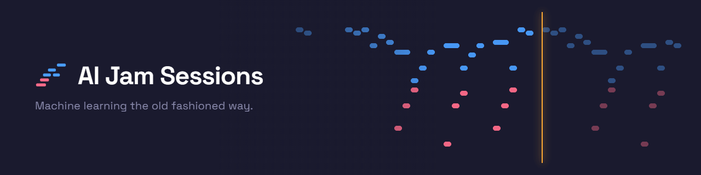
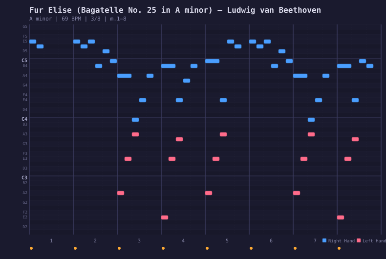
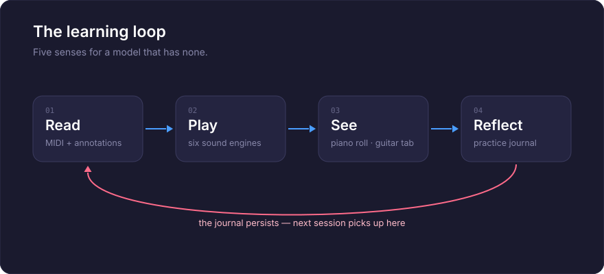

<p align="center">
  <a href="README.ja.md">日本語</a> | <a href="README.zh.md">中文</a> | <a href="README.es.md">Español</a> | <a href="README.fr.md">Français</a> | <a href="README.md">English</a> | <a href="README.it.md">Italiano</a> | <a href="README.pt-BR.md">Português (BR)</a>
</p>

<p align="center">
  
</p>

<p align="center">
  <em>Machine Learning the Old Fashioned Way</em>
</p>

<p align="center">
  An MCP server that teaches AI to play piano and guitar — and sing.<br/>
  109 annotated songs across 12 genres. Six sound engines. Interactive guitar tablature.<br/>
  A browser cockpit with vocal synthesizer. A practice journal that remembers everything.
</p>

<p align="center">
  <a href="https://github.com/mcp-tool-shop-org/ai-jam-sessions/actions/workflows/ci.yml"></a>
  <a href="https://codecov.io/gh/mcp-tool-shop-org/ai-jam-sessions"></a>
  <a href="https://www.npmjs.com/package/@mcptoolshop/ai-jam-sessions"></a>
  <a href="https://github.com/mcp-tool-shop-org/ai-jam-sessions"></a>
  <a href="https://github.com/mcp-tool-shop-org/ai-jam-sessions"></a>
  <a href="datasets/jam-actions-v0-public/README.md"></a>
  <a href="https://doi.org/10.5281/zenodo.20279918"></a>
</p>

---

## पहले सुनें: तीन भजन, लयबद्ध रूप से गाए गए

**[अमेजिंग ग्रेस, अमेरिका द ब्यूटीफुल और द बैटल हाइमन ऑफ द रिपब्लिक](https://mcp-tool-shop-org.github.io/ai-jam-sessions/#listen)**,
प्रत्येक छंद, एक सिंथेटिक आवाज द्वारा पियानो की धुन पर गाया जाता है, जो प्रत्येक भजन के लिए लिखी गई है। लैंडिंग पेज इसे 3डी स्कोर के साथ बजाता है जो आवाज और शब्दों का अनुसरण करता है, और जैसे ही वे गाए जाते हैं, वे चमकते हैं।

प्रत्येक प्रदर्शन को स्कोर-आधारित गायक के सोलह रिकॉर्डिंग से जोड़ा गया:
- प्रत्येक वाक्यांश के लिए एक रिकॉर्डिंग, जिसे एक स्थानीय श्रोता और एक पिच ट्रैकर द्वारा चुना गया;
- समय-विकृति का उपयोग करके स्कोर पर रखा गया, ताकि किसी भी वाक्यांश के भीतर कुछ भी न कट जाए;
- दो समय मापने वाले उपकरणों और दो पिच ट्रैकर्स द्वारा जांच की गई;
- कान से जांच की गई, और हर समस्या को एक सुनने की समीक्षा में चिह्नित किया गया, जिससे यह उसकी जड़ तक पहुंच सके।

प्रत्येक गीत से पहले एक ध्वनि जांच, आवाज की समय की सीमा को मापता है, और बताता है कि गीत को कितने रिकॉर्डिंग की आवश्यकता होगी।

यह कैसे बनाया गया: [हैंडबुक → वोकल्स](https://mcp-tool-shop-org.github.io/ai-jam-sessions/handbook/vocals/)।

| | अमेजिंग ग्रेस | अमेरिका द ब्यूटीफुल | बैटल हाइमन |
|---|---|---|---|
| स्कोर के 40 मिलीसेकंड के भीतर के अक्षर | 107/112 | 217/224 | 285/414 |
| 50 सेंट के भीतर के नोट्स | 135/140 | 218/224 | 368/424 |

बैटल हाइमन की तेज बिंदीदार धुनें गायक के अपने समय के अनुसार छोड़ी जाती हैं, और यहीं पर इसकी अधिकांश समय संबंधी त्रुटियां होती हैं।

आवाज सिंथेटिक है: [SoulX-Singer](https://github.com/Soul-AILab/SoulX-Singer) (अपाचे-2.0), जिसमें अपनी विशिष्ट ध्वनि है, और यह किसी भी वास्तविक गायक की नकल नहीं करती है। इस परियोजना के लिए पियानो की धुन Kimi-K3 द्वारा लिखी गई थी और इसे सार्वजनिक डोमेन (CC0) को समर्पित किया गया है। तीनों भजन सार्वजनिक डोमेन में हैं।

## यह क्या है?

एक पियानो और गिटार जिसे एआई बजाना सीखता है। यह सिंथेसाइज़र नहीं है, न ही यह एक एमआईडीआई लाइब्रेरी है - यह एक शिक्षण उपकरण है।

एक एलएलएम पाठ पढ़ और लिख सकता है, लेकिन यह संगीत का अनुभव उस तरह से नहीं कर सकता जिस तरह से हम करते हैं। इसमें कान नहीं हैं, उंगलियां नहीं हैं, और मांसपेशियों की स्मृति नहीं है। एआई जैम सेशन इस अंतर को दूर करता है, मॉडल को ऐसी इंद्रियां प्रदान करके जिनका वह वास्तव में उपयोग कर सकता है:

- **पढ़ना** — गहन संगीत एनोटेशन के साथ वास्तविक MIDI शीट संगीत। हाथ से लिखी गई अनुमानित प्रतियां नहीं — पार्स की गई, विश्लेषण की गई और समझाई गई।
- **सुनना** — छह ऑडियो इंजन (ऑसिलेटर पियानो, सैंपल पियानो, वोकल सैंपल, फिजिकल वोकल ट्रैक्ट, एडिटिव वोकल सिंथ, फिजिकली-मॉडल किए गए गिटार) जो आपके स्पीकर के माध्यम से बजते हैं, इसलिए कमरे में मौजूद लोग AI के कान बन जाते हैं। और अब मॉडल के अपने कान हैं, दोगुने: यह रिकॉर्डिंग के बाद माप सकता है (देखें [सुनना](#सुनना)) और यह संगीत बजते समय बैंड को देख सकता है (देखें [लाइव एन्सेम्बल](#लाइव-एनसेंबल))।
- **देखना** — एक पियानो रोल जो SVG के रूप में बजाए गए संगीत को प्रस्तुत करता है, जिसे मॉडल वापस पढ़ और सत्यापित कर सकता है। एक इंटरैक्टिव गिटार टैबलेचर संपादक। एक ब्राउज़र कॉकपिट जिसमें एक दृश्य कीबोर्ड, दोहरे मोड नोट संपादक और ट्यूनिंग लैब है।
- **याद रखना** — एक अभ्यास जर्नल जो सत्रों में बना रहता है, इसलिए समय के साथ सीखने में वृद्धि होती है।
- **गाना** — 20 वोइस प्रीसेट के साथ वोकल ट्रैक्ट संश्लेषण, ओपेरा सोप्रानो से लेकर इलेक्ट्रॉनिक कोरस तक। सोल्फेज, कंटूर और शब्दांश कथन के साथ साथ गाने का मोड। और पियानो की घड़ी पर पूरे गाने गाए जाते हैं: एक स्कोर-कंडीशन्ड गायक जो गाने की व्यवस्था से प्रेरित होता है, कई टेक से वाक्यांश दर वाक्यांश इकट्ठा किया जाता है, और समय (40 एमएस) और पिच (50 सेंट) पर गेट किया जाता है, इससे पहले कि आप इसे सुनें — देखें [गाना](#गाओ)।

109 गीतों में से प्रत्येक को अब पूरी तरह से एनोटेट किया गया है - ऐतिहासिक संदर्भ, बार-दर-बार संरचनात्मक विश्लेषण, मुख्य क्षण, शिक्षण लक्ष्य और प्रदर्शन युक्तियाँ, सभी 12 शैलियों में। इस रीडमी के पुराने संस्करण में कहा गया था कि कच्चे गाने "एआई द्वारा पैटर्न को अवशोषित करने, संगीत बजाने और अपनी एनोटेशन लिखने" की प्रतीक्षा कर रहे थे। यही वास्तव में हुआ: एनोटेशन एआई द्वारा प्रति-गीत विश्लेषण के खिलाफ लिखे गए थे (कॉर्ड, पुनरावृत्ति संरचना, अनुभाग सीमाएं, सामग्री-सत्यापित कुंजियाँ), एक गुणवत्ता रूब्रिक द्वारा गेट किया गया, और प्रतिकूल रूप से तथ्य-जांच किए गए दावे द्वारा दावा - माप संख्याएं, कॉर्ड विंडो और संरचनात्मक गणनाएं सभी वास्तविक एमआईडीआई के खिलाफ सत्यापित हैं इससे पहले कि कुछ भी जारी किया जाए।

इस समान कार्य से, हम **[jam-actions-v0](#प्रशिक्षण-डेटासेट)** भी प्रकाशित करते हैं — वास्तविक शास्त्रीय पियानो पर 57 मल्टी-टर्न MCP टूल-उपयोग ट्रेस का एक सार्वजनिक डेटासेट। यह LLM को *प्रतीकात्मक संगीत पर ग्राउंडेड टूल-उपयोग* करने के लिए सिखाता है, न कि केवल टेक्स्ट जनरेशन, और इसमें 7-एक्सिस रिलीज़ गेट शामिल है जो "सबूत प्रदान करने" और "यह कहने" के बीच अंतर करता है कि कार्य तुच्छ है।" पूरी कहानी के लिए नीचे [प्रशिक्षण डेटासेट](#प्रशिक्षण-डेटासेट) देखें।

## सुनना

लंबे समय तक यह सर्वर ध्वनि उत्पन्न कर सकता था, लेकिन कभी भी इसका विश्लेषण नहीं कर सकता था। मॉडल बजाता था, एक इंसान सुनता था, और मॉडल उनकी बात को स्वीकार करता था। अब वह अंतर दूर हो गया है।

इसे एक WAV फ़ाइल पर इंगित करें और यह मापता है कि उसमें क्या है। यह किसी चित्र को देखकर अनुमान नहीं लगाता है, बल्कि सिग्नल को उसी प्रकार के उपकरणों से चलाता है जिनका उपयोग यह पहले से ही स्कोर पर करता है:

- **`analyze_audio`** — ऑनसेट, पिच कंटूर और स्तर। पिच नोट नामों के रूप में वापस आती है, जिसमें सेंट विचलन होता है, कभी भी कच्चे आवृत्तियों के रूप में नहीं। स्तर का अर्थ अब वास्तविक संख्याएँ हैं: BS.1770-4 एकीकृत लाउडनेस LUFS में, dBFS में नमूना शिखर, और एक क्लिप्ड-सैंपल गणना, साथ ही एक अखंडता पास जो ड्रॉपआउट और शोर विस्फोटों की रिपोर्ट करता है — रेंडर QA का क्लिक-एंड-ग्लिच आधा हिस्सा। एक बैलेंस अनुभाग बताता है कि ऊर्जा कहाँ है, सब-बास से लेकर हवा तक: प्रत्येक बैंड का हिस्सा गुलाबी शोर के मुकाबले, चमक और झुकाव।
- **`transcribe_audio`** — रिकॉर्डिंग को नोट्स के रूप में: पिच, शुरुआत, अवधि और प्रत्येक नोट कितना दूर है, यह कॉन्सर्ट पिच से।
- **`score_audio_take`** — पुस्तकालय में एक गाने के मुकाबले प्रदर्शन का मूल्यांकन **कान से** करें। यह रिकॉर्डिंग को ट्रांसक्रिप्ट करता है, इसे स्कोर से मिलाता है, और रिपोर्ट करता है कि कौन से नोट बज गए, कौन से भटक गए, और कौन से छूटे हुए थे। फिर `view_scored_piano_roll` परिणाम को स्कोर पर खींचता है, ठीक उसी तरह जैसे यह कैप्चर किए गए MIDI टेक के लिए करता है। इस तरह आप एक वास्तविक वाद्य यंत्र, एक गाए गए टेक या किसी भी चीज़ का मूल्यांकन करते हैं, जहाँ कैप्चर करने के लिए कोई MIDI नहीं है।
- **`view_spectrogram`** — ध्वनि देखें। एक निरंतर-Q स्पेक्ट्रोग्राम जिसमें बाईं ओर एक पियानो कीबोर्ड है, इसलिए पिच को एक नज़र में पढ़ा जा सकता है, और गाने के इच्छित नोट अनुरोध पर उस पर खींचे जाते हैं।
- **`check_loop_seam`** — एक लूपिंग रेंडर का मूल्यांकन करें जहाँ यह लूप करता है: वेवफॉर्म चरण पूंछ की अपनी ढलान को एक्सट्रपलेट करने के बाद, जोड़ पर बर्स्ट-आकार की ऊर्जा, और सीम पर स्तर परिवर्तन। एक चरण-परिपूर्ण लूप तब भी साफ बजता है जब कच्चा सीमा नमूना कूदता है।
- **`compare_balance`** — एक संदर्भ के मुकाबले एक रेंडर की ध्वनि, जो सही होने के लिए जानी जाती है, बैंड द्वारा बैंड में dB। एक संकेत जो अपने समकक्षों की तरह बजना चाहिए, एक पुन: रेंडर जो उस टेक से मेल खाना चाहिए जिसे वह बदलता है। लाउडनेस रद्द हो जाती है, इसलिए केवल ध्वनि की तुलना की जाती है।

**यह आपको क्या नहीं बताएगा।** चित्र यह पता लगाने के लिए है कि *कहाँ* कुछ गलत है; प्रत्येक संख्या सिग्नल प्रोसेसिंग से आती है, कभी भी किसी मॉडल से नहीं जो एक छवि पढ़ता है। ट्रांसक्राइबर एक समय में एक पंक्ति का अनुसरण करता है, इसलिए एक राग या एक पूर्ण मिश्रण कुछ आत्मविश्वासपूर्ण और गलत उत्पन्न करेगा, और यह ऐसा ही कहता है। ऑनसेट डिटेक्शन कला के वर्तमान स्तर पर लगभग F1 0.88 पर चलता है, इसलिए एक "छूटा हुआ" नोट वह हो सकता है जिसे ट्रांसक्राइबर नहीं सुन सका, न कि वह जिसे आपने नहीं बजाया — उपकरण अपने स्वयं के आउटपुट में उस चेतावनी को रखते हैं, बजाय इसके कि इसे यहाँ छिपाया जाए।

संपूर्ण सतह निर्भरता-मुक्त है: ट्रांसफॉर्म, पिच ट्रैकर, ऑनसेट डिटेक्टर, WAV डिकोडर और PNG एनकोडर सभी इस रिपॉजिटरी में हैं, और वे नोड और ब्राउज़र दोनों में समान संख्याएँ उत्पन्न करते हैं।

## लाइव एनसेंबल

सुनना एक रिकॉर्डिंग को तब ग्रेड करता है जब वह समाप्त हो जाती है। यह दूसरा भाग है: यह पूछना कि प्रत्येक वाद्य यंत्र **अभी** क्या कर रहा है, प्रदर्शन के दौरान।

```
ensemble_now()
```

यह प्रत्येक वाद्य यंत्र की स्थायी नोटों, प्रत्येक नोट की अवधि और संपूर्ण एनसेंबल में संयुक्त तार के साथ उत्तर देता है। एक युगल के दौरान, दोनों आवाजों को अलग-अलग रिपोर्ट किया जाता है, इसलिए आप पियानो को एक त्रिक बजाते हुए और सिंथ को उस पर धुन बजाते हुए देख सकते हैं।

### दो चैनल हैं, और सस्ता चैनल सटीक है।

यह वह भाग है जिसे समझना महत्वपूर्ण है, क्योंकि यह तय करता है कि किस संख्या पर भरोसा किया जाए।

**इरादा - प्रत्येक इंजन को क्या बजाने के लिए कहा गया था।** जब मॉडल ही प्रदर्शन कर रहा होता है, तो यह अनुमान नहीं होता है। एक पियानो तार ट्रांसक्रिप्ट करने के लिए कुछ नहीं है; यह तीन नोट-ऑन हैं जो भेजे गए थे। नोट सटीक, स्वतंत्र और तत्काल हैं।

**ध्वनिक - वास्तव में क्या निकला।** प्रत्येक इंजन अपने आउटपुट को एक निजी विश्लेषण बस में भेज सकता है, इसलिए प्रत्येक वाद्य यंत्र को स्रोत पर बिना किसी पृथक्करण और अस्पष्टता के मापा जाता है। यह चैनल **सत्यापन, खोज नहीं** है: यह कैसे आप सीखते हैं कि एक आवाज समय से भटक गई, एक टेक कट गया, या एक इंजन अभी भी नोट भेजे जाने पर शांत हो गया।

जब दोनों असहमत होते हैं, तो यह रेंडर के बारे में एक तथ्य है, न कि नोटों में सुधार।

### इसकी लागत क्या है

एक वाद्य यंत्र को देखने में लगभग **42.67 मिलीसेकंड के ब्लॉक के मुकाबले प्रति ऑडियो कॉलबैक 9 माइक्रोसेकंड** लगते हैं, जो लगभग ऑडियो बजट का 0.02% है, जिसे शून्य छोड़े गए नमूनों के साथ मापा जाता है। किसी ऐसे वाद्य यंत्र की लागत बिल्कुल भी नहीं है जिसके साथ कोई पर्यवेक्षक जुड़ा नहीं है।

### यह आपको क्या नहीं बताएगा

ध्वनिक चैनल में देरी होती है, और यह बताता है कि कितनी: पिच के लिए लगभग 23 मिलीसेकंड, और एक पुष्टि किए गए ऑनसेट के लिए 70 मिलीसेकंड, क्योंकि एक ऑनसेट की पुष्टि तब तक नहीं की जा सकती जब तक कि उसके बाद का ऑडियो नहीं आ जाता। उस किनारे के पास के ऑनसेट को रिपोर्ट करने के बजाय रोक दिया जाता है और बाद में वापस ले लिया जाता है।

ध्वनिक ट्रैकर एक समय में एक पंक्ति का अनुसरण करता है, इसलिए यह तार की नोटों को नहीं बताएगा - और यह ऐसा करने का दिखावा नहीं करता है। एक तार जिसे वह हल नहीं कर सकता, उसकी ज्ञात सीमा है, न कि कोई खोज, और एनसेंबल इसके बारे में चुप रहता है, बजाय इसके कि पियानो द्वारा बजाए जाने वाले प्रत्येक तार पर चिल्लाए।

## पियानो रोल

पियानो रोल वह तरीका है जिससे AI संगीत को देखता है। यह किसी भी गीत को SVG के रूप में रेंडर करता है - दाएं हाथ के लिए नीला, बाएं हाथ के लिए कोरल, जिसमें बीट ग्रिड, डायनेमिक्स और माप सीमाएं होती हैं:

<p align="center">
  
</p>

<p align="center"><em>Für Elise, measures 1–8 — the E5-D#5 trill in blue, bass accompaniment in coral</em></p>

दो रंग मोड: **हाथ** (नीला/कोरल) या **पिच-क्लास** (क्रोमैटिक इंद्रधनुष - प्रत्येक C लाल है, प्रत्येक F# सियान है)। SVG प्रारूप का मतलब है कि मॉडल छवि को देख सकता है और पिच, ताल और हाथ की स्वतंत्रता को सत्यापित करने के लिए मार्कअप को पढ़ सकता है।

## कॉकपिट

एक ब्राउज़र-आधारित रचना स्टूडियो जो इस रेपो में [`apps/cockpit`](apps/cockpit) में रहता है — और **[mcp-tool-shop-org.github.io/ai-jam-sessions/cockpit](https://mcp-tool-shop-org.github.io/ai-jam-sessions/cockpit/)** पर लाइव चलता है। कोई प्लगइन नहीं, कोई DAW नहीं, कोई इंस्टॉलेशन नहीं; सब कुछ आपके ब्राउज़र में रहता है (आपका काम स्थानीय रूप से स्वचालित रूप से सहेजा जाता है)। क्या आप इसे हैक करना पसंद करेंगे?

```bash
cd apps/cockpit && npm install && npm run dev   # Vite dev server, opens in your browser
```

- **डिफ़ॉल्ट रूप से नमूनायुक्त कंसर्ट ग्रैंड** - कॉकपिट एक संक्षिप्त सलामैंडर ग्रैंड पैक (90 ओजीजी, 8 एमबी) के साथ आता है जो आपकी पहली इंटरैक्शन पर लोड होता है और सिंथ आवाज़ों के समान आउटपुट चेन के माध्यम से बजता है; लोड होने से पहले (या ऑफ़लाइन) ट्यून किए गए ऑसिलेटर पियानो निर्बाध रूप से बजते हैं। [अलेक्जेंडर होल्म](https://freepats.zenvoid.org/Piano/acoustic-grand-piano.html) द्वारा नमूने, CC-BY 3.0।
- **पैनल मोड - सुनने का कमरा** - वास्तविक लाइब्रेरी धुनों पर रचना इंजन की आवाज़ों का अंधा, युग्मित ए/बी ऑडिट: समान लाउडनेस वाले क्लिप ऑफ़लाइन-रेंडर किए जाते हैं, छिपे हुए फ्लोर कैच-ट्रायल के साथ सीडेड, शफ़ल्ड परीक्षण, ब्रैडली-टेरी रैंकिंग जिसमें बूटस्ट्रैप कॉन्फिडेंस अंतराल शामिल हैं, और ईमानदार परिणाम (जब तक कि प्रत्येक जोड़ी अपनी वोट बजट तक नहीं पहुंच जाती, तब तक अस्थायी; जब भेदभाव सीमा विफल हो जाती है तो व्याख्या योग्य नहीं)। एक दूसरा सब-मोड स्थानीय एलएलएम न्यायाधीशों के साथ समान रैंकिंग चलाता है, साथ ही दोनों प्रकार के रन में इतिहास और एक तुलना दृश्य (केंडल τ + इंजन-रैंक मिलान) भी शामिल है, जो पूछता है कि क्या सस्ता प्रॉक्सी मानव सत्य को ट्रैक करता है।
- **बीट-सटीक परिवहन** - नोट्स संगीत समय में मौजूद होते हैं, इसलिए बीपीएम नियंत्रण वास्तव में प्लेबैक को फिर से समय देता है; ड्रैग-टू-सेट **लूप क्षेत्रों** के साथ क्लिक-टू-सीक टाइम-रूलर; ऑटो-स्क्रॉल जो प्लेहेड का अनुसरण करता है
- **रिकॉर्ड-आर्म कैप्चर** - क्यूईआरटीवाई कुंजियों, ऑन-स्क्रीन कीबोर्ड या वेब एमआईडीआई डिवाइस बजाएं और यह स्कोर में आ जाता है: 1-बार काउंट-इन, लूप चक्रों में लूपर-शैली ओवरडब (या रिप्लेस मोड), क्वांटाइज्ड दृश्य के तहत संरक्षित कच्चा प्रदर्शन समय, प्रत्येक पास एक अपरिवर्तनीय इकाई
- **पूर्ण पूर्ववत/फिर से करें** - स्पष्ट और आयात सहित प्रत्येक संपादन उलटा है (Ctrl+Z), ड्रैग जेस्चर वास्तविक संपादकों की तरह समेकित होते हैं
- **मल्टी-सेलेक्ट + क्लिपबोर्ड** - एक सिलेक्ट/ड्रॉ टूल टॉगल के तहत मार्की चयन, प्लेटफ़ॉर्म-मानक संशोधक क्लिक, कॉपी/कट/पेस्ट-एट-प्लेहेड, डुप्लिकेट
- **टच + पहुंच** - प्रत्येक सतह पर कैप्चर के साथ पॉइंटर इवेंट, एक गैर-ड्रैग विकल्प के रूप में टैप-टू-रीलोकेट, कीबोर्ड नोट संपादन, कलरब्लाइंड-सुरक्षित स्कोर ओवरले
- **डुअल-मोड पियानो रोल** - इंस्ट्रूमेंट मोड (क्रोमैटिक पिच-क्लास रंग) और वोकल मोड (स्वर आकार द्वारा रंगीन नोट्स: /a/ /e/ /i/ /o/ /u/) के बीच स्विच करें
- **विज़ुअल कीबोर्ड** - C4 से दो सप्तक, आपके क्यूईआरटीवाई कीबोर्ड पर मैप किए गए। क्लिक करें या टाइप करें।
- **20 वॉयस प्रीसेट** - 15 कोकोरो-मैप्ड वॉयस (एओडे, हार्ट, जेसिका, स्काई, एरिक, फेनरिर, लियाम, ओनेक्स, एलिस, एम्मा, इसाबेला, जॉर्ज, लुईस, साथ ही गाना और सिंथ-वॉयस), 4 ट्रैक-मैप्ड वॉयस और एक सिंथेटिक गाना अनुभाग
- **10 इंस्ट्रूमेंट प्रीसेट** - 6 सर्वर-साइड पियानो वॉयस प्लस सिंथ-पैड, ऑर्गन, बेल और स्ट्रिंग्स
- **नोट इंस्पेक्टर** - वेग, स्वर और कोमलता को संपादित करने के लिए किसी भी नोट पर क्लिक करें
- **7 ट्यूनिंग सिस्टम** - समान स्वभाव, शुद्ध इंटोनेशन (प्रमुख/माइनर), पाइथागोरस, क्वार्टर-कोमा मीनटोन, वेरक्मेइस्टर III, या कस्टम सेंट ऑफ़सेट। समायोज्य A4 संदर्भ (392–494 हर्ट्ज)।
- **ट्यूनिंग ऑडिट** - आवृत्ति तालिका, बीट-आवृत्ति विश्लेषण के साथ अंतराल परीक्षक, और ट्यूनिंग निर्यात/आयात
- **स्कोर आयात/निर्यात** - पूरे स्कोर को जेएसओएन के रूप में क्रमबद्ध करें और इसे वापस लोड करें
- **एलएलएम-फेसिंग एपीआई** - `window.__cockpit` `exportScore()`, `importScore()`, `addNote()`, `play()`, `stop()`, `panic()`, `setMode()` और `getScore()` को उजागर करता है ताकि एक एलएलएम प्रोग्रामेटिक रूप से रचना, व्यवस्थित और बजा सके

## लर्निंग लूप

<p align="center">
  
</p>

## सॉन्ग लाइब्रेरी

12 शैलियों में 109 एनोटेटेड गाने, वास्तविक एमआईडीआई फ़ाइलों से बनाए गए। प्रत्येक शैली में एक गहन रूप से एनोटेटेड उदाहरण है - जिसमें ऐतिहासिक संदर्भ, बार-दर-बार हार्मोनिक विश्लेषण, मुख्य क्षण, शिक्षण लक्ष्य और प्रदर्शन युक्तियाँ (वोकल मार्गदर्शन सहित) शामिल हैं। ये उदाहरण टेम्पलेट के रूप में काम करते हैं: एआई उनमें से एक का अध्ययन करता है, फिर बाकी को एनोटेट करता है। लोक उदाहरण **अमेरिका द ब्यूटीफुल** (सैमुअल ए. वार्ड, 1882, सार्वजनिक डोमेन) है: इस रिपॉजिटरी में व्यवस्थित एक एफ-प्रमुख भजन, मेलोडी F4–C5।

**क्या शिप किया जाता है, और आप क्या प्राप्त करते हैं।** एनोटेशन हमारे हैं और प्रत्येक गाने के साथ शिप किए जाते हैं। एमआईडीआई फ़ाइलें तब डाउनलोड की गईं जब लाइब्रेरी बनाई गई थी, और प्रति-फ़ाइल उत्पत्ति ऑडिट ([`docs/findings/library-provenance-audit.md`](docs/findings/library-provenance-audit.md)) से पता चला कि उनमें से केवल 14 में एक लाइसेंस है जो पुनर्वितरण की अनुमति देता है - बर्नड क्रूगर की पियानो-midi.de व्यवस्थाएँ (CC-BY-SA-3.0-DE) और म्यूटोपिया प्रोजेक्ट की सार्वजनिक डोमेन टाइपसेटिंग। वे 14 एनपीएम पैकेज में हैं। अन्य 94 डाउनलोड नहीं हैं: उनका `.json` शिप किया जाता है, जिसमें एक `provenance` ब्लॉक होता है जिसमें स्रोत, उसकी शर्तें और फ़ाइल का SHA-256, और `ai-jam-sessions library fetch --accept-source-terms` प्रत्येक को उस साइट से डाउनलोड करता है जिसने इसे प्रकाशित किया है, उस साइट की शर्तों के तहत, किसी भी फ़ाइल को अस्वीकार करता है जिसका हैश अब उस चीज़ से मेल नहीं खाता जिसके विरुद्ध एनोटेशन सत्यापित किए गए थे। बारह फ़ाइलें जो एक अलग रचना निकलीं, उन्हें संगरोध कर दिया गया, यही कारण है कि डाउनलोड की गई लाइब्रेरी में 108 गाने हैं और पहले के 120 संस्करणों में दावा किया गया था। **अमेरिका द ब्यूटीफुल** 109 वां गाना है और पैकेज में पंद्रहवां एमआईडीआई है: व्यवस्था यहां की गई थी और इसे सार्वजनिक डोमेन को समर्पित किया गया था। संस्करण 2.6.0 से पहले सभी 120 एमआईडीआई फ़ाइलें शिप की गईं; यह एक गलती थी, और इसे यहां ठीक किया गया है, न कि इसे छिपाया गया।

| शैली | उदाहरण | कुंजी | यह क्या सिखाता है |
|-------|----------|-----|-----------------|
| ब्लूज़ | द थ्रिल इज़ गॉन (बी.बी. किंग) | बी माइनर | माइनर ब्लूज़ रूप, कॉल-एंड-रिस्पॉन्स, बीट के पीछे बजाना |
| शास्त्रीय | फ्यूर एलिसे (बीथोवेन) | ए माइनर | रोंडो रूप, स्पर्श विभेदन, पेडलिंग अनुशासन |
| फिल्म | कॉम्पटाइन डी'उन ऑटर एट (टिएर्सन) | ई माइनर | आर्पेगिएटेड टेक्सचर, गतिशील आर्किटेक्चर बिना हार्मोनिक परिवर्तन के |
| लोक | अमेरिका द ब्यूटीफुल (वार्ड) | एफ मेजर | टोनिक-डोमिनेंट भजन सद्भाव, देशभक्तिपूर्ण वाक्यांश, मेलोडी F4–C5 में |
| जैज़ | ऑटम लीव्स (कोस्मा) | जी माइनर | ii-V-I प्रगति, गाइड टोन, स्विंग आठवीं, रूटलेस वोइसिंग |
| लैटिन | द गर्ल फ्रॉम इपानिमा (जोबिम) | एफ मेजर | बोसा नोवा ताल, क्रोमैटिक मॉड्यूलेशन, मुखर संयम |
| न्यू-एज | रिवर फ्लोज़ इन यू (यिरुमा) | ए मेजर | I-V-vi-IV पहचान, बहते हुए आर्पेगियो, रुबाटो |
| पॉप | इमेजिन (लेनन) | सी मेजर | आर्पेगिएटेड संगत, संयम, मुखर ईमानदारी |
| रैगटाइम | द एंटरटेनर (जोप्लिन) | सी मेजर | ऊम-पा बास, सिंकोपेशन, बहु-स्ट्रेन रूप, टेम्पो अनुशासन |
| आर एंड बी | सुपरस्टिशन (स्टीवी वंडर) | ईबी माइनर | 16वीं-नोट फंक, पर्कसिव कीबोर्ड, घोस्ट नोट्स |
| रॉक | योर सॉन्ग (एल्टन जॉन) | ईबी मेजर | पियानो बैलेड वॉइस-लीडिंग, इनवर्जन, संवादी गायन |
| सोल | लीन ऑन मी (बिल विथर्स) | सी मेजर | डायटोनिक धुन, गॉस्पेल संगत, कॉल-एंड-रिस्पॉन्स |

गाने **कच्चे** (केवल MIDI) → **एनोटेटेड** → **तैयार** (पूरी तरह से संगीत भाषा के साथ बजाने योग्य) से आगे बढ़ते हैं। AI गानों का अध्ययन करके और `annotate_song` के साथ एनोटेशन लिखकर उन्हें बढ़ावा देता है।

## साउंड इंजन

छह इंजन, साथ ही एक लेयर्ड कॉम्बिनेटर जो एक साथ किसी भी दो को चलाता है:

| इंजन | प्रकार | यह कैसा लगता है |
|--------|------|---------------------|
| **Oscillator Piano** | योगात्मक संश्लेषण | मल्टी-हार्मोनिक पियानो जिसमें हैमर शोर, इनहार्मोनिसिटी, वेलोसिटी-शेप्ड ब्राइटनेस, 48-वॉइस पॉलीफोनी, स्टीरियो इमेजिंग है। शून्य निर्भरताएँ। |
| **Sample Piano** | नमूना प्लेबैक | सलामैंडर ग्रैंड पियानो - असली चीज़। **जब भी कोई पैक स्थापित किया जाता है तो डिफ़ॉल्ट इंजन** (`samples/AccurateSalamander` या `AI_JAM_SAMPLES_DIR`); एनपीएम टारबॉल नमूना-मुक्त रहता है, इसलिए आप [सलामैंडर](https://freepats.zenvoid.org/Piano/acoustic-grand-piano.html) डाउनलोड प्रदान करते हैं। ब्राउज़र कॉकपिट अपना संक्षिप्त 8 एमबी पैक (90 ओजीजी, CC-BY 3.0 अलेक्जेंडर होल्म) शिप करता है - वेब पर बिल्कुल भी सेटअप की आवश्यकता नहीं है। |
| **Vocal (Sample)** | पिच-शिफ्टेड नमूने | पोर्टामेंटो और लेगाटो मोड के साथ निरंतर स्वर टोन। |
| **Vocal Tract** | भौतिक मॉडल | पिंक ट्रोम्बोन - 44-सेल डिजिटल वेवगाइड के माध्यम से एलएफ ग्लॉटल वेवफॉर्म। चार प्रीसेट: सोप्रानो, अल्टो, टेनर, बास। |
| **Vocal Synth** | योगात्मक संश्लेषण | 15 कोकोरो वॉइस प्रीसेट जिसमें फॉर्मेंट शेपिंग, सांस, वाइब्रेटो है। नियतात्मक (सीडेड आरएनजी)। |
| **Guitar** | योगात्मक संश्लेषण | भौतिक रूप से मॉडलिंग की गई प्लक्ड स्ट्रिंग - 4 प्रीसेट (स्टील ड्रेडनॉट, नायलॉन शास्त्रीय, जैज़ आर्चटॉप, बारह-स्ट्रिंग), 8 ट्यूनिंग, 17 ट्यून करने योग्य पैरामीटर। |
| **Layered** | कॉम्बिनेटर | दो इंजनों को जोड़ता है और प्रत्येक MIDI इवेंट को दोनों पर भेजता है - पियानो+सिंथ, वोकल+सिंथ, आदि। |

### कीबोर्ड आवाजें

छह ट्यून करने योग्य पियानो आवाजें, जिनमें से प्रत्येक को प्रति-पैरामीटर समायोजित किया जा सकता है (चमक, क्षय, हैमर कठोरता, डिट्यून, स्टीरियो चौड़ाई, और अधिक):

| आवाज | चरित्र |
|-------|-----------|
| कंसर्ट ग्रैंड | समृद्ध, पूर्ण, शास्त्रीय |
| अपराइट | गर्म, अंतरंग, लोक |
| इलेक्ट्रिक पियानो | रेशमी, जाज़ी, फ़ेंडर रोड्स जैसा अनुभव |
| हॉन्की-टोंक | बेसुरा, रैगटाइम, सैलून |
| म्यूजिक बॉक्स | क्रिस्टलीय, अलौकिक |
| चमकदार ग्रांड | आकर्षक, समकालीन, पॉप |

### गिटार की आवाज़ें

चार गिटार आवाज़ प्रीसेट, जिसमें भौतिक रूप से मॉडलिंग की गई स्ट्रिंग सिंथेसिस है, प्रत्येक में 17 ट्यून करने योग्य पैरामीटर हैं (चमक, बॉडी रेजोनेंस, प्लक पोजीशन, स्ट्रिंग डैम्पिंग, और बहुत कुछ):

| आवाज | चरित्र |
|-------|-----------|
| स्टील ड्रेडनॉट | चमकदार, संतुलित, क्लासिक ध्वनिक |
| नायलॉन क्लासिकल | गर्म, नरम, गोल |
| जाज़ आर्कटॉप | शांत, लकड़ी जैसा, स्पष्ट |
| बारह-स्ट्रिंग | चमकदार, दोहराया गया, कोरस जैसा |

## अभ्यास जर्नल

प्रत्येक सत्र के बाद, सर्वर यह रिकॉर्ड करता है कि क्या हुआ - कौन सा गाना, क्या गति, कितने माप, कितने समय तक। एआई अपनी राय जोड़ता है: उसने क्या देखा, उसने किन पैटर्न को पहचाना, आगे क्या प्रयास करना है।

```markdown
---
### 14:32 — Autumn Leaves
**jazz** | intermediate | G minor | 69 BPM × 0.7 | 32/32 measures | 45s

The ii-V-I in bars 5-8 (Cm7-F7-BbMaj7) is the same gravity as the V-i
in The Thrill Is Gone, just in major. Blues and jazz share more than the
genre labels suggest.

Next: try at full speed. Compare the Ipanema bridge modulation with this.
---
```

प्रति दिन एक मार्कडाउन फ़ाइल, `~/.ai-jam-sessions/journal/` में संग्रहीत। मानव-पठनीय, केवल जोड़ने की अनुमति। अगले सत्र में, एआई अपनी जर्नल पढ़ता है और वहीं से शुरू करता है जहाँ उसने छोड़ा था।

## प्रशिक्षण डेटासेट

**jam-actions-v0** - शास्त्रीय-पियानो एमआईडीआई में ग्राउंडेड, मल्टी-टर्न एमसीपी टूल-उपयोग ट्रेस का एक सार्वजनिक डेटासेट। उसी लाइब्रेरी से बनाया गया है जिसके साथ यह सर्वर सिखाता है, डेटासेट एलएलएम को **प्रतीकात्मक संगीत पर ग्राउंडेड टूल-उपयोग** करने के लिए सिखाता है - न कि केवल पाठ पीढ़ी।

प्रत्येक रिकॉर्ड 4-माप वाक्यांश विंडो को एनोटेटेड शिक्षण लक्ष्य और एक *लक्ष्य ट्रेस* के साथ जोड़ता है - एक सत्र जिसमें एक सहायक ऊपर दिए गए MCP टूल (`get_events_in_measure`, `get_events_in_hand`, `count_distinct_pitch_classes`, और शेष 9-टूल MIDI इंस्पेक्टर सतह) का उपयोग करके वाक्यांश को पढ़ता, विश्लेषण करता और उस पर चर्चा करता है।

| | |
|---|---|
| संस्करण | **0.6.0 (2026-09-25) - सुधार जारी** (नीचे देखें) |
| रिकॉर्ड | 57 (सार्वजनिक उपसमुच्चय): 45 प्रशिक्षण, 12 होल्ड-आउट परीक्षण (`clair-de-lune`) |
| रचनाएँ | 4 शास्त्रीय पियानो रचनाएँ: बाख BWV 846, मोजार्ट K. 545 I, बीथोवेन "फ्यूर एलिसे", डेबसी "क्लेयर डी ल्यून" |
| स्रोत MIDI | piano-midi.de - बर्नड क्रूगर की व्यवस्थाएँ, प्रत्येक फ़ाइल में क्रूगर का अपना कॉपीराइट क्रेडिट होता है |
| लाइसेंस | CC-BY-SA-3.0-DE (व्यवस्थाएँ) सार्वजनिक डोमेन रचनाओं पर |
| कहाँ | [`mcp-tool-shop/jam-actions-v0`](https://huggingface.co/datasets/mcp-tool-shop/jam-actions-v0) on Hugging Face and on Zenodo; DOIs and citation in the [dataset card](datasets/jam-actions-v0-public/README.md) and [`CITATION.cff`](datasets/jam-actions-v0-public/CITATION.cff) |

**0.6.0 संस्करण में सुधार।** 0.4.x और 0.5.x संस्करणों में 8 कार्यों में कुल 115 रिकॉर्ड थे, जिनमें से सभी का श्रेय बर्नड क्रूगर को दिया गया था। इस श्रेय की जांच piano-midi.de की संगीतकार सूचियों के साथ की गई थी, न कि फ़ाइलों के साथ। जब संगीत लाइब्रेरी की जांच MIDI बाइट्स से की गई, तो उन चार गीतों में से — चोपिन का नोक्टर्न ओप. 9 नंबर 2 और प्रील्यूड ओप. 28 नंबर 4, बीथोवेन का "पाथेटिक" II और शुमान का "ट्रॉमेरेई" — यह पाया गया कि उन्हें midiworld.com और bitmidi.com से प्राप्त फ़ाइलों से बनाया गया था, और उनके लिए कोई स्थापित व्यवस्था लाइसेंस नहीं था। उनके 58 रिकॉर्डों में उन व्यवस्थाओं को नोट-दर-नोट शामिल किया गया था, इसलिए 0.6.0 उन्हें हटा देता है। शेष 57 रिकॉर्ड 0.5.0 के समान हैं। कृपया पुराने संस्करणों से हटाए गए रिकॉर्डों को फिर से वितरित न करें। पूरी जानकारी [`docs/findings/published-dataset-licence-audit.md`](docs/findings/published-dataset-licence-audit.md) में दी गई है।

**सबूत गेट।** पैकेज अब प्रत्येक गाने के लाइब्रेरी प्रोवेनैंस ब्लॉक को फिर से पढ़ता है - MIDI बाइट्स से फिर से प्राप्त - और किसी भी रिकॉर्ड को अस्वीकार कर देता है जिसके गाने में पुनर्वितरित करने योग्य व्यवस्था लाइसेंस नहीं है, या जिसके स्रोत-फ़ाइल हैश का प्रमाणित फ़ाइल से अंतर है। यह विफल रहता है। एक परीक्षण प्रत्येक प्रतिबद्ध प्रकाशित पैकेज पर उसी जाँच को फिर से चलाता है, इसलिए बाद में प्रोवेनैंस में परिवर्तन से प्रकाशित सेट पर निर्माण लाल हो जाता है।

**गुणवत्ता कहानी - 7-अक्ष रिलीज गेट।** डेटासेट का रिलीज गेट साक्ष्य-आधारित पासिंग को छत-संतृप्त पासिंग से अलग करता है। अक्ष 1-6 अवरोधक हैं (पूर्ण न्यूनतम, मार्जिन यौगिक, टूल-उपयोग दर, टूल के बाद सही, गलत व्याख्या गणना, स्तर न्यूनतम); अक्ष 7 समृद्ध-बनाम-गैर रिपोर्टिंग है। इसके रिकॉर्ड किए गए निर्णयों को 0.4.x और 0.5.x के 115-रिकॉर्ड रचना पर मापा गया था और वे टैग `jam-actions-v0-0.5.0-cut-2026-07-11` से पुनरुत्पादित किए जा सकते हैं; उन्हें 0.6.0 पर फिर से नहीं मापा गया है।

**पुनरुत्पादनीयता।** किसी भी प्लेटफ़ॉर्म (विंडोज़ नेटिव, macOS, लिनक्स, WSL) पर एक नया योगदानकर्ता पैकेज को सत्यापित कर सकता है और उसे फिर से बना सकता है:

```bash
git clone https://github.com/mcp-tool-shop-org/ai-jam-sessions.git
cd ai-jam-sessions && pnpm install
pnpm exec tsx scripts/verify-public-package-checksums.ts                        # every file accounted for
pnpm exec tsx scripts/package-jam-actions-public.ts --today 2026-09-25 --dry-run # evidence gate runs first
pnpm build && pnpm exec tsx scripts/verify-public-package-execution.ts
# → "VERDICT: PASS" — every frozen tool call replays live (needs an audio device)
```

`.gitattributes` LF लाइन एंडिंग को `*.sha256` और सार्वजनिक-डेटासेट ट्री के लिए पिन करता है ताकि चेकसम सत्यापनकर्ता हर प्लेटफ़ॉर्म पर काम करे।

**ठीक-ट्यूनिंग इतिहास।** डेटासेट के दावों का परीक्षण पहले से पंजीकृत ठीक-ट्यूनिंग के साथ किया गया था, जिसकी तुलना सीलबंद आधारभूत मानों से की गई थी। **v0** (केवल 78 जैम ट्रेस) ने एक ईमानदार नकारात्मक परिणाम ([रिपोर्ट](docs/finetune-arc-eval-report.md)) दिया; **v1** ने उपकरण-आधारित QA को +0.202 तक बढ़ाया, लेकिन पहले से पंजीकृत बेंचमार्क से एक जोड़ी जीत से चूक गया ([रिपोर्ट](docs/finetune-arc-v1-eval-report.md)); **B-1** ने 36-रिकॉर्ड समूह पर जमे हुए v1 एडेप्टर का पुन: परीक्षण किया: 0.678 → 0.890, 29/36 जोड़ी जीत, जो पहले से निर्धारित 24/34 बेंचमार्क से अधिक है ([रिपोर्ट](docs/finetune-arc-v2-b1-eval-report.md))। ये माप दर्ज किए गए हैं। **एडेप्टर स्वयं हटा दिए गए हैं**: उनके प्रशिक्षण डेटा में उन चार गीतों से रिकॉर्ड शामिल थे जिन्हें हटा दिया गया था, इसलिए उन्हें इस डेटासेट की शर्तों के तहत पेश नहीं किया जा सकता है। केवल लाइसेंस-अनुमोदित सामग्री पर प्रशिक्षित एडेप्टर `jam-actions-v1` डेटासेट के साथ प्रकाशित किए जाते हैं।

> MIDI व्यवस्था बर्नड क्रूगर (piano-midi.de) द्वारा की गई है, और इसका लाइसेंस CC-BY-SA-3.0-DE है। एनोटेशन, ट्रेस और मूल्यांकन कलाकृतियाँ AI जैम सेशंस टीम द्वारा जारी की गई हैं, और यह समान लाइसेंस के तहत जारी की गई हैं ताकि शेयर-अलाइक श्रृंखला को शुरू से अंत तक बनाए रखा जा सके। **लाइसेंस सीमा:** रिपॉजिटरी का MIT लाइसेंस कोड को कवर करता है; `datasets/` के तहत सब कुछ CC-BY-SA-3.0-DE है। `datasets/jam-actions-v0/` पर कार्यशील कॉर्पस में ऐसे रिकॉर्ड भी शामिल हैं जो प्रकाशित नहीं हैं: दो कार्य जिनके मूल को कभी सत्यापित नहीं किया गया (सैट्टी जिम्नोपीडी नंबर 1, डेबसी अरबेस्क नंबर 1) और 0.6.0 में हटाए गए चार गीत — [`datasets/jam-actions-v0/PROVENANCE-NOTE.md`](datasets/jam-actions-v0/PROVENANCE-NOTE.md) देखें।

### ध्वनिक कॉर्पस

**jam-actions-acoustic-v0** — ऊपर दिए गए ट्रेस के विपरीत, यह **ऑडियो** पर आधारित है, न कि प्रतीकात्मक संगीत पर। 72 रिकॉर्ड, जिनमें से प्रत्येक एक सार्वजनिक डोमेन वाक्यांश के जानबूझकर परिवर्तित सिंथेटिक प्रतिपादन को उस परिणाम के साथ जोड़ता है जो विश्लेषण उपकरण वास्तव में देते हैं, ताकि प्रत्येक लेबल की जांच उपकरण के विरुद्ध की जाए, न कि केवल स्वयं के विरुद्ध।

| | |
|---|---|
| संस्करण | 1.1.0 (2026-09-25) — 1.0.x के 36 "ट्रौमेरी" रिकॉर्ड हटा दिए गए, जिनकी स्रोत फ़ाइल में कोई स्थापित व्यवस्था लाइसेंस नहीं है। |
| रिकॉर्ड | 72 — 2 वाक्यांश (बाख, फ़ुर एलिज़) × 9 प्रकार के परिवर्तन × 4 लक्ष्य नोट्स |
| अलग रखा गया | **वाक्यांश** (फ्यूर एलिसे) द्वारा, रिकॉर्ड द्वारा नहीं, इसलिए एक ही धुन की परेशान जुड़वां प्रतिलिपि लीक नहीं हो सकती। |
| वर्ग | मिलान, पिच विफल/चेतावनी, समय विफल/पास, छूटा हुआ, अतिरिक्त, ट्यून में वाइब्रेटो, ग्रेड करने के लिए कुछ भी नहीं, मौन |
| ऑडियो | कोई भी वितरित नहीं किया गया — प्रत्येक रिकॉर्ड एक निश्चित नुस्खा और उस वेवफॉर्म का SHA-256 रखता है जो यह उत्पन्न करता है। |
| स्कीमा | `jam-actions-acoustic-v0/1.0.0` |

नौ वर्गों में से दो इसलिए हैं क्योंकि एक भोला मॉडल उन्हें आत्मविश्वास से और गलत तरीके से उत्तर देता है: एक वाइब्रेटो नोट जिसका सही निर्णय *ट्यून में* है, और मौन जिसका सही निर्णय *ग्रेड करने के लिए कुछ भी नहीं* है। प्रत्येक सीमा, जिस पर निर्णय निर्भर करता है, को रिकॉर्ड में कॉपी किया जाता है, क्योंकि दोनों निर्माण के दौरान एक बार बदल गए थे।

यह रिपॉजिटरी से डेटा को पुन: उत्पन्न किया जा सकता है। इसे पुन: उत्पन्न करने से सभी 79 प्रकाशित फ़ाइलें और एक बाइट-समान `checksums.sha256` उत्पन्न होते हैं, और एक परीक्षण यह सुनिश्चित करता है कि प्रकाशित ट्री को लिखे बिना यह बिल्कुल वैसा ही हो।

**एक चेतावनी, जिसे मापा गया है, न कि माना गया।** प्रत्येक रिकॉर्ड `wav_sha256` रखता है, जो उस वेवफॉर्म का हैश है जो इसका नुस्खा उत्पन्न करता है, और रेंडरर प्रति नमूने `Math.pow` और `Math.sin` को एक बार कॉल करता है। यह आवश्यक नहीं है कि दोनों को सही ढंग से पूर्णांकित किया जाए, और V8 के परिणाम नोड 22 और नोड 24 के बीच बदल गए: मूल कॉर्पस द्वारा मूल्यांकन किए गए 27,869 विशिष्ट `Math.pow(2, x)` तर्कों में से, 253 एक अलग डबल मान लौटाते हैं। उनमें से लगभग सभी 16-बिट परिमाणीकरण के तहत गायब हो जाते हैं, लेकिन **72 रिकॉर्डों में से 2** — दोनों फ़्यूर एलिस के `extra` परिवर्तन, जिसका मोटिफ उस एक पिच पर है जहां अर्धस्वर अनुपात स्वयं भिन्न होता है — नोड 24 पर अलग-अलग हैश होते हैं। प्रत्येक रिकॉर्ड का प्रत्येक अन्य फ़ील्ड किसी भी इंजन पर पुन: उत्पन्न होता है, और रिपॉजिटरी दोनों दावों का अलग-अलग परीक्षण करता है। यदि आप फिर से रेंडर करते हैं और उन दो विसंगतियों को देखते हैं, तो यह यही है, न कि कोई दूषित डाउनलोड। वेवफॉर्म को बिट-पोर्टेबल बनाने का मतलब है कि ट्रांसेंडेंटल्स को बदलना, जो प्रत्येक हैश को बदल देता है और इसलिए एक नए स्कीमा संस्करण की आवश्यकता होती है।

### अपना खुद का बनाएं

वह ढांचा जिस पर यह कॉर्पस चलता है, वह आपके स्वयं के प्रयोगों के लिए उपलब्ध है।
[`experiments/_template/`](experiments/_template/) एक कार्यशील उदाहरण है जिसे आप कॉपी कर सकते हैं: एक कार्य घोषित करें, और आपको एसएफटी स्वरूपण, प्रति-वर्ग स्कोरिंग, आपके घोषित परिणाम सेट पर तुच्छ आधारभूत मान और एक जांच मिलती है कि कोई भी होल्डआउट इकाई विभाजन को पार नहीं करती है।

[अनुबंध](experiments/_template/README.md) वह हिस्सा है जिसे पढ़ने लायक है। जमीनी सच्चाई को हाथ से लिखने के बजाय बनाया जा सकता है, लेबल की जांच इस बात के विरुद्ध की जाती है कि उपकरण क्या मापते हैं, आप उस इकाई द्वारा विभाजित करते हैं जो लीक होती है, और आप आधारभूत मान और आधार मॉडल को किसी भी परिणाम के साथ रिपोर्ट करते हैं। प्रत्येक नियम को सीखने में कुछ लागत आती है।

## इंस्टॉल करें

```bash
npm install -g @mcptoolshop/ai-jam-sessions
```

इसके लिए **नोड.जेएस 22+** की आवश्यकता है (v2.0.0 ने `node-web-audio-api` 2.0 के साथ न्यूनतम आवश्यकता को बढ़ा दिया)। कोई MIDI ड्राइवर, कोई वर्चुअल पोर्ट, कोई बाहरी सॉफ़्टवेयर नहीं।

### क्लाउड डेस्कटॉप / क्लाउड कोड

```json
{
  "mcpServers": {
    "ai_jam_sessions": {
      "command": "npx",
      "args": ["-y", "-p", "@mcptoolshop/ai-jam-sessions", "ai-jam-sessions-mcp"]
    }
  }
}
```

### डॉकर

प्रत्येक रिलीज़ `ghcr.io/mcp-tool-shop-org/ai-jam-sessions` भी प्रकाशित करता है, जो एक पतला इमेज है जो एमसीपी सर्वर को एसटीडीआईओ पर चलाता है। एकमात्र बात जो आपको जाननी चाहिए वह यह है कि `/data` मेमोरी है: जर्नल, सर्वर स्थिति, उपयोगकर्ता गीत और कोई भी प्राप्त मिडी लाइव यहीं संग्रहीत होते हैं, इसलिए एक वॉल्यूम माउंट करें या वे कंटेनर के साथ समाप्त हो जाएंगे।

```json
{
  "mcpServers": {
    "ai_jam_sessions": {
      "command": "docker",
      "args": ["run", "--rm", "-i", "-v", "ai-jam-data:/data", "ghcr.io/mcp-tool-shop-org/ai-jam-sessions"]
    }
  }
}
```

छवि 14 पुनर्वितरित करने योग्य MIDI फ़ाइलों को भेजती है; `library fetch --accept-source-terms` को एक बार कंटेनर के अंदर चलाने से अन्य 94 फ़ाइलें वॉल्यूम में आ जाती हैं। `docker compose up` एक नामित वॉल्यूम के साथ ऐसा ही करता है, और `--profile ollama` एक ओलामा साइडकार जोड़ता है। विवरण, छवि के अंदर CLI और वह जो जानबूझकर इसमें नहीं है: [docs/docker.md](docs/docker.md)। ठीक-ट्यून किए गए ग्रेडर को ओलामा में चलाना, 4-बिट आधार की मापी गई लागत के साथ: [docs/ollama-adapters.md](docs/ollama-adapters.md)।

## एमसीपी उपकरण

आठ श्रेणियों में 56 उपकरण और 4 प्रॉम्प्ट टेम्पलेट:

### सीखें

| उपकरण | यह क्या करता है |
|------|--------------|
| `list_songs` | शैली, कठिनाई या कीवर्ड के अनुसार ब्राउज़ करें |
| `song_info` | पूर्ण संगीत विश्लेषण — संरचना, मुख्य क्षण, शिक्षण लक्ष्य, शैली युक्तियाँ |
| `registry_stats` | लाइब्रेरी-व्यापी आँकड़े: कुल गीत, शैलियाँ, कठिनाइयाँ |
| `list_measures` | प्रत्येक माप के नोट्स, गतिशीलता और शिक्षण नोट्स |
| `teaching_note` | एकल माप में गहराई से जाएँ — उंगली की स्थिति, गतिशीलता, संदर्भ |
| `suggest_song` | शैली, कठिनाई और आपके द्वारा बजाए गए संगीत के आधार पर अनुशंसा |
| `practice_setup` | अनुशंसित गति, मोड, आवाज सेटिंग्स और किसी गीत के लिए सीएलआई कमांड |
| `compare_songs` | क्रॉस-शैली पैटर्न पहचान — प्रमुख संबंध, पिच/अंतराल समानता, साझा रूप, शिक्षण संबंध |
| `annotation_progress` | पूरी लाइब्रेरी में एनोटेशन गुणवत्ता को ट्रैक करें — स्कोर, ग्रेड और सुधार सुझाव |
| `server_info` | सर्वर संस्करण, लाइब्रेरी आँकड़े, इंजन सूची, सक्रिय सत्र |

### चलाएँ

| उपकरण | यह क्या करता है |
|------|--------------|
| `play_song` | स्पीकरों के माध्यम से चलाएँ — लाइब्रेरी गीत या कच्चे .मिड फ़ाइलें। चार इंजन (पियानो, वोकल, ट्रैक्ट, गिटार), कोई भी गति, मोड, माप सीमा — साथ ही एक मेट्रोनोम जिसमें काउंट-इन और एक `record` ध्वज है जो स्कोरिंग के लिए सत्र को कैप्चर करता है। सिंथ और लेयर्ड इंजन केवल सीएलआई हैं। |
| `stop_playback` | रोकें |
| `pause_playback` | रोकें या फिर से शुरू करें |
| `set_speed` | प्लेबैक के बीच गति बदलें (0.1×–4.0×) |
| `playback_status` | वास्तविक समय स्नैपशॉट: वर्तमान माप, टेम्पो, गति, कीबोर्ड आवाज, स्थिति |
| `view_piano_roll` | एसवीजी के रूप में रेंडर करें (हाथ का रंग या पिच-क्लास क्रोमैटिक इंद्रधनुष) |
| `score_performance` | मिडी प्ले-अलॉन्ग को स्कोर करें — पिच सटीकता, समय, पूर्णता, वर्गीकृत प्रतिक्रिया के साथ |
| `mute_hand` | अभ्यास के दौरान बाएं/दाएं हाथ को म्यूट या अनम्यूट करें — एक समय में एक हाथ को अलग करें |
| `detect_chord` | वर्तमान में बज रहे मिडी नोट्स के सेट से कॉर्ड का नाम दें (जैसे, `[60,64,67]` → सी) |
| `preview_teaching_cues` | चलाने से पहले सभी शिक्षण नोट्स और मुख्य क्षण देखें |

### अभ्यास करें

| उपकरण | यह क्या करता है |
|------|--------------|
| `practice_loop` | एक वास्तविक शिक्षक द्वारा दिया गया अभ्यास: माप 5–8 को धीमा करके लूप करें, और टेम्पो केवल एक *स्वच्छ* पास के बाद (+5%) बढ़ता है — प्रत्येक पास रिकॉर्ड किया जाता है, स्कोर किया जाता है और सारांशित किया जाता है |
| `practice_status` | अभ्यास कहाँ है: वर्तमान पास, गति और अंतिम प्रयास का प्रति-माप निदान |
| `score_last_take` | सबसे हालिया रिकॉर्ड किए गए प्रयास को स्कोर करें — पिच सटीकता, समय, पूर्णता, प्रति-नोट निर्णय |
| `view_scored_piano_roll` | प्रत्येक शिक्षक द्वारा उपयोग किया जाने वाला चिह्नित स्कोर: पियानो रोल, जिसमें रंग-अंधेपन से सुरक्षित पैलेट में प्रति-नोट टिप्पणियाँ शामिल हैं (ठोस = सही, धराशायी = समय, ✕ = छूटा हुआ) |

### गाओ

| उपकरण | यह क्या करता है |
|------|--------------|
| `sing_along` | गाया जा सकने वाला पाठ - नोट्स के नाम, सोल्फेज, लय, या शब्दांश। पियानो के साथ या बिना। |
| `ai_jam_sessions` | एक जैम ब्रीफ तैयार करें - कॉर्ड प्रगति, मेलोडी रूपरेखा और पुनर्व्याख्या के लिए शैली संकेत। |
| `verify_harmony` | निर्माता लूप का सत्यापन गेट: प्रस्तावित पुन: सामंजस्य को प्लेटफ़ॉर्म के अपने नियतात्मक उपकरणों द्वारा जांचा जाता है - कॉर्ड निष्ठा (कॉर्ड इंजन को प्रत्येक इच्छित कॉर्ड का पता लगाना चाहिए), मेलोडी सामंजस्य (स्वर/तनाव/क्रोमैटिक), बास स्वर-अग्रणी, कुंजी सदस्यता। |
| `auto_reharmonize` | एक कॉल में निर्माता लूप - एक स्थानीय मॉडल पुन: सामंजस्य का प्रस्ताव करता है, `verify_harmony` का नियतात्मक गेट प्रत्येक स्वर की जांच करता है, सर्वश्रेष्ठ-में-n, जब तक कि एक सत्यापित व्याख्या वापस नहीं आ जाती। |
| `compose_panel` | किसी भी गाने पर स्वर-अग्रणी रचना पैनल चलाएं: चार सिस्टम संगतता उत्पन्न करते हैं, ब्लाइंड क्रॉस-फैमिली एलएलएम न्यायाधीश उन्हें रैंक करते हैं, ब्रैडली-टेरी एकत्रित करता है - एक भेदभाव-आधार गेट के साथ जो व्याख्या करने योग्य नहीं होने वाले रनों को रद्द कर देता है (केवल दिशात्मक संकेत, कभी भी गुणवत्ता स्कोर नहीं)। मिनटों तक चलता है और काम करते समय प्रगति सूचनाएं प्रसारित करता है। |

**एक गीत जो पूरी तरह से घड़ी पर आधारित है: गायन का तरीका।** कोई भी गीत वास्तविक गायन का उपयोग कर सकता है जो पियानो पर बजता है।
- **घड़ी।** एक स्कोर घड़ी (`scripts/build-score-clock.mjs`) गीत की व्यवस्था से प्रत्येक शब्दांश की पिच, शुरुआत और अवधि प्राप्त करती है, और यह सब खिलाड़ी के समय-निर्धारण पर आधारित होता है।
- **ध्वनि जांच।** किसी गीत को प्रस्तुत करने से पहले, वही आवाज गीत की गति (`scripts/soundcheck.py`) पर सोलह शब्दों का अंशांकन वाक्यांश गाती है। इसकी समय-सीमा, प्रत्येक व्यंजन समूह के लिए और छोटे स्वरों के साथ, यह बताती है कि गीत को कितने प्रयासों की आवश्यकता है और कौन से शब्द जोखिम भरे हैं, इससे पहले कि गीत पर कोई भी GPU समय खर्च किया जाए।
- **गायक।** एक स्कोर-आधारित गायक ([SoulX-Singer](https://github.com/Soul-AILab/SoulX-Singer), Apache-2.0) उस घड़ी से सोलह बार गाता है, या तो स्थानीय रूप से या ऑफ़्रिग के माध्यम से किराए पर लिए गए GPU पर।
- **चयन।** `scripts/sing_clock.py --by-phrase --warp` प्रत्येक वाक्यांश के लिए एक बार गाता है। एक स्थानीय श्रोता का प्रतिलेख और FCPE पिच तय करते हैं, और वाक्यांश को स्कोर पर समय के अनुसार समायोजित किया जाता है।
- **गेट।** **समय:** एक ऊर्जा डिटेक्टर, जो गायन के लिए मजबूर किए गए अलाइनर द्वारा क्रॉस-चेक किया जाता है, प्रत्येक स्वर को 40 मिलीसेकंड के भीतर रखता है। **पिच:** FCPE, pYIN द्वारा चिह्नित किए गए बिंदुओं को फिर से पढ़कर, प्रत्येक नोट को 50 सेंट के भीतर रखता है।
- **कान।** सुनने की समीक्षा (`scripts/review_marks.py`) किसी व्यक्ति को **M** दबाने की अनुमति देती है, जहां भी कुछ गलत लगता है, साथ में एक श्रेणी और एक नोट भी। रिपोर्ट प्रत्येक निशान को उसके प्रयास, उसके संयोजन और गेट तक ट्रेस करती है, और समीक्षक के स्तर के अनुसार इसका मूल्यांकन करती है: एक श्रोता का कान यह तय करता है कि *कहां* यह गलत लगता है, जबकि यह नाम देना कि *यह क्या* है, प्रशिक्षण से अधिक महत्वपूर्ण है। यह एक स्थानीय सुनने वाले पृष्ठ के रूप में और कॉकपिट में समीक्षा मोड के रूप में चलता है, जिसमें सहेजे गए सत्र और प्रत्येक क्लिप के लिए एक समान ध्वनि स्तर होता है। मार्ग, लीवर और रसीदें: [हैंडबुक → वोकल्स](https://mcp-tool-shop-org.github.io/ai-jam-sessions/handbook/vocals/), [`docs/vocal-clock.md`](docs/vocal-clock.md); विकल्पों के पीछे का शोध: [`docs/vocal-singing-study-2026-09.md`](docs/vocal-singing-study-2026-09.md)।

### गिटार

| उपकरण | यह क्या करता है |
|------|--------------|
| `view_guitar_tab` | इंटरैक्टिव गिटार टैब को एचटीएमएल के रूप में प्रस्तुत करें - क्लिक-टू-एडिट, प्लेबैक कर्सर, कीबोर्ड शॉर्टकट |
| `list_guitar_voices` | उपलब्ध गिटार ध्वनि प्रीसेट |
| `list_guitar_tunings` | उपलब्ध गिटार ट्यूनिंग सिस्टम (मानक, ड्रॉप-डी, ओपन जी, डीएडीजीएडी, आदि) |
| `tune_guitar` | किसी भी गिटार ध्वनि के किसी भी पैरामीटर को समायोजित करें। सत्रों में बना रहता है। |
| `get_guitar_config` | वर्तमान गिटार ध्वनि कॉन्फ़िगरेशन बनाम फ़ैक्टरी डिफ़ॉल्ट |
| `reset_guitar` | गिटार ध्वनि को फ़ैक्टरी रीसेट करें |

### बनाएं

| उपकरण | यह क्या करता है |
|------|--------------|
| `add_song` | एक नया गाना JSON के रूप में जोड़ें |
| `import_midi` | मेटाडेटा के साथ एक .mid फ़ाइल आयात करें |
| `annotate_song` | एक कच्चे गाने के लिए संगीत भाषा लिखें और इसे तैयार के रूप में बढ़ावा दें |
| `save_practice_note` | स्वचालित रूप से कैप्चर किए गए सत्र डेटा के साथ जर्नल प्रविष्टि |
| `read_practice_journal` | संदर्भ के लिए हालिया प्रविष्टियाँ लोड करें |
| `list_keyboards` | उपलब्ध कीबोर्ड ध्वनि |
| `tune_keyboard` | किसी भी कीबोर्ड ध्वनि के किसी भी पैरामीटर को समायोजित करें। सत्रों में बना रहता है। |
| `get_keyboard_config` | वर्तमान कॉन्फ़िगरेशन बनाम फ़ैक्टरी डिफ़ॉल्ट |
| `reset_keyboard` | कीबोर्ड ध्वनि को फ़ैक्टरी रीसेट करें |
| `score_annotation` | 5 आयामों में स्कोर एनोटेशन गुणवत्ता - पूर्णता, गहराई, विशिष्टता, शिक्षण मूल्य, शब्दावली |
| `validate_song_entry` | जोड़ने से पहले स्कीमा के विरुद्ध एक गाने के JSON को मान्य करें |
| `transpose_song` | अर्ध-स्वर द्वारा एक गाने को ऊपर या नीचे स्थानांतरित करें - नई कुंजी, नए नोट्स |
| `list_sections` | एक गाने के संरचनात्मक अनुभाग देखें (परिचय, छंद, कोरस, आदि) |
| `add_section` | संरचनात्मक नेविगेशन के लिए एक गाने में एक अनुभाग मार्कर जोड़ें |

### स्कोर

| उपकरण | यह क्या करता है |
|------|--------------|
| `score_performance` | किसी लाइब्रेरी गीत के साथ एक MIDI प्ले-अलॉन्ग का मूल्यांकन करें - पिच, समय, पूर्णता, और वर्गीकृत प्रतिक्रिया के साथ। |
| `score_annotation` | 5 आयामों में एनोटेशन गुणवत्ता का मूल्यांकन करें। |

### सुनें

रिकॉर्ड किए गए ऑडियो को मापें। मोनोफोनिक: वे एक समय में एक पंक्ति का पालन करते हैं, इसलिए एक तार या एक पूर्ण मिश्रण से स्पष्ट रूप से अर्थहीन ध्वनि उत्पन्न होती है। प्रत्येक संख्या सिग्नल प्रोसेसिंग से आती है, कभी भी किसी मॉडल से नहीं जो किसी चित्र को पढ़ता है।

| उपकरण | यह क्या करता है |
|------|--------------|
| `analyze_audio` | एक WAV फ़ाइल को मापें - शुरुआत का समय, नोट नामों और सेंट के साथ पिच का ग्राफ, स्तर (BS.1770-4 LUFS, शिखर dBFS, कटे हुए नमूने), बैंड द्वारा वर्णक्रमीय संतुलन, और एक अखंडता जांच (ड्रॉपआउट, शोर, क्लिक)। |
| `transcribe_audio` | एक मोनोफोनिक रिकॉर्डिंग को नोट्स में बदलें, जिसमें प्रत्येक नोट का कॉन्सर्ट पिच से विचलन शामिल हो। वे नोट्स जिन्हें ट्रैकर ट्रैक नहीं कर सका, उन्हें अनुमान लगाने के बजाय छोड़ दिया जाता है। |
| `score_audio_take` | किसी लाइब्रेरी गीत के साथ एक प्रदर्शन का **कान से** मूल्यांकन करें, फिर परिणाम को `view_scored_piano_roll` को सौंप दें। |
| `view_spectrogram` | ध्वनि देखें - एक पियानो-कीबोर्ड अक्ष पर एक निरंतर-क्यू स्पेक्ट्रोग्राम, वैकल्पिक रूप से इच्छित नोट्स के साथ ओवरले किया गया। डिफ़ॉल्ट रूप से, यह दृश्य बंद रहता है। |
| `check_loop_seam` | निर्णय लें कि एक लूप का अंत कहाँ से शुरू होता है - एक्सट्रपलेटेड वेवफॉर्म चरण, जोड़ पर ऊर्जा का विस्फोट, इसके पार स्तर परिवर्तन |
| `compare_balance` | एक संदर्भ के विरुद्ध एक रेंडर के टोनल संतुलन की तुलना करें, dB में बैंड द्वारा बैंड, चमक और झुकाव में परिवर्तन के साथ। ध्वनि स्तर रद्द हो जाता है। |
| `ensemble_now` | प्रत्येक वाद्य यंत्र **अभी** क्या बजा रहा है, प्रदर्शन के दौरान। नोट्स उस डेटा से आते हैं जो भेजा गया था, इसलिए वे अनुमानित होने के बजाय सटीक होते हैं। |

### एमसीपी संकेत

संरचित शिक्षण कार्यप्रवाह के लिए चार संकेत टेम्पलेट:

| संकेत | यह क्या करता है |
|--------|--------------|
| `annotate_song` | निर्देशित एनोटेशन कार्यप्रवाह - एक उदाहरण का अध्ययन करें, एक कच्चे गाने के लिए संगीत भाषा लिखें |
| `practice_plan` | शैली, कठिनाई और लक्ष्यों के आधार पर एक संरचित अभ्यास योजना बनाएं |
| `performance_review` | एक पूर्ण सत्र की समीक्षा करें - क्या अच्छा हुआ, आगे क्या ध्यान केंद्रित करना है |
| `maker_loop` | पूरे निर्माता लूप को चलाएं - एक पुन: सामंजस्य का प्रस्ताव करें, इसे प्लेटफ़ॉर्म के नियतात्मक उपकरणों के साथ सत्यापित करें, फिर सत्यापित परिणाम जोड़ें और चलाएं |

## सीएलआई

```
ai-jam-sessions list [--genre <genre>] [--difficulty <level>]
ai-jam-sessions play <song-id> [--speed <mult>] [--mode <mode>] [--engine <piano|vocal|tract|synth|guitar|piano+synth|guitar+synth>] [--metronome] [--count-in <bars>] [--record]
ai-jam-sessions practice <song-id> --measures <start-end> [--start-speed <pct>] [--target <pct>] [--step <pct>]
ai-jam-sessions sing <song-id> [--with-piano] [--engine <engine>]
ai-jam-sessions view <song-id> [--measures <start-end>] [--out <file.svg>]
ai-jam-sessions view-guitar <song-id> [--measures <start-end>] [--tuning <tuning>]
ai-jam-sessions info <song-id>
ai-jam-sessions tune <keyboard-id> [--param value ...] [--reset] [--show]
ai-jam-sessions tune-guitar <voice-id> [--param value ...] [--reset] [--show]
ai-jam-sessions keyboards
ai-jam-sessions guitars
ai-jam-sessions stats
ai-jam-sessions library
ai-jam-sessions ports
ai-jam-sessions help
ai-jam-sessions --version
```

## स्थिति

**v2.9.0: वास्तविक पियानो व्यवस्थाओं पर तीन भजन।** अमेजिंग ग्रेस, अमेरिका द ब्यूटीफुल और द बैटल हाइमन ऑफ द रिपब्लिक को प्रत्येक भजन के लिए लिखे गए पियानो व्यवस्थाओं पर गाया जाता है, प्रत्येक की अपनी गति और आकार होती है, और वाक्यांशों को अंत तक गाया जाता है। अब एक वॉयस गेट डिफ़ॉल्ट रूप से चलता है और इसने बैटल हाइमन में एक लगभग-शांत शब्दांश को पकड़ा, जिसे अब इसके साथ फिर से प्रकाशित किया गया है। कॉकपिट में अब एक सुनने की समीक्षा मोड है। [चेंजलॉग](CHANGELOG.md) देखें।

**v2.8.0: दो भजन, गाए गए।** अमेजिंग ग्रेस और अमेरिका द ब्यूटीफुल को पूरी तरह से गाया जाता है, प्रत्येक छंद, पियानो की घड़ी पर: सोलह प्रयास, प्रत्येक वाक्यांश के लिए एक प्रयास, वारप प्लेसमेंट, दो-वाद्य यंत्रों का समय और पिच गेट, और एक व्यक्ति जो अंत में सुनता है। दोनों को सुनकर पास किया गया, और [लैंडिंग पृष्ठ](https://mcp-tool-shop-org.github.io/ai-jam-sessions/) उनसे शुरू होता है। पुस्तकालय में अमेरिका द ब्यूटीफुल अब वार्ड की अपनी मटेर्ना धुन है। [चेंजलॉग](CHANGELOG.md) देखें।

**v2.7.0 — अमेरिका द ब्यूटीफुल।** पुस्तकालय में 109 एनोटेटेड गाने हैं। पंद्रह MIDI फाइलें शामिल हैं; 94 अभी भी उनके स्रोतों से प्राप्त की जाती हैं। नया गीत एक सार्वजनिक डोमेन व्यवस्था है जो इस रिपॉजिटरी में बनाई गई है (सैमुअल ए. वार्ड द्वारा धुन, 1882), एफ मेजर में, और यह लोक उदाहरण है। एक SoulX-Singer मार्ग इसे गाता है: समय और पिच गेट पास होते हैं, और लैंडिंग पृष्ठ तीन पिच चेतावनियों को रखता है। [चेंजलॉग](CHANGELOG.md) देखें।

**v2.6.0 — वह रिलीज़ जो उन चीज़ों को शिप करना बंद कर देती है जिनके लिए उसके पास लाइसेंस नहीं था** (देखें [चेंजलॉग](CHANGELOG.md))।
गाने की लाइब्रेरी का प्रति-फ़ाइल उत्पत्ति ऑडिट करने पर पता चला कि 108 MIDI व्यवस्थाओं में से, 14 में एक लाइसेंस है जो पुनर्वितरण की अनुमति देता है और 94 में नहीं - और यह कि बारह फाइलें एक अलग रचना थीं, जो उनके नाम से अलग थीं। अब प्रत्येक गीत में एक साक्ष्य-आधारित `provenance` ब्लॉक होता है (स्रोत URL, साइट की शर्तें, व्यवस्थापक के रूप में फ़ाइल के स्वयं के कॉपीराइट घटना नाम, SHA-256, शीर्षक निर्णय); बारह को संगरोध किया गया है; npm पैकेज 14 को शिप करता है और बाकी को *प्राप्त नहीं किया गया* के रूप में चिह्नित करता है, और `ai-jam-sessions library fetch --accept-source-terms` प्रत्येक को उस साइट से डाउनलोड करता है जिसने इसे प्रकाशित किया है, उस साइट की शर्तों के तहत, किसी भी ऐसी फ़ाइल को अस्वीकार करते हुए जिसका हैश अब मेल नहीं खाता है। पहले के संस्करणों में सभी 120 फाइलें शामिल थीं और npm पर उन्हें अप्रचलित कर दिया गया है। उसी ऑडिट ने jam-actions-v1 डेटासेट को उन ग्यारह गीतों पर रीसेट कर दिया जिनकी व्यवस्था सत्यापित है (तीन क्रूगर CC-BY-SA-3.0-DE, आठ यूटोपिया पब्लिक डोमेन); कॉर्पस, इसका निकट-गेट जांच और प्रशिक्षण चाप जिसने दिखाए गए-कार्य लक्ष्य को पाया - एक 3B रैंक-16 LoRA एक अपरिवर्तित नुस्खा पर जो 54/54 होल्ड-आउट और 72/72 से पहले एक वर्ग से शुरू होता है, एक बार जब सहायक ने तुलना के अंकों को लिखा, तो वे रिपो में `datasets/` और `experiments/coverage-v1-sft/` के तहत हैं, साथ ही सत्यापित कॉर्पस से हगिंग फेस और ज़ेनोडो पर प्रकाशन भी किया जाएगा। इस रिलीज़ में भी: `scorePerformance` कॉलर के गेट पर सही विंडो को सीमित करता है, इसलिए 40 मिलीसेकंड का घरेलू नियम बिल्कुल निर्णय विंडो है।

पहले v2.5.0 में — वह रिलीज़ जिसमें मॉडल बैंड को बजाते हुए देख सकता है।
`ensemble_now` रिपोर्ट करता है कि प्रत्येक वाद्य यंत्र क्या कर रहा है, जबकि संगीत अभी भी बज रहा है: प्रत्येक वाद्य यंत्र के लिए, कितने समय तक नोट दबाया गया, और संयुक्त तार। यह दो चैनलों पर चलता है, और सस्ता वाला सटीक होता है — जब यह सर्वर इसे निष्पादित करता है, तो यह जानता है कि उसने वास्तव में क्या भेजा, इसलिए एक तार तीन नोटों से मिलकर बनता है, न कि एक ट्रांसक्रिप्शन समस्या, जबकि एक अलग ध्वनिक टैप प्रत्येक इंजन को **स्रोत पर** सत्यापन के लिए मापता है। मापी गई लागत लगभग **9 माइक्रोसेकंड प्रति ऑडियो कॉलबैक** है; विलंबता बताई गई है, निहित नहीं (~23 एमएस पिच, ~70 एमएस पुष्टि की गई शुरुआत); और सीमाएं प्रलेखित हैं क्योंकि वे कार्रवाई योग्य हैं — ट्रैकर मोनोफोनिक है, परतों में बच्चों को अलग-अलग टैप किया जाता है और कभी भी एक साथ नहीं, और एक ऐसा वाद्य यंत्र जिसमें कोई टैप नहीं है, वह मौन वाद्य यंत्र नहीं है।
उसी रिलीज़ में डेटासेट मशीनरी को एक ऐसे अनुबंध में बदल दिया गया है जिसके खिलाफ कोई भी दावा कर सकता है, जिसमें एक तैयार टेम्पलेट है, ताकि उपयोगकर्ता अपने स्वयं के कॉर्पोरा बना सकें और उसी अनुशासन के खिलाफ अपने स्वयं के एडेप्टर को प्रशिक्षित कर सकें। साथ ही, ध्वनिक कॉर्पस की पुनरुत्पादकता गेट को इसके 115 प्रकाशित रास्तों में से 109 को कवर करते हुए पाया गया, और छह में से तीन को जनरेटर द्वारा बिल्कुल भी उत्सर्जित नहीं किया गया था — पुन: उत्पन्न करने पर वे हटा दिए गए। अब पूर्ण पुनरुत्पादन प्रत्येक फ़ाइल और चेकसम मेनिफेस्ट बाइट को बाइट दर बाइट पुन: उत्पन्न करता है। लाइव सतह **54 उपकरण और 4 प्रॉम्प्ट टेम्पलेट** हैं, जिसमें **165 फ़ाइलों में से 3,389 परीक्षण पास हुए (1 छोड़ा गया)**।

पहले v2.4.0 में — वह रिलीज़ जिसमें मॉडल को सुनने की क्षमता मिली। चार उपकरणों ने ऑडियो को प्रस्तुत करने और उसकी जांच करने के बीच के अंतर को पाटा: `analyze_audio` शुरुआत, पिच कंटूर और स्तर के लिए; `transcribe_audio` एक मोनोफोनिक रिकॉर्डिंग को नोट्स के रूप में; `score_audio_take` प्रदर्शन को सुनकर और परिणाम को मौजूदा स्कोर किए गए पियानो रोल में अपरिवर्तित रूप से सौंपना; और `view_spectrogram` ध्वनि को एक स्थिर-क्यू, पियानो-कीबोर्ड अक्ष पर देखना। यह सब निर्भरता-मुक्त सिग्नल प्रोसेसिंग है जो इस रिपॉजिटरी में लिखी गई है — इसका अपना एफएफटी, विंडो, मेल और स्थिर-क्यू ट्रांसफॉर्म, शुरुआत का पता लगाना और पिच ट्रैकिंग — क्योंकि एक मॉडल विश्वसनीय रूप से किसी चित्र को नहीं देख सकता है और नियतात्मक प्रश्न सटीक उत्तरों वाले प्रश्नों के लिए अनुमान से बेहतर होते हैं। उस रिलीज़ में **jam-actions-acoustic-v0** भी प्रकाशित किया गया, जो ऑडियो पर उपकरण के उपयोग के 108 निर्माण योग्य-गोल्ड रिकॉर्ड हैं।

पहले v2.3.0 में — वह रिलीज़ जिसमें वाद्य यंत्र ने घड़ी के साथ गाना सीखा (देखें [चेंजलॉग](CHANGELOG.md))। अब कोई भी लाइब्रेरी गीत एक वास्तविक गाए गए पंक्ति को ले जा सकता है जो पियानो पर उतरती है: एक **स्कोर घड़ी** प्रत्येक शब्दांश की पिच, शुरुआत और अवधि को गीत के एमआईडीआई से प्राप्त करती है, जो खिलाड़ी के अपने समयरेखा पर है; एक स्थानीय, अपाचे-2.0, स्कोर-आधारित गायक ([SoulX-Singer](https://github.com/Soul-AILab/SoulX-Singer)) इससे गाता है; और दो गेट किसी भी चीज़ को मिश्रण कहने से पहले कलाकृति को मापते हैं — समय (स्कोर के 40 एमएस के भीतर प्रत्येक स्वर) और पिच (प्रत्येक नोट 50 सेंट के भीतर)। शिप किए गए अमेजिंग ग्रेस रन में सबसे खराब समय 6 एमएस और वैश्विक पिच -2.7 सेंट मापा गया, जिसके साथ रसीदें संलग्न हैं; लैंडिंग पृष्ठ इसे एक ईमानदार स्थिति के रूप में प्रस्तुत करता है, जिसमें एक शेष दोष का नाम दिया गया है (शुरुआती स्प्लिस, सौंप दिया गया)। मार्ग, इसके लीवर और प्रत्येक विकल्प के पीछे का शोध (पांच अध्ययन लेन, उद्धृत) [हैंडबुक](https://mcp-tool-shop-org.github.io/ai-jam-sessions/handbook/vocals/) और [`docs/`](docs/) में हैं। लाइव सतह अपरिवर्तित है, जिसमें **49 उपकरण और 4 प्रॉम्प्ट टेम्पलेट** हैं, जिसमें **3,080 परीक्षण पास हुए (1 छोड़ा गया)**, साथ ही वोकल इंस्ट्रूमेंट का अपना पायटेस्ट सूट भी है। **प्रकाशन स्थिति:** प्रकाशित — [`@mcptoolshop/ai-jam-sessions@2.3.0`](https://www.npmjs.com/package/@mcptoolshop/ai-jam-sessions) एनपीएम पर, उत्पत्ति-प्रमाणित।

पहले v2.2.0 में — वह रिलीज़ जिसमें वाद्य यंत्र को वास्तविक कान और एक सुनने का कमरा मिला। कॉकपिट का डिफ़ॉल्ट पियानो अब एक **सैंपल किया गया कंसर्ट ग्रैंड** है — एक छंटनी किया गया सलामैंडर पैक जो आपके पहले हावभाव पर लोड होता है और जब तक यह तैयार नहीं हो जाता, तब तक ट्यून किए गए ऑसिलेटर सिंथ पर वापस चला जाता है — और सर्वर स्वचालित रूप से नमूना इंजन का चयन करता है जब भी एक पूर्ण पैक स्थापित होता है। इसके ऊपर **कंपोज़िशन पैनल** है: एक अंधा, लाउडनेस-मिलान किया गया ए/बी सुनने का कमरा जहां एक मानव रचना इंजन की आवाज़ों को सिद्धांत-मान्य और सिद्धांत-अमान्य एंकरों के खिलाफ रैंक करता है (ब्रैडली-टेरी विद बूटस्ट्रैप सीआई, एक एमयूएसएचआरए-शैली भेदभाव फर्श, अस्थायी और व्याख्या न करने योग्य के रूप में प्रथम-श्रेणी के परिणाम), एक स्थानीय-मॉडल पैनल के बगल में जो क्रॉस-फैमिली एलएलएम न्यायाधीशों के साथ समान रैंकिंग चलाता है और एक तुलना दृश्य (केंडल τ) जो पूछता है कि क्या सस्ता प्रॉक्सी मानव सत्य को ट्रैक करता है।

उसी रिलीज़ में वह रचना इंजन है जो पैनल को फीड करता है (`src/compose/`: एक नियतात्मक वॉइस-लीडिंग गेट जिसमें नामित शैली प्रीसेट, सदस्यता-द्वारा-निर्माण वॉइसिंग विनिर्देश, एक-एक करके भाग को परिष्कृत करने वाला), एक पूर्ण स्वास्थ्य पास (45 निष्कर्षों को ठीक किया गया — सुरक्षा मुद्रा, मानवीकृत स्ट्रिंग्स, एक लुक-संरक्षण दृश्य संशोधन), सैटी और डेबसी लाइब्रेरी प्रविष्टियां जो प्राप्त मुटोपिया सार्वजनिक-डोमेन बाइट्स से फिर से प्राप्त की गई हैं, और एक अजनबी-परीक्षण सख्त पास: वर्णनात्मक सत्यापन त्रुटियां, संरचित `{code, message, hint}` त्रुटि लिफाफे, एक क्यूरेटेड टारबॉल, लंबे उपकरणों पर प्रगति सूचनाएं और सीएलआई त्रुटि व्याकरण। उस रिलीज़ को [`@mcptoolshop/ai-jam-sessions@2.2.0`](https://www.npmjs.com/package/@mcptoolshop/ai-jam-sessions) के रूप में शिप किया गया, जिसमें 49 उपकरण, 4 प्रॉम्प्ट टेम्पलेट और 3,033 परीक्षण थे।

पहले v2.1.0 में — वह रिलीज़ जिसमें विश्लेषक एक **निर्माता** बन गया। निर्माता लूप उत्पाद के रूप में शिप किया जाता है: एक मॉडल किसी भी लाइब्रेरी गीत के पुन: सामंजस्य का प्रस्ताव करता है, और प्लेटफ़ॉर्म के अपने नियतात्मक उपकरण इसे गेट करते हैं — कॉर्ड इंजन को प्रत्येक इच्छित वॉइसिंग की पुष्टि करनी चाहिए (`verify_harmony`), प्रत्येक मेलोडी नोट को नए सामंजस्य के खिलाफ लेबल किया जाता है, और केवल एक सत्यापित व्याख्या `add_song` → `play_song` → `view_piano_roll` पर जाती है। निर्माण द्वारा सत्यापित पीढ़ी — कोई रूब्रिक नहीं, कोई स्व-मूल्यांकन नहीं; वही `inferChord` जो जैम ब्रीफ लिखता है, वह न्यायाधीश है। `maker_loop` प्रॉम्प्ट टेम्पलेट पूरे लूप को चलाता है।

पहले v2.0.0 में — वह रिलीज़ जिसमें डेटासेट ने अपनी क्षमता साबित की। **ब्रेकिंग: Node.js का न्यूनतम संस्करण अब 22 है** (`node-web-audio-api` 2.0); उपकरण का स्वरूप अपरिवर्तित है — छह ध्वनि इंजन, 47 एमसीपी उपकरण, 3 प्रॉम्प्ट टेम्पलेट, और एक **पूरी तरह से एनोटेटेड लाइब्रेरी: 12 शैलियों में 120/120 गाने** (12 मुख्य फ़ील्ड को इस रिलीज़ में सामग्री-आधारित कुंजियों में सुधारा गया)। शिक्षण चक्र शुरू से अंत तक पूर्ण है: मेट्रोनोम के साथ गिनती → लाइव रिकॉर्डिंग → प्रति-नोट स्कोरिंग → चिह्नित स्कोर की गई पियानो रोल → अभ्यास लूप जो केवल त्रुटिहीन प्रदर्शन के बाद गति बढ़ाते हैं। ब्राउज़र कॉकपिट एक वास्तविक रचना उपकरण है — सटीक बीट के साथ लूप क्षेत्रों, रिकॉर्ड-आर्म कैप्चर, पूर्ण पूर्ववत/फिर से करें, बहु-चयन और क्लिपबोर्ड, टच समर्थन — [वेब पर लाइव](https://mcp-tool-shop-org.github.io/ai-jam-sessions/cockpit/)।

इसके अतिरिक्त **[jam-actions-v0](#प्रशिक्षण-डेटासेट)** प्रकाशित करता है — शास्त्रीय पियानो पर बहु-मोड़ एमसीपी उपकरण-उपयोग ट्रेस का 57-रिकॉर्ड प्रशिक्षण डेटासेट, जिसमें 7-अक्ष रिलीज़ गेट, कोल्ड-स्टार्ट पुनरुत्पादकता और पूर्ण ज़ेनोडो + CITATION.cff मेटाडेटा (CC-BY-SA-3.0-DE) शामिल है — [हगिंग फेस](https://huggingface.co/datasets/mcp-tool-shop/jam-actions-v0) पर मिरर किया गया, और अब दोनों तरीकों से **सत्यापित फाइन-ट्यूनिंग परिणाम** प्रदान करता है: एक ईमानदार नकारात्मक (v0) और एक पूर्व-पंजीकृत सकारात्मक जो अपनी स्वयं की जीत की सीमा से एक जोड़ी जीत कम पर रुक गया (v1) — [फाइन-ट्यूनिंग रसीदें](#प्रशिक्षण-डेटासेट) देखें। यह रिलीज़ स्रोत पर बाख रिकॉर्ड को भी ठीक करता है (कार्यशील-सेट संशोधन r001/r002 त्रुटियों के साथ) v1 पाइपलाइन के निष्पादन गेट द्वारा प्रकाशित विंडो को बीडब्ल्यूवी 846 के वास्तविक 62 मापों से अधिक होने के बाद। एमसीपी सर्वर + कॉकपिट + डेटासेट पैकेजर्स + मूल्यांकन हार्नेस + रिलीज़-गेट सत्यापनकर्ता में 2506 परीक्षण पास हुए। सभी मिडी उपलब्ध हैं, प्रत्येक गीत सिखा सकता है, और उस शिक्षण का संग्रह इसके साथ आता है।

## सुरक्षा और गोपनीयता

**उपयोग किया गया डेटा:** गीत लाइब्रेरी (JSON + MIDI), उपयोगकर्ता गीत निर्देशिका (`~/.ai-jam-sessions/songs/`), गिटार ट्यूनिंग कॉन्फ़िगरेशन, अभ्यास जर्नल प्रविष्टियाँ, स्थानीय ऑडियो आउटपुट डिवाइस।

**डेटा अपरिवर्तित (डिफ़ॉल्ट पथ):** एमसीपी सर्वर और सीएलआई कोई नेटवर्क कॉल नहीं करते हैं, कोई क्रेडेंशियल नहीं पढ़ते हैं, और उपयोगकर्ता के गीत निर्देशिका के बाहर किसी भी सिस्टम फ़ाइल को नहीं छूते हैं। कोई टेलीमेट्री एकत्र या भेजी नहीं जाती है। **ऑप्ट-इन डेटासेट/मूल्यांकन उपकरण** उसी पैकेज (`scripts/run-llm-eval.ts`, उत्पत्ति सत्यापनकर्ता) में भेजे जाते हैं: जब आप इसे स्पष्ट रूप से सक्रिय करते हैं, तो यह एलएलएम एपीआई को कॉल कर सकता है (आपके वातावरण से `ANTHROPIC_API_KEY` पढ़ता है, इसे कभी भी संग्रहीत नहीं करता है) और उत्पत्ति यूआरएल प्राप्त कर सकता है। `scripts/arrange-hymn.ts`, जो एक भजन की पियानो व्यवस्था का आदेश देता है, जब आप इसे चलाते हैं तो OpenRouter को `OPENROUTER_API_KEY` के साथ कॉल करता है और लागत रिकॉर्ड करता है। यह कभी भी सर्वर, सीएलआई या इंस्टॉलेशन के हिस्से के रूप में नहीं चलता है।

**अनुमतियाँ:** एमसीपी सर्वर केवल stdio परिवहन का उपयोग करता है (कोई HTTP नहीं)। सीएलआई स्थानीय फ़ाइल सिस्टम और ऑडियो उपकरणों तक पहुंचता है। पूरी नीति के लिए [SECURITY.md](SECURITY.md) देखें।

## लाइसेंस

एमआईटी
