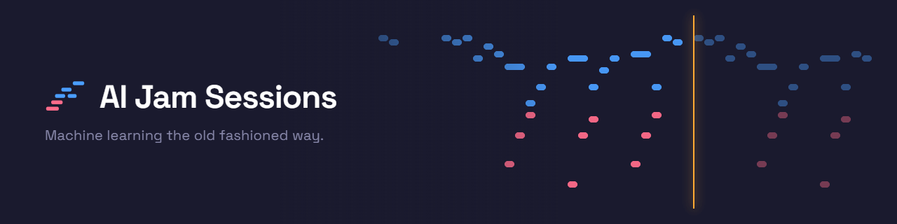
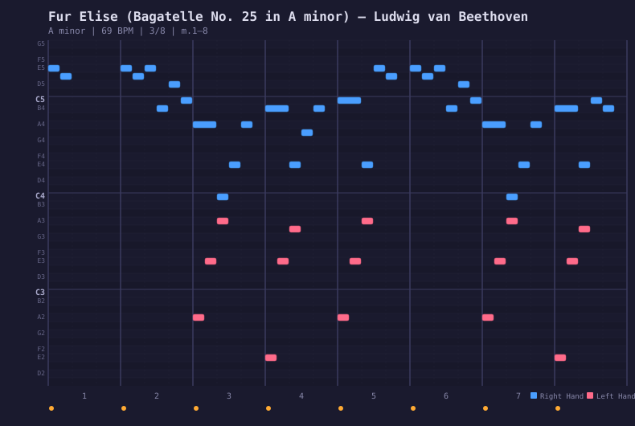
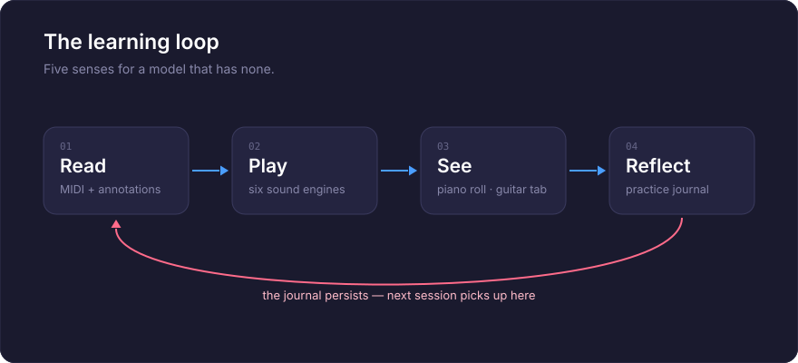

<p align="center">
  <a href="README.ja.md">日本語</a> | <a href="README.zh.md">中文</a> | <a href="README.es.md">Español</a> | <a href="README.fr.md">Français</a> | <a href="README.hi.md">हिन्दी</a> | <a href="README.md">English</a> | <a href="README.pt-BR.md">Português (BR)</a>
</p>

<p align="center">
  
</p>

<p align="center">
  <em>Machine Learning the Old Fashioned Way</em>
</p>

<p align="center">
  An MCP server that teaches AI to play piano and guitar — and sing.<br/>
  109 annotated songs across 12 genres. Six sound engines. Interactive guitar tablature.<br/>
  A browser cockpit with vocal synthesizer. A practice journal that remembers everything.
</p>

<p align="center">
  <a href="https://github.com/mcp-tool-shop-org/ai-jam-sessions/actions/workflows/ci.yml"></a>
  <a href="https://codecov.io/gh/mcp-tool-shop-org/ai-jam-sessions"></a>
  <a href="https://www.npmjs.com/package/@mcptoolshop/ai-jam-sessions"></a>
  <a href="https://github.com/mcp-tool-shop-org/ai-jam-sessions"></a>
  <a href="https://github.com/mcp-tool-shop-org/ai-jam-sessions"></a>
  <a href="datasets/jam-actions-v0-public/README.md"></a>
  <a href="https://doi.org/10.5281/zenodo.20279918"></a>
</p>

---

## Ascolta prima: tre inni, cantati a ritmo

**[Amazing Grace, America the Beautiful e l'Inno della Repubblica](https://mcp-tool-shop-org.github.io/ai-jam-sessions/#listen)**,
ogni strofa, cantata da una voce sintetica su un accompagnamento pianistico creato per ogni inno. Nella pagina iniziale, questi brani vengono riprodotti con una partitura 3D che segue la voce e le parole, illuminandole mentre vengono cantate.

Ogni esecuzione è stata assemblata da sedici registrazioni di un cantante guidato dalla partitura:
- una registrazione per frase, scelta da un ascoltatore locale e da un rilevatore di intonazione;
- posizionata sulla partitura tramite la manipolazione del tempo, in modo che nulla all'interno di una frase venga tagliato;
- verificata da due strumenti di misurazione del tempo e due rilevatori di intonazione;
- valutata a orecchio, con ogni problema contrassegnato in una recensione di ascolto che lo ricollega alla sua causa.

Un controllo del suono prima di ogni canzone misura l'impronta temporale della voce e indica quante registrazioni saranno necessarie per la canzone.

Come è stato realizzato: [manuale → Voci](https://mcp-tool-shop-org.github.io/ai-jam-sessions/handbook/vocals/).

| | Amazing Grace | America the Beautiful | Battle Hymn |
|---|---|---|---|
| sillabe entro 40 ms dalla partitura | 107/112 | 217/224 | 285/414 |
| note entro 50 centesimi | 135/140 | 218/224 | 368/424 |

Le note puntate e veloci del Battle Hymn sono lasciate al ritmo del cantante, ed è da qui che derivano la maggior parte degli errori di tempismo.

La voce è sintetica: [SoulX-Singer](https://github.com/Soul-AILab/SoulX-Singer) (Apache-2.0), con un timbro di esempio unico,
che non imita alcun cantante reale. Gli accompagnamenti pianistici sono stati scritti per questo progetto da Kimi-K3 e sono dedicati al
dominio pubblico (CC0). Tutti e tre gli inni sono di dominio pubblico.

## Cos'è questo?

Un pianoforte e una chitarra che l'IA impara a suonare. Non un sintetizzatore, non una libreria MIDI, ma uno strumento didattico.

Un LLM può leggere e scrivere testi, ma non può sperimentare la musica come facciamo noi. Nessuna orecchio, nessuna dita, nessuna memoria muscolare. AI Jam Sessions colma questa lacuna fornendo al modello sensi che può effettivamente utilizzare:

- **Lettura:** partiture MIDI reali con annotazioni musicali approfondite. Non approssimazioni scritte a mano, ma dati analizzati e spiegati.
- **Ascolto:** sei motori audio (pianoforte a oscillatore, pianoforte campionato, campioni vocali, tratto vocale fisico, sintetizzatore vocale additivo, chitarra modellata fisicamente) che vengono riprodotti attraverso gli altoparlanti, in modo che le persone nella stanza diventino le orecchie dell'IA. E ora il modello ha le sue orecchie, doppie: può misurare una registrazione a posteriori (vedi [Ascolto](#ascolto)) e può osservare la band **mentre la musica è ancora in corso** (vedi [L'ensemble dal vivo](#lensemble-dal-vivo)).
- **Visione:** una tastiera di pianoforte che visualizza ciò che è stato suonato come SVG, un formato che il modello può leggere e verificare. Un editor interattivo di tablature per chitarra. Un pannello di controllo del browser con una tastiera visiva, un editor di note a doppia modalità e un laboratorio di accordatura.
- **Memoria:** un diario di pratica che persiste tra le sessioni, in modo che l'apprendimento si accumuli nel tempo.
- **Canto:** sintesi del tratto vocale con 20 preset vocali, da soprano d'opera a coro elettronico. Modalità di accompagnamento con solfeggio, contorno e narrazione sillabica. E intere canzoni cantate a ritmo del pianoforte: una partitura che guida il cantante, assemblata frase per frase da molteplici registrazioni e regolata in termini di tempistica (40 ms) e intonazione (50 centesimi) prima che venga ascoltata (vedi [Canto](#canta)).

Ognuna delle 109 canzoni è ora completamente annotata: contesto storico, analisi strutturale barra per barra, momenti chiave, obiettivi didattici e suggerimenti per l'esecuzione, in tutti i 12 generi. Una versione precedente di questo file README affermava che le canzoni originali stavano "aspettando che l'IA assorbisse i modelli, suonasse la musica e scrivesse le proprie annotazioni". Questo è esattamente ciò che è successo: le annotazioni sono state scritte dall'IA in base a un'analisi deterministica per ogni canzone (accordi, struttura di ripetizione, confini delle sezioni, tonalità verificate), filtrate da una rubrica di qualità e verificate in modo contraddittorio, affermazione per affermazione: i numeri delle misure, le finestre degli accordi e i conteggi strutturali sono tutti verificati rispetto al MIDI effettivo prima che qualcosa venga rilasciato.

Da questo stesso lavoro, pubblichiamo anche **[jam-actions-v0](#set-di-dati-di-addestramento)**: un set di dati pubblico di 57 sequenze di utilizzo di strumenti MCP in più fasi su un vero pianoforte classico. Insegna agli LLM a eseguire *un utilizzo di strumenti basato su dati musicali simbolici*, non solo la generazione di testo, ed è dotato di un gate di rilascio a 7 assi che distingue "la trasmissione di prove" dal "procedere perché il compito è banale". Vedi [Set di dati di addestramento](#set-di-dati-di-addestramento) di seguito per tutti i dettagli.

## Ascolto

Per molto tempo, questo server poteva emettere suoni ma non analizzarli. Il modello suonava, una persona
ascoltava e il modello si basava sul suo parere. Questa lacuna è ora colmata.

Se lo si applica a un file WAV, misura ciò che contiene. Non analizzando un'immagine e indovinando,
ma facendo passare il segnale attraverso gli stessi strumenti che già utilizza per la partitura:

- **`analyze_audio`:** attacchi, il contorno dell'intonazione e il livello. L'intonazione viene restituita come nomi di note con
deviazioni in centesimi, mai come frequenze grezze. Il livello indica i valori reali: volume integrato BS.1770-4
in LUFS, il picco del campione in dBFS e un conteggio dei campioni troncati, oltre a un
controllo di integrità che segnala interruzioni e picchi di rumore: la metà del controllo qualità del rendering che riguarda i clic e i glitch.
Una sezione "Bilanciamento" indica dove si concentra l'energia, dai bassi profondi all'acuto: la quota di ciascuna banda rispetto
al rumore rosa, la brillantezza e l'inclinazione.
- **`transcribe_audio`:** la registrazione come note: intonazione, inizio, durata e quanto ogni nota
si discosta dall'intonazione di riferimento.
- **`score_audio_take`:** valuta una performance rispetto a una canzone nella libreria **ad orecchio**.
Trascrive la registrazione, la confronta con la partitura e indica quali note sono state suonate correttamente, quali
hanno avuto delle deviazioni e quali sono state omesse. Quindi `view_scored_piano_roll` disegna il risultato sulla partitura,
esattamente come fa per una registrazione MIDI. Questo è il modo in cui si valuta uno strumento reale, una registrazione vocale o qualsiasi cosa per cui non ci sia una registrazione MIDI.
- **`view_spectrogram`:** osserva il suono. Uno spettrogramma a Q costante con una tastiera di pianoforte sul
bordo sinistro, in modo che l'intonazione sia leggibile a colpo d'occhio e le note previste della canzone vengano visualizzate su di esso su richiesta.
- **`check_loop_seam`:** valuta un rendering in loop quando si ripete: la forma d'onda dopo
l'estrapolazione della pendenza della coda, l'energia a forma di impulso nel punto di giunzione e lo spostamento di livello lungo
la linea di giunzione. Un loop perfettamente in fase suona bene anche quando il campione al bordo grezzo salta.
- **`compare_balance`:** il timbro di un rendering rispetto a un riferimento che si sa essere corretto,
banda per banda in dB. Un elemento che dovrebbe suonare come i suoi simili, un re-rendering che dovrebbe corrispondere
alla registrazione che sostituisce. Il volume viene annullato, quindi viene confrontato solo il timbro.

**Cosa non vi dirà.** L’immagine serve per individuare *dove* si verifica un errore; ogni numero deriva dall’elaborazione del segnale e non dalla lettura di un’immagine da parte di un modello. Il trascrittore analizza una linea alla volta, quindi un accordo o un mix completo produrranno un risultato che sembra corretto ma in realtà è sbagliato, e il sistema lo segnala. Il rilevamento dell’inizio di una nota raggiunge un valore di circa F1 0,88, che rappresenta lo stato dell’arte; quindi, una nota “omessa” potrebbe essere una nota che il trascrittore non è riuscito a rilevare, piuttosto che una nota che non avete suonato; questo avvertimento è incluso nell’output degli strumenti, anziché essere nascosto qui.

L'intera struttura è indipendente da qualsiasi dipendenza: la trasformazione, il tracciatore di altezza, il rilevatore di inizio del suono, il
decodificatore WAV e l'encoder PNG sono tutti in questo repository e producono numeri identici in Node
e nel browser.

## L'ensemble dal vivo

L'ascolto valuta una registrazione una volta che è terminata. Questa è l'altra metà: chiedere cosa sta facendo
ogni strumento **in questo momento**, durante l'esecuzione.

```
ensemble_now()
```

Risponde con le note tenute da ogni strumento, per quanto tempo sono state tenute e l'accordo combinato
nell'intero ensemble. Durante un duetto, le due voci vengono segnalate separatamente, in modo da poter vedere il
pianoforte che tiene un triade mentre il sintetizzatore esegue la melodia.

### Due canali, e quello più economico è quello più preciso

Questa è la parte che vale la pena capire, perché decide quale numero considerare valido.

**Intento: cosa è stato chiesto a ciascun motore di suonare.** Quando il modello è quello che esegue, questo non è
una stima. Un accordo di pianoforte non è qualcosa da trascrivere; sono tre note che sono state inviate. Le
note sono esatte, libere e immediate.

**Acustico: cosa è effettivamente uscito.** Ogni motore può indirizzare il suo output a un bus di analisi privato,
in modo che ogni strumento venga misurato alla fonte, senza separazione e senza ambiguità. Questo canale è
**verifica, non scoperta**: è così che si viene a sapere che una voce si è discostata dal tempo, che una traccia
è stata interrotta o che un motore è rimasto in silenzio mentre continuava a ricevere note.

Quando i due non concordano, si tratta di un dato relativo al rendering, non di una correzione delle note.

### Cosa costa

L'analisi di uno strumento costa circa **9 microsecondi per ogni callback audio**, rispetto a un blocco di 42,67 ms,
che corrisponde a circa lo 0,02% del budget audio, misurato con zero campioni persi. Uno strumento senza un osservatore collegato non costa nulla.

### Cosa non ti dirà

Il canale acustico ha un ritardo e indica di quanto: circa 23 ms per l'altezza e 70 ms per un inizio del suono confermato, perché un inizio del suono non può essere confermato finché l'audio successivo non è arrivato. Gli inizi del suono vicini a tale limite vengono omessi anziché segnalati e successivamente ritirati.

Il tracciatore acustico segue una linea alla volta, quindi non indicherà le note di un accordo e non pretende di farlo. Un accordo che non riesce a risolvere è una sua limitazione nota, piuttosto che una scoperta, e
l'ensemble rimane in silenzio al riguardo, invece di lanciare l'allarme su ogni accordo suonato dal pianoforte.

## La tastiera del pianoforte

La tastiera del pianoforte è il modo in cui l'IA vede la musica. Visualizza qualsiasi canzone come SVG: blu per la mano destra, corallo per la mano sinistra, con griglie di battuta, dinamiche e confini di misura:

<p align="center">
  
</p>

<p align="center"><em>Für Elise, measures 1–8 — the E5-D#5 trill in blue, bass accompaniment in coral</em></p>

Due modalità di colore: **mano** (blu/corallo) o **classe di intonazione** (arcobaleno cromatico: ogni Do è rosso, ogni Fa# è ciano). Il formato SVG significa che il modello può sia vedere l'immagine che leggere il markup per verificare l'intonazione, il ritmo e l'indipendenza delle mani.

## Il pannello di controllo

Uno studio di composizione basato sul browser che si trova in questo repository all'indirizzo [`apps/cockpit`](apps/cockpit) e funziona in tempo reale all'indirizzo **[mcp-tool-shop-org.github.io/ai-jam-sessions/cockpit](https://mcp-tool-shop-org.github.io/ai-jam-sessions/cockpit/)**. Nessun plugin, nessun software DAW, nessuna installazione; tutto rimane nel tuo browser (il tuo lavoro viene salvato automaticamente in locale). Preferisci modificarlo?

```bash
cd apps/cockpit && npm install && npm run dev   # Vite dev server, opens in your browser
```

- **Di default, un Concert Grand campionato** — il pannello di controllo include un pacchetto Salamander Grand ridotto (90 file OGG, 8 MB) che viene caricato alla prima interazione e riproduce attraverso la stessa catena di elaborazione delle voci del sintetizzatore; prima del caricamento (o in modalità offline), le voci di pianoforte dell'oscillatore sintonizzato si sovrappongono in modo fluido. Campioni di [Alexander Holm](https://freepats.zenvoid.org/Piano/acoustic-grand-piano.html), CC-BY 3.0.
- **Modalità pannello — la sala di ascolto** — test A/B comparativi alla cieca delle voci del motore di composizione su melodie reali della libreria: clip con volume uniformato, elaborate offline attraverso il percorso della voce reale, serie di prove casuali con prove di controllo nascoste, classifiche Bradley-Terry con intervalli di confidenza bootstrap e risultati onesti (PROVVISORI fino a quando ogni coppia raggiunge il suo limite di voti; NON INTERPRETABILI quando la soglia di discriminazione non viene superata). Una seconda sotto-modalità esegue la stessa classificazione con giudici LLM locali, più cronologia di entrambi i tipi di esecuzione e una vista di confronto (Kendall τ + corrispondenza del rango del motore) che chiede se le tracce proxy economiche riflettono la verità umana.
- **Trasporto preciso al ritmo** — le note si mantengono nel tempo musicale, quindi il controllo BPM regola effettivamente il tempo di riproduzione; una barra temporale con clic per la ricerca e la possibilità di trascinare per impostare le **regioni di loop**; scorrimento automatico che segue la testina di riproduzione.
- **Acquisizione con attivazione della registrazione** — suona i tasti QWERTY, la tastiera sullo schermo o un dispositivo Web MIDI e il risultato viene inserito nella partitura: conteggio di 1 battuta all'inizio, sovraincisione in stile looper attraverso i cicli di loop (o modalità di sostituzione), la tempistica della performance originale viene preservata in una visualizzazione quantizzata, ogni passaggio è un'unità modificabile.
- **Annullamento/Ripristino completo** — ogni modifica, inclusi Annulla e Importa, è reversibile (Ctrl+Z), con gesti di trascinamento che si combinano come fanno i veri editor.
- **Selezione multipla + area di copia/incolla** — selezione tramite marquee sotto un'opzione di commutazione tra gli strumenti Seleziona/Disegna, clic con modificatori standard della piattaforma, copia/taglia/incolla durante la riproduzione, Duplica.
- **Touch + accessibilità** — eventi del puntatore con acquisizione su ogni superficie, tocco per riposizionare come alternativa non basata sul trascinamento, modifica delle note tramite tastiera, sovrapposizioni di partiture sicure per persone con daltonismo.
- **Piano roll a doppia modalità** — passa tra la modalità Strumento (colori delle classi cromatiche) e la modalità Vocale (note colorate in base alla forma della vocale: /a/ /e/ /i/ /o/ /u/).
- **Tastiera visiva** — due ottave da C4, mappata sulla tastiera QWERTY. Clicca o digita.
- **20 preset di voci** — 15 voci mappate Kokoro (Aoede, Heart, Jessica, Sky, Eric, Fenrir, Liam, Onyx, Alice, Emma, Isabella, George, Lewis, più coro e voce di sintetizzatore), 4 voci mappate al tratto e una sezione di coro sintetico.
- **10 preset di strumenti** — le 6 voci di pianoforte lato server più pad di sintetizzatore, organo, campana e archi.
- **Ispettore di note** — clicca su qualsiasi nota per modificare la velocità, la vocale e la sonorità.
- **7 sistemi di accordatura** — temperamento equabile, intonazione giusta (maggiore/minore), pitagorico, temperamento a virgola di quarto, Werckmeister III o offset di cent personalizzati. Riferimento A4 regolabile (392–494 Hz).
- **Verifica dell'accordatura** — tabella delle frequenze, tester di intervalli con analisi della frequenza di battito ed esportazione/importazione dell'accordatura.
- **Importazione/esportazione della partitura** — serializza l'intera partitura come JSON e caricala di nuovo.
- **API orientata all'LLM** — `window.__cockpit` espone `exportScore()`, `importScore()`, `addNote()`, `play()`, `stop()`, `panic()`, `setMode()` e `getScore()` in modo che un LLM possa comporre, arrangiare e riprodurre in modo programmatico.

## Il ciclo di apprendimento

<p align="center">
  
</p>

## La libreria di brani

109 brani annotati in 12 generi, creati da file MIDI reali. Ogni genere ha un esempio annotato in modo approfondito, con contesto storico, analisi armonica battuta per battuta, momenti chiave, obiettivi didattici e suggerimenti per l'esecuzione (inclusa la guida vocale). Questi esempi fungono da modelli: l'IA ne studia uno, quindi annota il resto. L'esempio folk è **America the Beautiful** (Samuel A. Ward, 1882, dominio pubblico): un inno in F maggiore arrangiato in questo repository, melodia F4–C5.

**Cosa viene fornito e cosa devi recuperare.** Le annotazioni sono nostre e vengono fornite con ogni brano. I file MIDI sono stati scaricati da siti MIDI pubblici quando è stata creata la libreria e un audit della provenienza per ogni file ([`docs/findings/library-provenance-audit.md`](docs/findings/library-provenance-audit.md)) ha rivelato che solo 14 di questi download contengono una licenza che ne consente la ridistribuzione: gli arrangiamenti di Bernd Krueger su piano-midi.de (CC-BY-SA-3.0-DE) e le trascrizioni di pubblico dominio del Mutopia Project. Questi 14 sono inclusi nel pacchetto npm. Gli altri 94 download non lo sono: il loro `.json` viene fornito, con un blocco `provenance` che indica la fonte, i suoi termini e il SHA-256 del file, e `ai-jam-sessions library fetch --accept-source-terms` scarica ciascuno di essi dal sito che lo ha pubblicato, secondo i termini di quel sito, rifiutando qualsiasi file il cui hash non corrisponde più a ciò rispetto a cui le annotazioni sono state verificate. Dodici file che si sono rivelati essere brani diversi da quelli indicati nel loro nome sono stati messi in quarantena, motivo per cui questa libreria scaricata contiene 108 brani e non i 120 delle versioni precedenti. **America the Beautiful** è il 109° brano e il quindicesimo file MIDI incluso nel pacchetto: l'arrangiamento è stato creato qui ed è stato dedicato al pubblico dominio. Le versioni precedenti alla 2.6.0 includevano tutti i 120 file MIDI; si è trattato di un errore, che viene corretto qui anziché essere semplicemente ignorato.

| Genere | Esempio | Tonalità | Cosa insegna |
|-------|----------|-----|-----------------|
| Blues | L’emozione è svanita (B.B. King) | Si minore | Forma blues minore, botta e risposta, suonare leggermente in ritardo |
| Classica | Für Elise (Beethoven) | La minore | Forma di rondò, differenziazione del tocco, disciplina del pedale |
| Colonna sonora | Comptine d'un autre été (Tiersen) | Mi minore | Tessiture arpeggiate, architettura dinamica senza cambiamenti armonici |
| Folk | America the Beautiful (Ward) | Fa maggiore | Armonia di inno tonico-dominante, fraseggio patriottico, melodia in F4–C5 |
| Jazz | Autumn Leaves (Kosma) | Sol minore | Progressioni ii-V-I, note guida, ottavi di swing, voci senza la fondamentale |
| Latino | The Girl from Ipanema (Jobim) | Fa maggiore | Ritmo bossa nova, modulazione cromatica, moderazione vocale |
| New Age | River Flows in You (Yiruma) | Una tonalità maggiore | Riconoscimento I-V-vi-IV, arpeggi fluidi, rubato |
| Pop | Imagine (Lennon) | Do maggiore | Accompagnamento arpeggiato, moderazione, sincerità vocale |
| Ragtime | The Entertainer (Joplin) | Do maggiore | Basso "oom-pah", sincopazione, forma multi-strofica, disciplina del tempo |
| R&B | Superstition (Stevie Wonder) | Mi bemolle minore | Funk in sedicesimi, tastiera percussiva, note fantasma |
| Rock | Your Song (Elton John) | Mi bemolle maggiore | Ballata per pianoforte, conduzione delle voci, canto colloquiale, inversioni |
| Soul | Lean on Me (Bill Withers) | Do maggiore | Melodia diatonica, accompagnamento gospel, botta e risposta |

Le canzoni progrediscono da **grezze** (solo MIDI) → **annotate** → **pronte** (completamente riproducibili con il linguaggio musicale). L'IA promuove le canzoni studiandole e scrivendo annotazioni con `annotate_song`.

## Motori del suono

Sei motori, più un combinatore a livelli che esegue due motori contemporaneamente:

| Motore | Tipo | Come suona |
|--------|------|---------------------|
| **Oscillator Piano** | Sintesi additiva | Pianoforte multi-armonico con rumore del martelletto, inarmonicità, brillantezza modellata dalla velocità, polifonia a 48 voci, immagine stereo. Nessuna dipendenza. |
| **Sample Piano** | Riproduzione di campioni | Salamander Grand Piano: il suono reale. **Il motore predefinito ogni volta che viene installato un pacchetto** (`samples/AccurateSalamander` o `AI_JAM_SAMPLES_DIR`); il pacchetto npm rimane privo di campioni, quindi è necessario fornire il download di [Salamander](https://freepats.zenvoid.org/Piano/acoustic-grand-piano.html). Il pannello di controllo del browser include il proprio pacchetto ridotto da 8 MB (90 OGG, CC-BY 3.0 Alexander Holm), quindi non è necessaria alcuna configurazione sul web. |
| **Vocal (Sample)** | Campioni con variazione di altezza | Toni vocalici sostenuti con portamento e modalità legato. |
| **Vocal Tract** | Modello fisico | Pink Trombone: forma d'onda glottale LF attraverso una guida d'onda digitale a 44 celle. Quattro preset: soprano, contralto, tenore, basso. |
| **Vocal Synth** | Sintesi additiva | 15 preset di voce Kokoro con modellazione del formante, respiro, vibrato. Deterministico (RNG con seme). |
| **Guitar** | Sintesi additiva | Corda pizzicata modellata fisicamente: 4 preset (dreadnought in acciaio, classica in nylon, jazz archtop, a dodici corde), 8 accordature, 17 parametri regolabili. |
| **Layered** | Combinatore | Combina due motori e invia ogni evento MIDI a entrambi: pianoforte + sintetizzatore, voce + sintetizzatore, ecc. |

### Voci per tastiera

Sei voci di pianoforte regolabili, ciascuna con parametri regolabili (brillantezza, decadimento, durezza del martelletto, disintonizzazione, ampiezza stereo e altro):

| Voce | Caratteristica |
|-------|-----------|
| Concert Grand | Ricco, pieno, classico |
| Upright | Caldo, intimo, folk |
| Electric Piano | Setoso, jazz, stile Fender Rhodes |
| Honky-Tonk | Disintonizzato, ragtime, da saloon |
| Music Box | Cristallino, etereo |
| Bright Grand | Incisivo, contemporaneo, pop |

### Voci per chitarra

Quattro preset di voce per chitarra con sintesi di corde modellata fisicamente, ciascuno con 17 parametri regolabili (brillantezza, risonanza del corpo, posizione del pizzico, smorzamento delle corde e altro):

| Voce | Caratteristica |
|-------|-----------|
| Steel Dreadnought | Brillante, equilibrato, acustico classico |
| Nylon Classical | Caldo, morbido, arrotondato |
| Jazz Archtop | Dolce, legnoso, pulito |
| Twelve-String | Scintillante, raddoppiato, simile a un chorus |

## Il diario della pratica

Dopo ogni sessione, il server registra ciò che è accaduto: quale canzone, quale velocità, quante misure, quanto tempo. L'IA aggiunge le proprie riflessioni: cosa ha notato, quali schemi ha riconosciuto, cosa provare dopo.

```markdown
---
### 14:32 — Autumn Leaves
**jazz** | intermediate | G minor | 69 BPM × 0.7 | 32/32 measures | 45s

The ii-V-I in bars 5-8 (Cm7-F7-BbMaj7) is the same gravity as the V-i
in The Thrill Is Gone, just in major. Blues and jazz share more than the
genre labels suggest.

Next: try at full speed. Compare the Ipanema bridge modulation with this.
---
```

Un file markdown al giorno, archiviato in `~/.ai-jam-sessions/journal/`. Leggibile dall'uomo, solo aggiunte. Nella sessione successiva, l'IA legge il suo diario e riprende da dove si era interrotta.

## Set di dati di addestramento

**jam-actions-v0**: un set di dati pubblico di tracce di utilizzo di strumenti MCP multi-turno, basato su MIDI di pianoforte classico. Costruito utilizzando la stessa libreria con cui questo server insegna, il set di dati insegna agli LLM a eseguire **un utilizzo di strumenti basato su dati in musica simbolica**, non solo sulla generazione di testo.

Ogni record associa una finestra di frase di 4 misure a un obiettivo di insegnamento annotato e a una *traccia di riferimento*: una sessione passo dopo passo in cui un assistente utilizza gli strumenti MCP sopra (`get_events_in_measure`, `get_events_in_hand`, `count_distinct_pitch_classes` e il resto della superficie di ispezione MIDI a 9 strumenti) per leggere, analizzare e discutere la frase.

| | |
|---|---|
| Versione | **0.6.0 (2026-09-25) — versione correttiva** (vedere di seguito) |
| Record | 57 (sottoinsieme pubblico): 45 per l'addestramento, 12 per il test (`clair-de-lune`) |
| Composizioni | 4 opere per pianoforte classico: Bach BWV 846, Mozart K. 545 I, Beethoven "Für Elise", Debussy "Clair de Lune" |
| MIDI di origine | piano-midi.de: arrangiamenti di Bernd Krueger, ogni file riporta il credito di copyright di Krueger |
| Licenza | CC-BY-SA-3.0-DE (arrangiamenti) su composizioni di pubblico dominio |
| Dove | [`mcp-tool-shop/jam-actions-v0`](https://huggingface.co/datasets/mcp-tool-shop/jam-actions-v0) on Hugging Face and on Zenodo; DOIs and citation in the [dataset card](datasets/jam-actions-v0-public/README.md) and [`CITATION.cff`](datasets/jam-actions-v0-public/CITATION.cff) |

**La correzione 0.6.0.** Le versioni 0.4.x e 0.5.x contenevano 115 brani distribuiti su 8 opere, tutti attribuiti a Bernd Krueger. Tale attribuzione è stata verificata rispetto alle pagine dei compositori di piano-midi.de, e non rispetto ai file. Quando la libreria di brani è stata sottoposta a verifica a partire dai byte MIDI, quattro di questi brani – il Notturno in Do diesis minore, Op. 9 n. 2 e il Preludio in Mi bemolle maggiore, Op. 28 n. 4 di Chopin, la "Patetica" n. 2 di Beethoven e "Träumerei" di Schumann – si è scoperto che erano stati creati a partire da file ottenuti da midiworld.com e bitmidi.com, senza una licenza di arrangiamento stabilita. I loro 58 brani riproducevano tali arrangiamenti nota per nota, quindi la versione 0.6.0 li rimuove. I 57 brani rimanenti sono identici a quelli della versione 0.5.0. Si prega di non ridistribuire i brani rimossi dalle versioni precedenti. La descrizione completa è disponibile in [`docs/findings/published-dataset-licence-audit.md`](docs/findings/published-dataset-licence-audit.md).

**Il controllo delle prove.** Il pacchettizzatore ora rilegge il blocco di provenienza della libreria di ogni brano – derivato nuovamente dai byte MIDI – e rifiuta qualsiasi brano la cui canzone non abbia una licenza di arrangiamento ridistribuibile, o il cui hash del file di origine differisca dal file di riferimento. Funziona in modalità di sicurezza. Un test esegue lo stesso controllo su ogni pacchetto pubblicato, quindi una successiva modifica della provenienza fa sì che la compilazione risulti fallita per i set pubblicati.

**La storia della qualità: il sistema di rilascio a 7 assi.** Il sistema di rilascio del set di dati distingue tra il superamento basato su prove e il superamento che raggiunge il limite massimo. Gli assi da 1 a 6 sono di blocco (soglia assoluta, margine composto, frequenza di utilizzo degli strumenti, correzione dopo l'uso dello strumento, numero di interpretazioni errate, soglia dello strato); l'asse 7 è arricchito rispetto alla segnalazione standard. I risultati registrati sono stati misurati sulla composizione di 115 brani delle versioni 0.4.x e 0.5.x e rimangono riproducibili a partire dal tag `jam-actions-v0-0.5.0-cut-2026-07-11`; non sono stati rimisurati sulla versione 0.6.0.

**Riproducibilità.** Un nuovo collaboratore su qualsiasi piattaforma (Windows nativo, macOS, Linux, WSL) può verificare il pacchetto e ricostruirlo:

```bash
git clone https://github.com/mcp-tool-shop-org/ai-jam-sessions.git
cd ai-jam-sessions && pnpm install
pnpm exec tsx scripts/verify-public-package-checksums.ts                        # every file accounted for
pnpm exec tsx scripts/package-jam-actions-public.ts --today 2026-09-25 --dry-run # evidence gate runs first
pnpm build && pnpm exec tsx scripts/verify-public-package-execution.ts
# → "VERDICT: PASS" — every frozen tool call replays live (needs an audio device)
```

`.gitattributes` imposta le terminazioni di riga LF per `*.sha256` e l'albero del set di dati pubblico, in modo che il verificatore del checksum funzioni su ogni piattaforma.

**Cronologia della messa a punto.** Le affermazioni del set di dati sono state testate con messe a punto preregistrate, valutate rispetto a baseline sigillate. **v0** (solo le 78 tracce) ha restituito un risultato negativo onesto ([report](docs/finetune-arc-eval-report.md)); **v1** ha migliorato la QA basata sugli strumenti di 0,202, ma non ha raggiunto la soglia preregistrata di una sola vittoria ([report](docs/finetune-arc-v1-eval-report.md)); **B-1** ha ri-testato gli adattatori congelati v1 su un gruppo di 36 brani: 0,678 → 0,890, 29/36 vittorie rispetto alla soglia ex-ante di 24/34 ([report](docs/finetune-arc-v2-b1-eval-report.md)). Queste misurazioni rimangono valide. **Gli adattatori stessi sono stati rimossi**: i loro dati di addestramento includevano brani provenienti dai quattro brani rimossi, quindi non possono essere offerti alle condizioni di questo set di dati. Gli adattatori addestrati solo su materiale con licenza chiara sono pubblicati con i set di dati `jam-actions-v1`.

> Gli arrangiamenti MIDI sono di Bernd Krueger (piano-midi.de), con licenza CC-BY-SA-3.0-DE. Le annotazioni, le tracce e gli artefatti di valutazione sono del team AI Jam Sessions, rilasciati con la stessa licenza, in modo che la catena di condivisione sia preservata dall'inizio alla fine. **Limite della licenza:** la licenza MIT del repository copre il codice; tutto ciò che si trova in `datasets/` è CC-BY-SA-3.0-DE. Il corpus di lavoro in `datasets/jam-actions-v0/` contiene anche brani che non sono pubblicati: due opere la cui provenienza non è mai stata verificata (Gymnopédie n. 1 di Satie, Arabesque n. 1 di Debussy) e i quattro brani rimossi nella versione 0.6.0 – vedere [`datasets/jam-actions-v0/PROVENANCE-NOTE.md`](datasets/jam-actions-v0/PROVENANCE-NOTE.md).

### Il corpus acustico

**jam-actions-acoustic-v0** – il corrispettivo delle tracce di cui sopra, ma sull'**audio** anziché sulla musica simbolica. 72 brani, ciascuno dei quali associa un rendering sintetico deliberatamente perturbato di una frase di pubblico dominio al risultato che gli strumenti di analisi restituiscono effettivamente, in modo che ogni etichetta sia verificata rispetto allo strumento e non solo rispetto a se stessa.

| | |
|---|---|
| Versione | 1.1.0 (2026-09-25) – ha rimosso i 36 brani di "Träumerei" della versione 1.0.x, il cui file di origine non ha una licenza di arrangiamento stabilita. |
| Record | 72 – 2 frasi (Bach, Für Elise) × 9 tipi di perturbazione × 4 note di destinazione |
| Escluso | per **frase** (Für Elise), non per registrazione, in modo che una copia leggermente modificata della stessa melodia non possa "trapelare". |
| Classi | corrispondenza, errore/avviso di altezza, errore/superamento del tempismo, mancante, extra, vibrato a tono, silenzio senza elementi da valutare |
| Audio | nessuno distribuito – ogni brano contiene una ricetta deterministica e il SHA-256 della forma d'onda che produce |
| Schema | `jam-actions-acoustic-v0/1.0.0` |

Due delle nove classi sono presenti perché un modello ingenuo risponde in modo sicuro ma errato: una
nota di vibrato il cui verdetto corretto è *a tono* e il silenzio il cui verdetto corretto è *nessun elemento da valutare*. Ogni soglia da cui dipende il verdetto viene copiata nella registrazione, perché entrambe sono cambiate una volta durante la compilazione.

Il corpus può essere riprodotto da questo repository. La sua rigenerazione produce tutti i 79 file pubblicati e un file `checksums.sha256` identico in termini di byte, e un test verifica esattamente questo senza scrivere l'albero pubblicato.

**Una precisazione, misurata anziché presunta.** Ogni brano contiene `wav_sha256`, l'hash della forma d'onda prodotta dalla sua ricetta, e il renderer chiama `Math.pow` e `Math.sin` una volta per campione. Nessuno dei due deve essere arrotondato correttamente e i risultati di V8 sono cambiati tra Node 22 e Node 24: dei 27.869 argomenti distinti `Math.pow(2, x)` valutati dal corpus originale, 253 restituiscono un valore double diverso. Quasi tutto ciò scompare con la quantizzazione a 16 bit, ma **2 dei 72 brani** – entrambi la perturbazione `extra` di Für Elise, il cui motivo si trova sull'unica nota in cui il rapporto del semitono stesso è diverso – hanno un hash diverso su Node 24. Tutti gli altri campi di ogni brano vengono riprodotti su qualsiasi motore e il repository testa entrambe le affermazioni separatamente. Se si esegue nuovamente il rendering e si riscontrano queste due incongruenze, è questo il problema, e non un download corrotto. Rendere la forma d'onda portabile a livello di bit significa sostituire le funzioni trascendenti, il che modifica ogni hash e quindi richiede una nuova versione dello schema.

### Crea il tuo

L'infrastruttura su cui funziona il corpus è disponibile per i propri esperimenti.
[`experiments/_template/`](experiments/_template/) è un esempio funzionante che è possibile copiare: si dichiara un compito e si ottengono la formattazione SFT, il punteggio per classe, le baseline banali rispetto all'insieme di risultati dichiarato e un controllo che nessuna unità di holdout si sovrapponga alla suddivisione.

Il [contratto](experiments/_template/README.md) è la parte che vale la pena leggere. La verità fondamentale è costruibile anziché scritta a mano, le etichette sono verificate rispetto a ciò che gli strumenti misurano, si suddivide in base all'unità che presenta perdite e si segnalano le baseline e il modello di base insieme a qualsiasi risultato. Ognuna di queste regole ha un costo da apprendere.

## Installazione

```bash
npm install -g @mcptoolshop/ai-jam-sessions
```

Richiede **Node.js 22+** (v2.0.0 ha aumentato il requisito minimo con `node-web-audio-api` 2.0). Nessun driver MIDI, nessuna porta virtuale, nessun software esterno.

### Claude Desktop / Claude Code

```json
{
  "mcpServers": {
    "ai_jam_sessions": {
      "command": "npx",
      "args": ["-y", "-p", "@mcptoolshop/ai-jam-sessions", "ai-jam-sessions-mcp"]
    }
  }
}
```

### Docker

Ogni versione include anche `ghcr.io/mcp-tool-shop-org/ai-jam-sessions`, un'immagine leggera che esegue il server MCP su stdio. L'unica cosa da sapere è che `/data` è la memoria: il registro, lo stato del server, le canzoni dell'utente e tutti i file MIDI recuperati sono memorizzati lì, quindi è necessario montare un volume, altrimenti il container si interromperà.

```json
{
  "mcpServers": {
    "ai_jam_sessions": {
      "command": "docker",
      "args": ["run", "--rm", "-i", "-v", "ai-jam-data:/data", "ghcr.io/mcp-tool-shop-org/ai-jam-sessions"]
    }
  }
}
```

L'immagine include 14 file MIDI ridistribuibili; l'esecuzione di `library fetch --accept-source-terms` all'interno del container posiziona gli altri 94 nel volume. `docker compose up` fa lo stesso con un volume denominato e `--profile ollama` aggiunge un sidecar Ollama. Dettagli, l'interfaccia a riga di comando all'interno dell'immagine e ciò che non è incluso intenzionalmente: [docs/docker.md](docs/docker.md). Esecuzione dei valutatori ottimizzati in Ollama, con il costo misurato di una base a 4 bit: [docs/ollama-adapters.md](docs/ollama-adapters.md).

## Strumenti MCP

56 strumenti e 4 modelli di prompt suddivisi in otto categorie:

### Scopri

| Strumento | Cosa fa |
|------|--------------|
| `list_songs` | Cerca per genere, difficoltà o parola chiave |
| `song_info` | Analisi musicale completa: struttura, momenti chiave, obiettivi didattici, suggerimenti sullo stile |
| `registry_stats` | Statistiche a livello di libreria: numero totale di brani, generi, difficoltà |
| `list_measures` | Note, dinamiche e note didattiche di ogni misura |
| `teaching_note` | Analisi approfondita di una singola misura: diteggiatura, dinamiche, contesto |
| `suggest_song` | Raccomandazione basata su genere, difficoltà e ciò che hai suonato |
| `practice_setup` | Velocità, modalità, impostazioni della voce e comando CLI consigliati per un brano |
| `compare_songs` | Riconoscimento di pattern intergenere: relazioni chiave, similarità di tono/intervallo, forme condivise, connessioni didattiche |
| `annotation_progress` | Qualità dell'annotazione dei brani in tutta la libreria: punteggi, valutazioni e suggerimenti per il miglioramento |
| `server_info` | Versione del server, statistiche della libreria, elenco dei motori, sessione attiva |

### Riproduci

| Strumento | Cosa fa |
|------|--------------|
| `play_song` | Riproduci tramite gli altoparlanti: brani della libreria o file .mid grezzi. Quattro motori (pianoforte, voce, tratto, chitarra), qualsiasi velocità, modalità, intervallo di misure, oltre a un metronomo con conteggio iniziale e un flag `record` che registra la sessione per la valutazione. I motori synth e a livelli sono disponibili solo tramite CLI. |
| `stop_playback` | Ferma |
| `pause_playback` | Metti in pausa o riprendi |
| `set_speed` | Cambia la velocità durante la riproduzione (0,1×–4,0×) |
| `playback_status` | Snapshot in tempo reale: misura corrente, tempo, velocità, voce della tastiera, stato |
| `view_piano_roll` | Renderizza come SVG (colore della mano o arcobaleno cromatico delle classi di altezza) |
| `score_performance` | Valuta una traccia MIDI: precisione dell'intonazione, tempistica, completezza, con feedback valutato |
| `mute_hand` | Disattiva o attiva la mano sinistra/destra durante la pratica: isola una mano alla volta |
| `detect_chord` | Individua l'accordo da un insieme di note MIDI attualmente in riproduzione (ad esempio, `[60,64,67]` → Do) |
| `preview_teaching_cues` | Visualizza tutte le note didattiche e i momenti chiave prima di suonare |

### Pratica

| Strumento | Cosa fa |
|------|--------------|
| `practice_loop` | L'esercizio che un insegnante reale assegna: ripeti le misure 5-8 più lentamente e il tempo aumenta (+5%) solo dopo una ripetizione *perfetta*: ogni ripetizione viene registrata, valutata e riassunta |
| `practice_status` | Stato dell'esercizio: ripetizione corrente, velocità e una diagnosi per misura dell'ultima esecuzione |
| `score_last_take` | Valuta l'ultima esecuzione registrata: precisione dell'intonazione, tempistica, completezza, valutazioni per nota |
| `view_scored_piano_roll` | Lo spartito contrassegnato che ogni insegnante utilizza: la tastiera del pianoforte sovrapposta alle valutazioni per nota in una tavolozza a prova di daltonismo (solido = corretto, tratteggiato = tempistica, ✕ = mancante) |

### Canta

| Strumento | Cosa fa |
|------|--------------|
| `sing_along` | Testo cantabile: nomi delle note, solfeggio, contorno o sillabe. Con o senza accompagnamento di pianoforte. |
| `ai_jam_sessions` | Genera una bozza di jam session: progressione di accordi, schema della melodia e suggerimenti sullo stile per la reinterpretazione |
| `verify_harmony` | Il gate di verifica del ciclo di creazione: una riarmonizzazione proposta viene controllata dagli strumenti deterministici della piattaforma: fedeltà degli accordi (il motore degli accordi deve rilevare ogni accordo previsto), consonanza della melodia (tono/tensione/cromatico), conduzione delle voci del basso, appartenenza alla tonalità |
| `auto_reharmonize` | Il ciclo di creazione in una sola chiamata: un modello locale propone una riarmonizzazione, il gate deterministico di `verify_harmony` controlla ogni voicing, il migliore tra n fino a quando non viene restituita un'interpretazione verificata |
| `compose_panel` | Esegui il pannello di composizione della conduzione delle voci su qualsiasi brano: quattro sistemi realizzano accompagnamenti, un LLM cross-familiare esegue una valutazione alla cieca e li classifica, l'aggregazione di Bradley-Terry, con un gate di discriminazione che annulla le esecuzioni non interpretabili (solo segnale direzionale, mai un punteggio di qualità). Funziona per minuti e trasmette notifiche di avanzamento durante l'esecuzione. |

**Un intero brano a tempo: la via vocale.** Qualsiasi brano può avere una vera voce cantata che si sovrappone al pianoforte.
- **Il cronometro.** Un cronometro dello spartito (`scripts/build-score-clock.mjs`) deriva l'intonazione, l'inizio e la durata di ogni sillaba dall'arrangiamento del brano, sulla linea temporale del riproduttore.
- **Il controllo del suono.** Prima che un brano venga renderizzato, la stessa voce canta una frase di calibrazione di sedici parole al tempo del brano (`scripts/soundcheck.py`). La sua impronta temporale, per gruppo di consonanti e per note lunghe rispetto a quelle brevi, indica quante ripetizioni il brano richiede e quali parole sono rischiose, prima che venga speso qualsiasi tempo di GPU sul brano stesso.
- **Il cantante.** Un cantante condizionato dallo spartito ([SoulX-Singer](https://github.com/Soul-AILab/SoulX-Singer), Apache-2.0) renderizza sedici esecuzioni da quel cronometro, localmente o su una GPU in affitto tramite offrig.
- **La scelta.** `scripts/sing_clock.py --by-phrase --warp` seleziona una esecuzione per frase. Una trascrizione e un'intonazione FCPE di un ascoltatore locale decidono e la frase viene distorta nel tempo sullo spartito.
- **I gate.** **Tempistica:** un rilevatore di energia, controllato da un allineatore vocale, posiziona ogni vocale entro 40 ms. **Intonazione:** FCPE, con pYIN che rilegge ciò che contrassegna, posiziona ogni nota entro 50 centesimi.
- **L'orecchio.** La revisione di ascolto (`scripts/review_marks.py`) consente a una persona di premere **M** ovunque qualcosa suoni male, con una categoria e una nota. Il rapporto traccia ogni segno alla sua esecuzione, al suo punto di unione e ai gate e lo pondera in base al livello del revisore: l'orecchio di un ascoltatore stabilisce *dove* suona male, mentre l'indicazione di *cosa* è, ha un peso maggiore per la formazione. Funziona come una pagina di ascolto locale e come modalità di revisione nel cockpit, con sessioni salvate e un solo livello di volume per ogni clip. Percorso, leve e ricevute: [manuale → Voci](https://mcp-tool-shop-org.github.io/ai-jam-sessions/handbook/vocals/), [`docs/vocal-clock.md`](docs/vocal-clock.md); la ricerca alla base delle scelte: [`docs/vocal-singing-study-2026-09.md`](docs/vocal-singing-study-2026-09.md).

### Chitarra

| Strumento | Cosa fa |
|------|--------------|
| `view_guitar_tab` | Visualizza tablature interattive per chitarra in formato HTML: modifica con un clic, cursore di riproduzione, scorciatoie da tastiera |
| `list_guitar_voices` | Preset di suoni per chitarra disponibili |
| `list_guitar_tunings` | Accordature per chitarra disponibili (standard, drop-D, open G, DADGAD, ecc.) |
| `tune_guitar` | Regola qualsiasi parametro di qualsiasi suono per chitarra. Le impostazioni vengono mantenute tra le sessioni. |
| `get_guitar_config` | Configurazione attuale del suono per chitarra rispetto alle impostazioni di fabbrica |
| `reset_guitar` | Ripristina le impostazioni di fabbrica di un suono per chitarra |

### Creazione

| Strumento | Cosa fa |
|------|--------------|
| `add_song` | Aggiungi una nuova canzone in formato JSON |
| `import_midi` | Importa un file .mid con metadati |
| `annotate_song` | Scrivi un linguaggio musicale per una canzone grezza e trasformala in una versione completa |
| `save_practice_note` | Voce del diario con dati di sessione acquisiti automaticamente |
| `read_practice_journal` | Carica le voci recenti per fornire un contesto |
| `list_keyboards` | Suoni per tastiera disponibili |
| `tune_keyboard` | Regola qualsiasi parametro di qualsiasi suono per tastiera. Le impostazioni vengono mantenute tra le sessioni. |
| `get_keyboard_config` | Configurazione attuale rispetto alle impostazioni di fabbrica |
| `reset_keyboard` | Ripristina le impostazioni di fabbrica di un suono per tastiera |
| `score_annotation` | Qualità delle annotazioni della partitura in base a 5 dimensioni: completezza, profondità, specificità, valore didattico, vocabolario |
| `validate_song_entry` | Valida un file JSON di una canzone rispetto allo schema prima di aggiungerlo |
| `transpose_song` | Trasponi una canzone di uno o più semitoni: nuova tonalità, nuove note |
| `list_sections` | Visualizza le sezioni strutturali di una canzone (Introduzione, Strofa, Ritornello, ecc.) |
| `add_section` | Aggiungi un marcatore di sezione a una canzone per la navigazione strutturale |

### Punteggio

| Strumento | Cosa fa |
|------|--------------|
| `score_performance` | Valuta una performance MIDI in accompagnamento a una canzone presente in una libreria, analizzando l'intonazione, il ritmo, la completezza, con un feedback graduale. |
| `score_annotation` | Valuta la qualità delle annotazioni su 5 dimensioni. |

### Ascolta

Misura l'audio registrato. Monofonico: segue una singola linea alla volta, quindi un accordo o un mix completo
producono risultati incoerenti. Ogni numero deriva dall'elaborazione del segnale, mai dalla lettura di un'immagine da parte di un modello.

| Strumento | Cosa fa |
|------|--------------|
| `analyze_audio` | Analizza un file WAV: tempi di attacco, la curva dell'intonazione come nomi di note con centesimi, livello (BS.1770-4 LUFS, picco dBFS, campioni distorti), equilibrio spettrale per banda e verifica dell'integrità (interruzioni, picchi di rumore, clic) |
| `transcribe_audio` | Trasforma una registrazione monofonica in note, indicando la deviazione di ciascuna nota rispetto all'intonazione di riferimento. Le note che il tracker non è stato in grado di seguire vengono omesse anziché essere stimate. |
| `score_audio_take` | Valuta una performance rispetto a una canzone presente in una libreria **ad orecchio**, quindi passa il risultato a `view_scored_piano_roll`. |
| `view_spectrogram` | Visualizza il suono: uno spettrogramma a Q costante su un asse a forma di tastiera di pianoforte, eventualmente sovrapposto alle note previste. Per impostazione predefinita, la visualizzazione è oscurata. |
| `check_loop_seam` | Giudica dove la fine di un loop si ricollega al suo inizio: estrapolazione della forma d'onda, energia del picco alla giunzione, variazione di livello |
| `compare_balance` | Confronta l'equilibrio tonale di un rendering con un riferimento, banda per banda in dB, con la variazione di luminosità e inclinazione. Il volume viene annullato. |
| `ensemble_now` | Mostra cosa sta suonando **in questo momento** ogni strumento, durante l'esecuzione. Le note derivano da ciò che è stato inviato, quindi sono esatte anziché stimate. |

### Suggerimenti MCP

Quattro modelli di suggerimento per flussi di lavoro didattici strutturati:

| Suggerimento | Cosa fa |
|--------|--------------|
| `annotate_song` | Flusso di lavoro guidato per l'annotazione: studia un esempio, scrivi un linguaggio musicale per una canzone grezza |
| `practice_plan` | Crea un piano di pratica strutturato basato su genere, difficoltà e obiettivi |
| `performance_review` | Rivedi una sessione completata: cosa ha funzionato bene, su cosa concentrarsi in seguito |
| `maker_loop` | Esegui l'intero ciclo di creazione: proponi una riarmonizzazione, verificala con gli strumenti deterministici della piattaforma, quindi aggiungi e riproduci il risultato verificato |

## CLI

```
ai-jam-sessions list [--genre <genre>] [--difficulty <level>]
ai-jam-sessions play <song-id> [--speed <mult>] [--mode <mode>] [--engine <piano|vocal|tract|synth|guitar|piano+synth|guitar+synth>] [--metronome] [--count-in <bars>] [--record]
ai-jam-sessions practice <song-id> --measures <start-end> [--start-speed <pct>] [--target <pct>] [--step <pct>]
ai-jam-sessions sing <song-id> [--with-piano] [--engine <engine>]
ai-jam-sessions view <song-id> [--measures <start-end>] [--out <file.svg>]
ai-jam-sessions view-guitar <song-id> [--measures <start-end>] [--tuning <tuning>]
ai-jam-sessions info <song-id>
ai-jam-sessions tune <keyboard-id> [--param value ...] [--reset] [--show]
ai-jam-sessions tune-guitar <voice-id> [--param value ...] [--reset] [--show]
ai-jam-sessions keyboards
ai-jam-sessions guitars
ai-jam-sessions stats
ai-jam-sessions library
ai-jam-sessions ports
ai-jam-sessions help
ai-jam-sessions --version
```

## Stato

**v2.9.0: tre inni, su arrangiamenti di pianoforte reali.** Amazing Grace, America the Beautiful e The Battle Hymn of the Republic sono cantati su arrangiamenti per pianoforte scritti per ciascun inno, ognuno con il proprio tempo e forma, e le frasi terminano in un silenzio. Un gate vocale ora funziona per impostazione predefinita e ha catturato una sillaba quasi silenziosa in The Battle Hymn, che viene ripubblicata con questa correzione. La console ottiene una modalità di revisione in ascolto. Vedi [CHANGELOG](CHANGELOG.md).

**v2.8.0: due inni, cantati.** Amazing Grace e America the Beautiful sono cantati per intero, ogni strofa, seguendo il tempo del pianoforte: sedici riprese, una ripresa per frase, posizionamento delle note, gate di tempo e intonazione per due strumenti e una persona che ascolta alla fine. Entrambi sono stati approvati a orecchio e la [pagina di destinazione](https://mcp-tool-shop-org.github.io/ai-jam-sessions/) li presenta. L'America the Beautiful della libreria è ora la melodia Materna di Ward. Vedi [CHANGELOG](CHANGELOG.md).

**v2.7.0 — America the Beautiful.** La libreria contiene 109 canzoni annotate. Vengono fornite quindici file MIDI; 94 vengono ancora recuperati dalle loro fonti. Il nuovo file è un arrangiamento di pubblico dominio creato in questo repository (melodia di Samuel A. Ward, 1882), in Fa maggiore, ed è l'esempio popolare. Un percorso SoulX-Singer lo canta: i gate di tempo e intonazione superano il test e la pagina di destinazione mantiene i tre avvisi sull'intonazione. Vedi [CHANGELOG](CHANGELOG.md).

**v2.6.0 — la versione che interrompe la distribuzione di ciò per cui non aveva una licenza** (vedi [CHANGELOG](CHANGELOG.md)).
Un audit della provenienza per ogni file della libreria delle canzoni ha rivelato che, delle 108 composizioni MIDI, 14 hanno una licenza che ne consente la ridistribuzione e 94 no, e che dodici file sono una composizione diversa da quella indicata nel loro nome. Ogni canzone ora contiene un blocco `provenance` supportato da prove (URL della fonte, i termini del sito, l'arrangiatore come indicato dai nomi degli eventi di copyright del file, SHA-256, verdetto sul titolo); i dodici sono messi in quarantena; il pacchetto npm include le 14 e contrassegna le altre come *non recuperate*, e `ai-jam-sessions library fetch --accept-source-terms` scarica ciascuna dal sito che l'ha pubblicata, in base ai termini di tale sito, rifiutando qualsiasi file il cui hash non corrisponda più. Le versioni precedenti includevano tutti i 120 file e sono obsolete su npm. Lo stesso audit ha reimpostato il set di dati jam-actions-v1 alle undici canzoni i cui arrangiamenti sono verificati (tre Krueger CC-BY-SA-3.0-DE, otto Mutopia Public Domain); il corpus, la sua sonda quasi-gate e l'arco di addestramento che ha trovato l'obiettivo del lavoro mostrato (un 3B rank-16 LoRA con una ricetta invariata che passa da una classe precedente a 54/54 escluse e 72/72 vicino al gate una volta che l'assistente ha scritto le cifre del confronto) sono nel repository sotto `datasets/` e `experiments/coverage-v1-sft/`, con la pubblicazione su Hugging Face e Zenodo che seguirà dal corpus verificato. Inoltre, in questa versione: `scorePerformance` limita la finestra corretta al gate del chiamante, in modo che la regola della casa di 40 ms sia esattamente la finestra di verdetto.

In precedenza, nella versione v2.5.0, è stata introdotta la funzionalità che permette al modello di osservare la band mentre suona.
`ensemble_now` registra cosa sta facendo ogni strumento mentre la musica è in corso: note tenute per strumento, la durata di ciascuna e l'accordo combinato. Funziona su due canali e quello più economico è anche il più preciso: quando questo server esegue l'operazione, sa esattamente cosa ha inviato, quindi un accordo è rappresentato da tre note invece che da un problema di trascrizione, mentre un sensore acustico separato misura ogni strumento **alla fonte** per la verifica. Il costo misurato è di circa **9 microsecondi per ogni callback audio**; la latenza è dichiarata, non implicita (~23 ms di altezza, ~70 ms di inizio confermato); e i limiti sono documentati perché sono modificabili: il tracker è monofonico, i figli sovrapposti vengono elaborati individualmente e mai come un mix, e uno strumento senza sensore non è uno strumento silenzioso.
La stessa versione trasforma il sistema di gestione dei dati in un contratto a cui chiunque può fare riferimento, con un modello predefinito, in modo che gli utenti possano creare i propri corpora e addestrare i propri adattatori utilizzando lo stesso schema. Nel corso del processo, è stato scoperto che il meccanismo di riproducibilità del corpus acustico copre 109 dei suoi 115 percorsi pubblicati, e tre dei sei percorsi mancanti non sono mai stati emessi dal generatore: rigenerandoli, questi vengono eliminati. Una rigenerazione completa ora riproduce ogni file e il manifesto checksum byte per byte. L'ambiente di test è composto da **54 strumenti e 4 modelli di prompt**, con **3.389 test superati su 165 file (1 saltato)**.

In precedenza, nella versione v2.4.0, è stata introdotta la capacità del modello di "sentire". Quattro strumenti hanno colmato il divario tra la riproduzione dell'audio e la sua analisi: `analyze_audio` per l'inizio, il profilo di altezza e il livello; `transcribe_audio` per una registrazione monofonica sotto forma di note; `score_audio_take` per valutare una performance a orecchio e trasmettere il risultato alla partitura del pianoforte esistente, senza modificarla; e `view_spectrogram` per visualizzare il suono su un asse costante-Q, simile a una tastiera di pianoforte. Tutto questo è un'elaborazione del segnale indipendente, scritta in questo repository: il suo FFT, le finestre, le trasformazioni mel e costante-Q, il rilevamento dell'inizio e il tracciamento dell'altezza, perché un modello non può valutare in modo affidabile un'immagine e le query deterministiche sono più efficaci dell'inferenza per le domande con risposte precise. In questa versione sono stati pubblicati anche **jam-actions-acoustic-v0**, 108 record "oro" costruibili relativi all'utilizzo degli strumenti sull'audio.

In precedenza, nella versione v2.3.0, è stata introdotta la funzionalità che ha permesso allo strumento di imparare a "cantare" a tempo (vedere [CHANGELOG](CHANGELOG.md)). Ora, qualsiasi brano della libreria può contenere una vera linea cantata che si allinea al pianoforte: un **clock di partitura** deriva l'altezza, l'inizio e la durata di ogni sillaba dalla traccia MIDI del brano sulla timeline del lettore; un cantante locale, con licenza Apache-2.0 e basato sulla partitura ([SoulX-Singer](https://github.com/Soul-AILab/SoulX-Singer)), canta a partire da essa; e due meccanismi misurano l'artefatto prima che qualcosa venga considerato un mix: il tempo (ogni vocale entro 40 ms dalla partitura) e l'altezza (ogni nota entro 50 centesimi). L'esecuzione di Amazing Grace inclusa misura un tempo massimo di 6 ms e un'altezza globale di -2,7 centesimi, con i risultati registrati; la pagina di destinazione lo presenta come uno stato reale, con l'unico difetto rimanente identificato (la giunzione iniziale). Il percorso, i suoi meccanismi e la ricerca alla base di ogni scelta (cinque aree di studio, citate) sono disponibili nel [manuale](https://mcp-tool-shop-org.github.io/ai-jam-sessions/handbook/vocals/) e in [`docs/`](docs/). L'ambiente di test è rimasto invariato, con **49 strumenti e 4 modelli di prompt**, con **3.080 test superati (1 saltato)**, oltre alla suite pytest dello strumento vocale. **Stato della pubblicazione:** pubblicato — [`@mcptoolshop/ai-jam-sessions@2.3.0`](https://www.npmjs.com/package/@mcptoolshop/ai-jam-sessions) su npm, con attestazione della provenienza.

In precedenza, nella versione v2.2.0, è stata introdotta la funzionalità che ha dotato lo strumento di "vere orecchie" e di una "stanza di ascolto". Il pianoforte predefinito del cockpit è ora un **pianoforte a coda campionato**: un pacchetto Salamander ridotto che si carica al primo gesto e torna al sintetizzatore oscillatore accordato finché non è pronto, e il server seleziona automaticamente il motore di campionamento ogni volta che viene installato un pacchetto completo. Sopra di esso si trova il **pannello di composizione**: una stanza di ascolto A/B cieca e con volume uniforme, in cui un essere umano valuta le voci del motore di composizione rispetto a punti di riferimento validi e non validi (Bradley-Terry con intervalli di confidenza bootstrap, un limite di discriminazione in stile MUSHRA, PROVISORIO e NON INTERPRETABILE come risultati di primo livello), accanto a un pannello di modelli locali che esegue la stessa valutazione con giudici LLM di famiglie diverse e una vista di confronto (Kendall τ) che chiede se il proxy economico traccia la verità umana.

La stessa versione include il motore di composizione che alimenta il pannello (`src/compose/`: un meccanismo deterministico di conduzione delle voci con preset di stile denominati, specifiche di voce basate sull'appartenenza, un raffinatore che elabora una parte alla volta), un controllo completo dello stato (45 problemi risolti: valuta di sicurezza, stringhe umanizzate, una modifica visiva che preserva l'aspetto), voci di libreria di Satie e Debussy riprese da byte di pubblico dominio di Mutopia con ricevuta e una fase di rafforzamento del test con estranei: errori di convalida descrittivi, buste di errore strutturate `{code, message, hint}`, un archivio tar curato, notifiche di avanzamento per gli strumenti lunghi e grammatica degli errori della CLI. Questa versione è stata rilasciata come [`@mcptoolshop/ai-jam-sessions@2.2.0`](https://www.npmjs.com/package/@mcptoolshop/ai-jam-sessions) con 49 strumenti, 4 modelli di prompt e 3.033 test.

In precedenza, nella versione v2.1.0, l'analista è diventato un **creatore**. Il ciclo di creazione viene fornito come prodotto: un modello propone una riarmonizzazione di qualsiasi brano della libreria e gli strumenti deterministici della piattaforma la valutano: il motore degli accordi deve confermare ogni voce prevista (`verify_harmony`), ogni nota della melodia è etichettata rispetto alla nuova armonia e solo un'interpretazione verificata viene trasmessa a `add_song` → `play_song` → `view_piano_roll`. La generazione è verificata tramite la costruzione: nessun criterio, nessuna autovalutazione; lo stesso `inferChord` che scrive i brief per le jam session è il giudice. Il modello di prompt `maker_loop` guida l'intero ciclo.

In precedenza, in v2.0.0, la versione in cui il set di dati ha dimostrato la sua efficacia. **Novità: la soglia minima per Node.js è ora 22** (`node-web-audio-api` 2.0); lo strumento in sé è rimasto invariato: sei motori audio, 47 strumenti MCP, 3 modelli di prompt e una **libreria completamente annotata: 120/120 brani suddivisi in 12 generi** (12 campi chiave corretti in base ai dati rilevati in questa versione). Il ciclo di apprendimento è completo: metronomo con conteggio iniziale → registrazione dal vivo → valutazione nota per nota → partitura del pianoforte evidenziata → cicli di pratica che aumentano il tempo solo dopo passaggi eseguiti correttamente. La console del browser è un vero strumento di composizione: trasporto preciso al ritmo con regioni di loop, acquisizione con attivazione della registrazione, annullamento/ripetizione completo, selezione multipla e area di trasferimento, supporto touch — [disponibile sul web](https://mcp-tool-shop-org.github.io/ai-jam-sessions/cockpit/).

Pubblica anche **[jam-actions-v0](#set-di-dati-di-addestramento)**: un set di dati di addestramento di 57 elementi contenente tracce di utilizzo di strumenti MCP in più fasi, applicato a brani classici per pianoforte, con una soglia di rilascio a 7 assi, riproducibilità in condizioni di avvio a freddo e metadati Zenodo + CITATION.cff completi (CC-BY-SA-3.0-DE), disponibili in forma speculare su [Hugging Face](https://huggingface.co/datasets/mcp-tool-shop/jam-actions-v0) e ora contenente **risultati di ottimizzazione fine documentati in entrambe le direzioni**: un risultato negativo onesto (v0) e un risultato positivo disciplinato dalla preregistrazione, che si è fermato a un passo dalla vittoria (v1) — vedere i [documenti relativi all'ottimizzazione fine](#set-di-dati-di-addestramento). Questa versione corregge anche i brani di Bach alla fonte (revisioni del set di lavoro r001/r002 con correzioni) dopo che il filtro di esecuzione della pipeline v1 ha rilevato che la finestra pubblicata superava le 62 misure effettive di BWV 846. 2506 test superati tra il server MCP, la console, i pacchetti di dati, gli strumenti di valutazione e il validatore della soglia di rilascio. Il MIDI è tutto presente, ogni brano può essere utilizzato per l'insegnamento e il corpus di apprendimento è incluso.

## Sicurezza e privacy

**Dati accessibili:** libreria di brani (JSON + MIDI), directory dei brani dell'utente (`~/.ai-jam-sessions/songs/`), configurazioni per l'accordatura della chitarra, voci del diario di pratica, dispositivo di output audio locale.

**Dati NON accessibili (percorsi predefiniti):** il server e l'interfaccia a riga di comando MCP non effettuano chiamate di rete, non leggono credenziali e non accedono a file di sistema al di fuori della directory dei brani dell'utente. Non vengono raccolti o inviati dati di telemetria. L'**strumento di set di dati/valutazione opzionale** incluso nello stesso pacchetto (`scripts/run-llm-eval.ts`, verificatore della provenienza) è l'unica eccezione: quando lo si attiva esplicitamente, può chiamare le API LLM (legge `ANTHROPIC_API_KEY` dall'ambiente, ma non lo memorizza) e recuperare gli URL di provenienza. `scripts/arrange-hymn.ts`, che commissiona un arrangiamento per pianoforte di un inno, chiama OpenRouter con `OPENROUTER_API_KEY` quando viene eseguito e registra il costo. Non viene mai eseguito come parte del server, dell'interfaccia a riga di comando o dell'installazione.

**Autorizzazioni:** il server MCP utilizza solo il trasporto stdio (nessun HTTP). L'interfaccia a riga di comando accede al file system locale e ai dispositivi audio. Consultare [SECURITY.md](SECURITY.md) per l'elenco completo delle policy.

## Licenza

MIT
