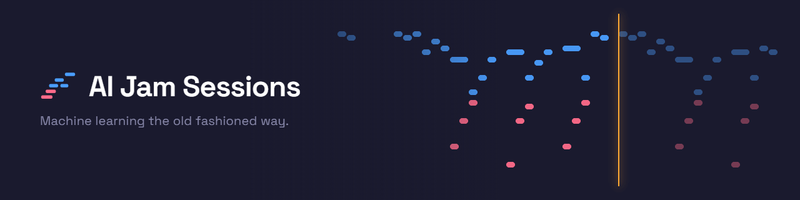
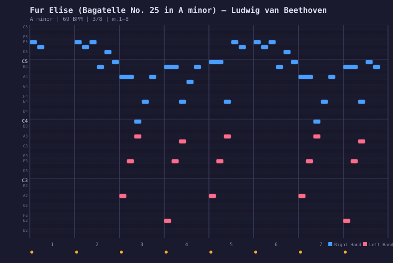
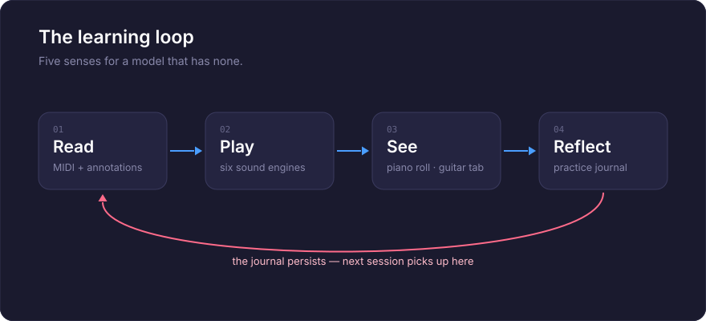

<p align="center">
  <a href="README.md">English</a> | <a href="README.zh.md">中文</a> | <a href="README.es.md">Español</a> | <a href="README.fr.md">Français</a> | <a href="README.hi.md">हिन्दी</a> | <a href="README.it.md">Italiano</a> | <a href="README.pt-BR.md">Português (BR)</a>
</p>

<p align="center">
  
</p>

<p align="center">
  <em>Machine Learning the Old Fashioned Way</em>
</p>

<p align="center">
  An MCP server that teaches AI to play piano and guitar — and sing.<br/>
  109 annotated songs across 12 genres. Six sound engines. Interactive guitar tablature.<br/>
  A browser cockpit with vocal synthesizer. A practice journal that remembers everything.
</p>

<p align="center">
  <a href="https://github.com/mcp-tool-shop-org/ai-jam-sessions/actions/workflows/ci.yml"></a>
  <a href="https://codecov.io/gh/mcp-tool-shop-org/ai-jam-sessions"></a>
  <a href="https://www.npmjs.com/package/@mcptoolshop/ai-jam-sessions"></a>
  <a href="https://github.com/mcp-tool-shop-org/ai-jam-sessions"></a>
  <a href="https://github.com/mcp-tool-shop-org/ai-jam-sessions"></a>
  <a href="datasets/jam-actions-v0-public/README.md"></a>
  <a href="https://doi.org/10.5281/zenodo.20279918"></a>
</p>

---

## まず聞いてください：3つの賛歌を、リズムに合わせて歌います

**[アメイジング・グレイス、美しいアメリカ、共和国の戦いの歌](https://mcp-tool-shop-org.github.io/ai-jam-sessions/#listen)**。
各賛歌のために書かれたピアノ伴奏に合わせて、合成音声で各節を歌う。ランディングページでは、3Dの楽譜が音声と歌詞に合わせて表示され、歌詞が歌われると光る。

各演奏は、楽譜に基づいて調整されたボーカルの16テイクから構成されています。
- 各フレーズにつき1テイクで、ローカルのリスナーとピッチトラッカーによって選択されます。
- 時間調整を行い、楽譜上に配置することで、フレーズ内の部分が途切れることがありません。
- 2つのタイミング測定器と2つのピッチトラッカーによってチェックされます。
- 最終的に、聴覚による確認が行われ、問題があれば、その原因まで遡ってレビューに記録されます。

各曲の前に、音声チェックを行い、音声のタイミングの特性を測定し、その曲に必要なテイク数を決定します。

どのように作成されたか：[ハンドブック → ボーカル](https://mcp-tool-shop-org.github.io/ai-jam-sessions/handbook/vocals/)。

| | Amazing Grace | America the Beautiful | Battle Hymn |
|---|---|---|---|
| 楽譜から40ミリ秒以内の音節 | 107/112 | 217/224 | 285/414 |
| 50セント以内の音 | 135/140 | 218/224 | 368/424 |

Battle Hymnの速い付点音符は、歌手自身のタイミングで演奏されるため、タイミングのずれが生じやすい。

音声は合成音声：[SoulX-Singer](https://github.com/Soul-AILab/SoulX-Singer)（Apache-2.0）。独自の音色サンプルを持ち、実際の歌手を模倣していない。ピアノ伴奏は、このプロジェクトのためにKimi-K3が作曲し、パブリックドメインに提供する（CC0）。3つの賛歌はいずれもパブリックドメインである。

## これは何ですか？

AIが演奏を学習するピアノとギターです。シンセサイザーでも、MIDIライブラリでもありません。これは、AIに音楽を教えるための楽器です。

LLMはテキストを読み書きできますが、私たちが音楽を体験するのと同じようには体験できません。耳もなければ、指もなければ、筋肉の記憶もありません。AI Jam Sessionsは、モデルが実際に使用できる感覚を与えることで、このギャップを埋めます。

- **楽譜の読み取り** — 詳細な音楽注釈が付いた実際のMIDI楽譜。手書きの近似ではなく、解析、分析、説明を行う。
- **聴覚** — 6つのオーディオエンジン（オシレーターピアノ、サンプルピアノ、ボーカルサンプル、物理的なボーカルトラクト、加算型ボーカルシンセ、物理的にモデル化されたギター）がスピーカーを通して再生され、部屋にいる人々がAIの「耳」となる。そして今、このモデルは独自の「耳」を持つようになった。録音を後から評価できる（[リスニング](#試聴)を参照）し、音楽が流れている間（[ライブアンサンブル](#ライブアンサンブル)を参照）に演奏を観察できる。
- **視覚** — ピアノロールは、再生された内容をSVGとしてレンダリングし、モデルが読み込んで検証できる。インタラクティブなギタータブ譜エディター。視覚的なキーボード、デュアルモードのノートエディター、チューニングラボを備えたブラウザのコントロールパネル。
- **記憶** — セッション間で永続化される練習ジャーナル。これにより、学習が時間とともに蓄積される。
- **歌唱** — 20種類の音声プリセットを備えたボーカルトラクト合成。オペラ歌手からエレクトロニックコーラスまで。ソルフェージュ、音程、音節によるナレーションを備えた、一緒に歌えるモード。そして、ピアノのテンポに合わせて歌われる楽曲全体。楽曲の構成に基づいて、多くのテイクからフレーズごとに組み立てられ、タイミング（40ms）と音程（50セント）で調整された後、聴くことができる（[歌唱](#歌う)を参照）。

現在、109曲すべてに完全な注釈が加えられています。歴史的背景、小節ごとの構造分析、重要なポイント、教育目標、パフォーマンスのヒントなど、すべての12のジャンルについて。このREADMEの以前のバージョンでは、生の楽曲は「AIがパターンを吸収し、音楽を演奏し、独自の注釈を作成するのを待っている」と記載されていました。まさにそれが起こりました。注釈は、決定論的な楽曲ごとの分析（コード、反復構造、セクションの境界、コンテンツが検証されたキー）に基づいてAIによって作成され、品質基準によってゲート処理され、そして、主張ごとに反対意見による事実確認が行われました。測定番号、コードウィンドウ、構造カウントはすべて、実際のMIDIに対して検証された後に出力されました。

このプロジェクトから、**[jam-actions-v0](#トレーニングデータセット)** — 実際のクラシックピアノの57のマルチターンMCPツール使用のデータセットも公開する。これは、単なるテキスト生成ではなく、シンボリックな音楽における*具体的なツール使用*をLLMに教えるものであり、7軸のリリースゲートが付属しており、「証拠を伝える」ことと「タスクが些細であるために合格する」ことを区別する。詳細については、以下の[トレーニングデータセット](#トレーニングデータセット)を参照。

## 試聴

以前は、このサーバーは音を出すことはできましたが、分析することはできませんでした。モデルが演奏し、人がそれを聞き、モデルはその人の意見を尊重していました。しかし、そのギャップは今や解消されました。

WAVファイルを指定すると、その内容を測定します。楽譜に対して現在使用しているのと同じ種類のツールを使用して信号を処理することで、画像を見て推測するのではなく、測定を行います。

- **`analyze_audio`** — 音の開始点、音程の輪郭、レベル。音程は、セント単位のずれとともに、音名として返される。生の周波数としては返されない。レベルとは、BS.1770-4に準拠したLUFS単位の統合ラウドネス、dBFS単位のサンプルピーク、クリップされたサンプルの数、およびドロップアウトやノイズバーストを報告する整合性チェックである。これは、レンダリングの品質管理における「クリックとグリッチ」の側面である。バランスセクションでは、サブベースから高音域まで、各帯域のエネルギーがピンクノイズに対してどの程度であるか、明るさ、傾きを示す。
- **`transcribe_audio`** — 録音を音符として表現：音程、開始時間、持続時間、および各音符がコンサートピッチからどれだけ離れているか。
- **`score_audio_take`** — ライブラリ内の楽曲を**耳で**評価して、演奏の質を評価する。録音をトランスクライブし、楽譜と照合し、どの音符が正確に演奏され、どの音符がずれて演奏され、どの音符が演奏されなかったかを報告する。その後、`view_scored_piano_roll`がその結果を楽譜上に描画し、キャプチャされたMIDIテイクと同様に表示する。これにより、実際の楽器、歌唱テイク、またはMIDIをキャプチャできないものを評価できる。
- **`view_spectrogram`** — 音を視覚化する。ピアノのキーボードが左端に配置された定Qスペクトログラム。これにより、音程が一目でわかる。必要に応じて、楽曲の意図された音符がその上に描画される。
- **`check_loop_seam`** — ループ再生を評価する。波形のステップは、テイルの傾きを外挿した後、結合部にバースト状のエネルギー、およびシームにわたるレベルシフトを評価する。位相が完全に一致したループは、生の境界サンプルがジャンプしても、きれいに聞こえる。
- **`compare_balance`** — 既知の正しい参照に対して、レンダリングの音色をバンドごとにdBで評価する。キューは、他の音と同様に聞こえるはずであり、再レンダリングは、置き換えるテイクと一致するはずである。ラウドネスは相殺されるため、音色のみが比較される。

**このツールではわからないこと。** 画像は、*どこ*に問題があるかを見つけるためのものである。すべての数値は、信号処理から得られるものであり、モデルが画像を読み取って得られるものではない。トランスクライバーは一度に1行を処理するため、コードやフルミックスでは、確信を持って誤った結果が出力され、その旨も表示される。音の開始点の検出精度は、最先端技術で約F10.88であるため、「見逃された」音符は、実際に演奏されなかったのではなく、トランスクライバーが聞き取れなかったものである可能性がある。これらのツールは、その点に注意を払い、出力にその情報を表示する。

全体的な構造は、依存関係がありません。変換、ピッチトラッカー、発音検出器、WAVデコーダー、PNGエンコーダーはすべてこのリポジトリにあり、Nodeとブラウザの両方で同じ数値を生成します。

## ライブ・アンサンブル

試聴機能は、録音を完了した後に評価します。これは、その逆の機能です。演奏中に、各楽器が**現在**何をしているかを尋ねます。

```
ensemble_now()
```

各楽器の持続音、その持続時間、およびアンサンブル全体のコードを返します。デュエットの場合、2つの音声は個別に報告されるため、ピアノが三和音を保持し、シンセがその上にメロディーを演奏している様子を確認できます。

### 2つのチャンネルがあり、安価な方が正確です

これは理解しておくべき部分であり、どの数値を信頼するかを決定します。

**意図 - 各エンジンに演奏するように指示されたこと。**モデルが演奏する場合、これは推定ではありません。ピアノのコードは、トランスクライブするものではなく、送信された3つのノートオンです。ノートは正確で、自由で、即時です。

**音響 - 実際にどのような音が鳴ったか。**各エンジンは、出力をプライベートな分析バスに送ることができるため、すべての楽器は、分離や曖昧さなしに、ソースで測定されます。このチャンネルは、**発見ではなく検証**です。これにより、音声がタイミングからずれたり、録音が途切れたり、エンジンがノートを送信され続けているにもかかわらず沈黙したりしたことを知ることができます。

2つの結果が一致しない場合、それはレンダリングに関する事実であり、ノートの修正ではありません。

### コスト

楽器を監視するには、42.67msのブロックに対して、約**9マイクロ秒/オーディオコールバック**かかり、これはオーディオバジェットの約0.02%であり、サンプルが1つもドロップしていない状態で測定されます。オブザーバーがアタッチされていない楽器は、まったくコストがかかりません。

### ただし、以下のことはわかりません

音響チャンネルは遅れており、その遅延量を示します。約23ms（ピッチ）、および70ms（確認された発音）です。これは、その後のオーディオが到着するまで、発音を確認できないためです。そのエッジに近い発音は、報告されてから後で取り下げられるのではなく、保留されます。

音響トラッカーは一度に1行を追跡するため、コードのノートを特定することはできません。また、そうしようともしません。解決できないコードは、既知の制限であり、アンサンブルは、ピアノが演奏するすべてのコードで「狼少年」のように叫ぶのではなく、静かにします。

## ピアノロール

ピアノロールは、AIが音楽をどのように認識するかを示します。AIは、あらゆる曲をSVG形式でレンダリングします。右手の音は青色、左手の音はコーラル色で表示され、ビートグリッド、ダイナミクス、小節の境界線も表示されます。

<p align="center">
  
</p>

<p align="center"><em>Für Elise, measures 1–8 — the E5-D#5 trill in blue, bass accompaniment in coral</em></p>

2つのカラーモード：**手**（青/コーラル）または**ピッチクラス**（クロマティックレインボー - すべてのCは赤、すべてのF#はシアン）。SVG形式であるため、モデルは画像を視覚的に確認できるだけでなく、マークアップを読み込んでピッチ、リズム、および手の独立性を検証することもできます。

## コックピット

このリポジトリにあるブラウザベースの作曲スタジオ：[`apps/cockpit`](apps/cockpit)。また、**[mcp-tool-shop-org.github.io/ai-jam-sessions/cockpit](https://mcp-tool-shop-org.github.io/ai-jam-sessions/cockpit/)**でライブで実行できる。プラグイン、DAW、インストールは不要。すべてがブラウザ内に保存される（作業はローカルに自動保存される）。ハッキングしたい場合は？

```bash
cd apps/cockpit && npm install && npm run dev   # Vite dev server, opens in your browser
```

- **デフォルトではサンプリングされたコンサートグランドピアノ** — コックピットには、トリミングされたサラマンダーグランドパック（90個のOGGファイル、8MB）が同梱されており、初回起動時にロードされ、シンセサイザーのボイスと同じ出力チェーンを通じて再生されます。ロードされる前（またはオフライン時）には、調整されたオシレーターピアノがシームレスにカバーします。サンプルは[Alexander Holm](https://freepats.zenvoid.org/Piano/acoustic-grand-piano.html)によるもので、CC-BY 3.0です。
- **パネルモード — リスニングルーム** — 実際のライブラリのメロディーを基にした、作曲エンジンのボイシングのブラインドペアワイズA/Bオーディション：音量調整されたクリップを、実際のボイスパスを通じてオフラインでレンダリングし、隠された下限のトライアルを含む、シャッフルされたトライアルを生成し、ブートストラップ信頼区間を使用したブラッドリー・テリーランキングを行い、正直な結果を出力します（すべてのペアが投票予算に達するまで一時的な結果、識別閾値が失敗した場合は解釈不能）。2番目のサブモードでは、ローカルLLMジャッジを使用して同じランキングを実行し、さらに両方の実行タイプにわたる履歴と、比較ビュー（ケンダルτ + エンジンランクマッチ）を提供します。これは、安価なプロキシトラックが人間の真実をどれだけ追跡しているかを尋ねます。
- **正確なビートに同期したトランスポート** — ノートは音楽の時間軸に沿って再生されるため、BPMコントロールは実際に再生時間を調整します。ドラッグしてループ領域を設定できる、クリックしてシークするタイムルーラー。プレイヘッドを追跡する自動スクロール。
- **録音アームキャプチャ** — QWERTYキー、オン スクリーンキーボード、またはWeb MIDIデバイスを操作すると、スコアに記録されます。1小節のカウントイン、ループサイクル全体にわたるルーパースタイルのオーバーダビング（または置換モード）、量子化されたビューの下で生のパフォーマンスタイミングを保持し、各パスは1つの元に戻せる単位として扱われます。
- **完全な元に戻し/やり直し** — クリアやインポートを含むすべての編集は元に戻すことができます（Ctrl+Z）。ドラッグジェスチャーは、実際の編集ツールと同様に統合されます。
- **複数選択 + クリップボード** — 選択/描画ツールの切り替えの下で、長方形選択を実行します。プラットフォーム標準の修飾キークリック、プレイヘッドでのコピー/カット/ペースト、複製。
- **タッチ + アクセシビリティ** — すべてのサーフェスでキャプチャされたポインターイベント、ドラッグ以外の代替手段としてタップして再配置、キーボードによるノート編集、色覚異常でも識別しやすいスコアオーバーレイ。
- **デュアルモードピアノロール** — インストルメントモード（クロマチックピッチクラスの色）とボイスモード（母音の形によって色が付けられたノート：/a/ /e/ /i/ /o/ /u/）を切り替えます。
- **ビジュアルキーボード** — C4から2オクターブをマッピングし、QWERTYキーボードに割り当てます。クリックまたは入力します。
- **20個のボイスプリセット** — 15個のKokoroマッピングされたボイス（Aoede、Heart、Jessica、Sky、Eric、Fenrir、Liam、Onyx、Alice、Emma、Isabella、George、Lewis、および合唱とシンセボイス）、4個のトラクトマッピングされたボイス、および合成合唱セクション。
- **10個のインストルメントプリセット** — サーバー側の6つのピアノボイスに加えて、シンセパッド、オルガン、ベル、ストリングス。
- **ノートインスペクター** — 任意のノートをクリックして、ベロシティ、母音、ブレス音を編集します。
- **7つのチューニングシステム** — 平均律、純正律（長調/短調）、ピタゴラス音階、四分音平均律、ヴェルクマイスターIII、またはカスタムセントオフセット。調整可能なA4基準（392〜494 Hz）。
- **チューニング監査** — 周波数テーブル、ビート周波数分析を備えたインターバルトエスター、およびチューニングのエクスポート/インポート。
- **スコアのインポート/エクスポート** — スコア全体をJSONとしてシリアライズし、ロードします。
- **LLM対応API** — `window.__cockpit`は、`exportScore()`、`importScore()`、`addNote()`、`play()`、`stop()`、`panic()`、`setMode()`、および`getScore()`を公開するため、LLMはプログラム的に作曲、編曲、および再生できます。

## 学習ループ

<p align="center">
  
</p>

## 曲のライブラリ

12のジャンルにわたる109曲のアノテーション付き楽曲。実際のMIDIファイルから作成されています。各ジャンルには、歴史的背景、小節ごとのハーモニー分析、重要な瞬間、教育目標、およびパフォーマンスのヒント（ボーカルガイダンスを含む）を備えた、深くアノテーションされた模範曲が1つあります。これらの模範曲はテンプレートとして機能します。AIはまず1つを学習し、次に残りの曲にアノテーションを付けます。フォークの模範曲は、「アメリカの美しい」（Samuel A. Ward、1882年、パブリックドメイン）で、このリポジトリでアレンジされたF長調の賛美歌で、メロディーはF4–C5です。

**同梱されるものと、取得するもの。** アノテーションは当社のもので、すべての曲に同梱されています。MIDIファイルは、ライブラリが作成されたときに、パブリックMIDIサイトからダウンロードされました。ファイルごとの出所監査（[`docs/findings/library-provenance-audit.md`](docs/findings/library-provenance-audit.md)）の結果、再配布を許可するライセンスを持つダウンロードは14個のみであることがわかりました。これには、Bernd Kruegerのpiano-midi.deの編曲（CC-BY-SA-3.0-DE）と、Mutopia Projectのパブリックドメインのタイプセットが含まれます。これらの14個はnpmパッケージに含まれています。残りの94個のダウンロードは含まれていません。それらの`.json`は、ソース、その条件、およびファイルのSHA-256を記載した`provenance`ブロックとともに同梱され、`ai-jam-sessions library fetch --accept-source-terms`は各ファイルを、そのサイトの条件の下で、そのサイトからダウンロードし、アノテーションが検証されたものと一致しないハッシュ値を持つファイルを拒否します。名前が実際の曲と異なることが判明した12個のファイルは隔離されました。そのため、ダウンロードされたライブラリには108曲であり、以前のバージョンで主張されていた120曲ではありません。「アメリカの美しい」は109番目の曲であり、パッケージに同梱されている15番目のMIDIファイルです。このアレンジはここで作成され、パブリックドメインに寄贈されました。バージョン2.6.0より前のバージョンでは、すべての120個のMIDIファイルが同梱されていました。これは間違いであり、ここで修正され、後で修正されることはありません。

| ジャンル | 代表的な楽曲 | キー | 教える内容 |
|-------|----------|-----|-----------------|
| ブルース | 「The Thrill Is Gone」（B.B.キング） | Bマイナー | マイナーブルースの形式、コール＆レスポンス、ビートの後ろで演奏する |
| クラシック | 「エリーゼのために」（ベートーヴェン） | Aマイナー | ロンド形式、タッチの使い分け、ペダルの技術 |
| 映画 | 「Comptine d'un autre été」（ティエルセン） | Eマイナー | アルペジオのテクスチャ、和声の変化のないダイナミックなアーキテクチャ |
| フォーク | 「アメリカの美しい」（ワード） | F長調 | トニック-ドミナントの賛美歌のハーモニー、愛国的なフレーズ、メロディーはF4–C5 |
| ジャズ | 「Autumn Leaves」（コスマ） | Gマイナー | ii-V-Iの進行、ガイドトーン、スウィングの8分音符、ルートレスのボイシング |
| ラテン | 「The Girl from Ipanema」（ジョビン） | F長調 | ボサノバのリズム、クロマチックな転調、抑制されたボーカル |
| ニューエイジ | 「River Flows in You」（イルマ） | A長調 | I-V-vi-IVの認識、流れるようなアルペジオ、ルバート |
| ポップ | 「Imagine」（レノン） | C長調 | アルペジオの伴奏、抑制、真摯なボーカル |
| ラグタイム | 「The Entertainer」（ジョプリン） | C長調 | 「Oom-pah」のベース、シンコペーション、多小節形式、テンポの技術 |
| R&B | 「Superstition」（スティーヴィー・ワンダー） | Ebマイナー | 16分音符のファンク、打楽器のようなキーボード、ゴーストノート |
| ロック | 「Your Song」（エルトン・ジョン） | Eb長調 | ピアノバラードのボイスリーディング、転回形、会話のような歌い方 |
| ソウル | 「Lean on Me」（ビル・ウィザース） | C長調 | ダイアトニックなメロディー、ゴスペルの伴奏、コール＆レスポンス |

楽曲は、**生の**（MIDIのみ）→**アノテーション付き**→**準備完了**（音楽言語で完全に再生可能）へと進行します。AIは、楽曲を学習し、[`annotate_song`]を使用してアノテーションを作成することで、楽曲を促進します。

## サウンドエンジン

6つのエンジンと、任意の2つを同時に実行できるレイヤードコンビネーターがあります。

| エンジン | タイプ | どのような音が出るか |
|--------|------|---------------------|
| **Oscillator Piano** | 加算合成 | ハンマーノイズ、不協和性、ベロシティによって変化する明るさ、48ボイスのポリフォニー、ステレオイメージを持つ、多重ハーモニックピアノ。依存関係はありません。 |
| **Sample Piano** | サンプル再生 | サラマンダーグランドピアノ — 本物です。**パックがインストールされると、デフォルトのエンジンになります**（`samples/AccurateSalamander`または`AI_JAM_SAMPLES_DIR`）。npm tarballはサンプルを含まないため、[Salamander](https://freepats.zenvoid.org/Piano/acoustic-grand-piano.html)のダウンロードを提供する必要があります。ブラウザのコックピットには、独自のトリミングされた8MBのパック（90個のOGGファイル、CC-BY 3.0 Alexander Holm）が同梱されており、Web上ではまったくセットアップは必要ありません。 |
| **Vocal (Sample)** | ピッチシフトされたサンプル | ポルタメントとレガートモードを備えた、持続的な母音の音色。 |
| **Vocal Tract** | 物理モデル | ピンク・トロンボーン — LFの喉頭波形を44セルのデジタル波導管に通します。4つのプリセット：ソプラノ、アルト、テノール、バス。 |
| **Vocal Synth** | 加算合成 | 15個のKokoroボイスプリセット。フォルマントシェイピング、息遣い、ビブラートを備えています。決定論的（シードされた乱数ジェネレーター）。 |
| **Guitar** | 加算合成 | 物理的にモデリングされた弦楽器 — 4つのプリセット（スチール・ドレッドノート、ナイロン・クラシック、ジャズ・アーチトップ、12弦）、8つのチューニング、17個の調整可能なパラメーター。 |
| **Layered** | コンビネーター | 2つのエンジンをラップし、すべてのMIDIイベントを両方に送信します — ピアノ+シンセ、ボーカル+シンセなど。 |

### キーボードボイス

6つの調整可能なピアノボイス。それぞれ、明るさ、減衰、ハンマーの硬さ、デチューン、ステレオ幅など、パラメーターごとに調整できます。

| ボイス | 特徴 |
|-------|-----------|
| コンサートグランド | 豊かで、フルで、クラシック |
| アップライト | 暖かく、親密で、フォーク |
| エレクトリックピアノ | シルキーで、ジャジーで、フェンダー・ローズのような音色 |
| ホンキー・トンク | 音程がずれていて、ラグタイム調で、酒場の雰囲気 |
| オルゴール | クリスタルクリアで、幽玄な |
| 明るいグランドピアノ | 現代的で、ポップな、際立った音色 |

### ギターの音色

物理的なモデリングによる弦の合成を用いた、4つのギター音色プリセット。それぞれに17個の調整可能なパラメータ（明るさ、ボディの共鳴、ピッキング位置、弦の減衰など）があります。

| ボイス | 特徴 |
|-------|-----------|
| スティール・ドレッドノート | 明るく、バランスが良く、クラシックなアコースティックギター |
| ナイロン弦のクラシックギター | 暖かく、柔らかく、丸みのある音色 |
| ジャズ・アーチトップ | 穏やかで、木の質感があり、クリアな音色 |
| 12弦ギター | きらめきがあり、音が重なり、コーラスのような効果 |

## 練習日誌

各セッションの後、サーバーは、どの曲、どの速度、何小節、どれくらいの時間演奏したかを記録します。AIは、何に気づいたか、どのようなパターンを認識したか、次に何を試すべきかを自身の考察として追加します。

```markdown
---
### 14:32 — Autumn Leaves
**jazz** | intermediate | G minor | 69 BPM × 0.7 | 32/32 measures | 45s

The ii-V-I in bars 5-8 (Cm7-F7-BbMaj7) is the same gravity as the V-i
in The Thrill Is Gone, just in major. Blues and jazz share more than the
genre labels suggest.

Next: try at full speed. Compare the Ipanema bridge modulation with this.
---
```

1日に1つのマークダウンファイルとして、`~/.ai-jam-sessions/journal/`に保存されます。人間が読める形式で、追記のみが可能です。次のセッションでは、AIはその日誌を読み、中断したところから再開します。

## トレーニングデータセット

**jam-actions-v0** — クラシックピアノMIDIを基にした、複数ターンのMCPツール使用のトレースのパブリックデータセット。このサーバーが使用するのと同じライブラリから作成されており、データセットはLLMに、**シンボリック音楽に対するグラウンデッドツール使用**を教えます。テキスト生成だけではありません。

各レコードは、4小節のフレーズウィンドウと、注釈付きのティーチングターゲット、および*ターゲットトレース*（アシスタントが上記のMCPツール（`get_events_in_measure`、`get_events_in_hand`、`count_distinct_pitch_classes`、およびその他の9つのMIDIインスペクターツール）を使用して、フレーズを読み、分析し、議論する、ターンごとのセッション）をペアにします。

| | |
|---|---|
| バージョン | **0.6.0（2026年9月25日）— 修正リリース**（以下を参照） |
| レコード | 57（公開サブセット）：トレーニング用45、ホールドアウトテスト用12（`clair-de-lune`） |
| 楽曲 | 4つのクラシックピアノ曲：バッハBWV 846、モーツァルトK. 545 I、ベートーヴェン「エリーゼのために」、ドビュッシー「月の光」 |
| MIDIソース | piano-midi.de — ベン・クルーガーによる編曲。各ファイルには、クルーガー自身の著作権表示が含まれています。 |
| ライセンス | CC-BY-SA-3.0-DE（編曲）とパブリックドメインの楽曲 |
| 場所 | [`mcp-tool-shop/jam-actions-v0`](https://huggingface.co/datasets/mcp-tool-shop/jam-actions-v0) on Hugging Face and on Zenodo; DOIs and citation in the [dataset card](datasets/jam-actions-v0-public/README.md) and [`CITATION.cff`](datasets/jam-actions-v0-public/CITATION.cff) |

**0.6.0の修正。** 0.4.xおよび0.5.xのバージョンには、合計8つの作品にわたる115件のレコードが含まれており、すべてベアト・クルーガーによるものとされています。この帰属は、ファイルではなく、piano-midi.deの作曲家ページと照合されました。MIDIバイトから楽曲ライブラリを監査したところ、ショパンのノクターン第9番第2番とプレリュード第28番第4番、ベートーヴェンの「悲愴」第2楽章、シューマンの「トロイメライ」の4曲が、midiworld.comとbitmidi.comから入手したファイルに基づいて作成されたことが判明し、確立された編曲ライセンスは存在しませんでした。これらの4曲の58件のレコードには、その編曲が音符ごと含まれているため、0.6.0ではこれらの曲を削除します。残りの57件のレコードは、0.5.0とバイトレベルで同一です。以前のバージョンから削除されたレコードを再配布しないでください。詳細については、[`docs/findings/published-dataset-licence-audit.md`](docs/findings/published-dataset-licence-audit.md)をご覧ください。

**エビデンスゲート。**パッケージャーは、各楽曲のライブラリのプロビナンスブロックをMIDIバイトから再導出し、再読み込みし、再配布可能な編曲ライセンスがない楽曲、またはソースファイルのハッシュがエビデンスのあるファイルと異なるレコードを拒否します。安全側に倒して動作します。テストは、コミットされた公開パッケージごとに同じチェックを再実行するため、後続のプロビナンスの変更は、公開されたセット自体でビルドを赤色にします。

**品質ストーリー—7軸リリースゲート。**データセットのリリースゲートは、エビデンスに基づいた合格と、上限に達した合格を区別します。軸1〜6はブロック（絶対的な下限、マージンコンパウンド、ツール使用率、ツール使用後の修正、誤解の数、下限）であり、軸7はエンリッチド対非エンリッチドのレポートです。記録された結果は、0.4.xと0.5.xの115レコードの構成に対して測定され、タグ`jam-actions-v0-0.5.0-cut-2026-07-11`から再現可能です。0.6.0では再測定されていません。

**再現性。** どのプラットフォーム（Windowsネイティブ、macOS、Linux、WSL）でも、新しいコントリビューターがパッケージを検証し、再ビルドできます。

```bash
git clone https://github.com/mcp-tool-shop-org/ai-jam-sessions.git
cd ai-jam-sessions && pnpm install
pnpm exec tsx scripts/verify-public-package-checksums.ts                        # every file accounted for
pnpm exec tsx scripts/package-jam-actions-public.ts --today 2026-09-25 --dry-run # evidence gate runs first
pnpm build && pnpm exec tsx scripts/verify-public-package-execution.ts
# → "VERDICT: PASS" — every frozen tool call replays live (needs an audio device)
```

`.gitattributes`は、LFの行末を`*.sha256`と公開データセットツリーに固定し、チェックサム検証がすべてのプラットフォームで機能するようにします。

**ファインチューニングの履歴。** データセットの主張は、事前に登録されたファインチューニングでテストされ、固定されたベースラインに対してスコアリングされました。**v0**（78件のジャムトレースのみ）は、正直な否定結果を返しました（[レポート](docs/finetune-arc-eval-report.md））。**v1**は、ツールベースのQAを0.202ポイント改善しましたが、事前に登録された目標値に1つのペアで到達できませんでした（[レポート](docs/finetune-arc-v1-eval-report.md））。**B-1**は、36件のレコードのコホートで、凍結されたv1アダプターを再テストしました。0.678 → 0.890、36件中29件でペアで勝利し、事前に登録された目標値である34件中24件を上回りました（[レポート](docs/finetune-arc-v2-b1-eval-report.md））。これらの測定値は、記録されたとおりに有効です。**アダプター自体は削除されました。** そのトレーニングデータには、削除された4曲のレコードが含まれているため、このデータセットの条件の下では提供できません。ライセンスがクリアされた素材のみでトレーニングされたアダプターは、`jam-actions-v1`データセットとともに公開されます。

> MIDIの編曲は、ベアト・クルーガー（piano-midi.de）によるもので、CC-BY-SA-3.0-DEのライセンスが適用されています。注釈、トレース、および評価アーティファクトは、AI Jam Sessionsチームによって作成され、同じライセンスの下でリリースされるため、共有ライセンスのチェーンが最初から最後まで維持されます。**ライセンスの境界線：** リポジトリのMITライセンスは、コードを対象としています。`datasets/`の下にあるものはすべて、CC-BY-SA-3.0-DEです。`datasets/jam-actions-v0/`にある作業コーパスには、公開されていないレコードも含まれています。それは、出所が確認されなかった2つの作品（サティのジムノペディ第1番、ドビュッシーのアラベスク第1番）と、0.6.0で削除された4つの作品です。詳細については、[`datasets/jam-actions-v0/PROVENANCE-NOTE.md`](datasets/jam-actions-v0/PROVENANCE-NOTE.md)をご覧ください。

### 音響コーパス

**jam-actions-acoustic-v0** — 上記のトレースに対応するもので、シンボリック音楽ではなく、**オーディオ**を対象としています。72件のレコードがあり、それぞれが、公開ドメインのフレーズの意図的に変更された合成レンダリングと、分析ツールが実際に返す結果をペアにしています。そのため、すべてのラベルは、それ自体だけでなく、楽器に対して検証されます。

| | |
|---|---|
| バージョン | 1.1.0（2026年9月25日）— 1.0.xの36件の「Träumerei」レコードを削除しました。これらのレコードのソースファイルには、確立された編曲ライセンスがありません。 |
| レコード | 72 — 2つのフレーズ（バッハ、エリーゼのために）× 9種類の摂動 × 4つのターゲットノート |
| 除外 | **フレーズ**（エリーゼのために）ごとであり、記録ごとではないため、同じメロディーのわずかに異なるバージョンが、データに漏れることはありません。 |
| クラス | 一致、ピッチの失敗/警告、タイミングの失敗/合格、見逃し、追加、調和のとれたビブラート、評価する必要のない沈黙 |
| オーディオ | 配布されるレコードはありません。各レコードには、決定的なレシピと、生成される波形のSHA-256が含まれています。 |
| スキーマ | `jam-actions-acoustic-v0/1.0.0` |

9つのクラスのうち2つは、単純なモデルが自信を持って誤った回答をするため存在します。1つは、正しい評価が「調和のとれた」であるビブラートノート、もう1つは、正しい評価が「評価する必要がない」である沈黙です。評価の基礎となるすべての閾値は、記録にコピーされます。これは、両方がビルド中に1回変更されたためです。

このリポジトリからコーパスを再現できます。これを再生成すると、公開されているすべての79個のファイルと、バイト単位で同一の`checksums.sha256`が生成されます。また、テストによって、公開されたツリーを書き込まずに、それが正確であることを確認します。

**測定された、仮定されたものではない、1つの注意点。** 各レコードには、そのレシピが生成する波形のハッシュである`wav_sha256`が含まれており、レンダラーはサンプルごとに`Math.pow`と`Math.sin`を1回呼び出します。どちらも正しく丸められる必要はなく、V8の結果はNode 22とNode 24の間で変化しました。元のコーパスで評価された27,869個の異なる`Math.pow(2, x)`引数のうち、253個は異なるdouble値を返します。そのほとんどは16ビット量子化の下で消えますが、**72件のレコードのうち2件** — Für Eliseの`extra`摂動（そのモチーフは、半音の比率自体が異なるピッチにあります） — は、Node 24で異なるハッシュ値を持ちます。すべてのレコードの他のすべてのフィールドは、どのエンジンでも再現され、リポジトリは両方の主張を個別にテストします。再レンダリングして、これらの2つの不一致が発生した場合、それはこれであり、破損したダウンロードではありません。波形をビットポータブルにするには、超越関数を置き換える必要があります。これにより、すべてのハッシュが変更されるため、新しいスキーマバージョンが必要です。

### 独自のものを構築する

このコーパスが実行されるためのスキャフォールディングは、独自の実験に使用できます。
[`experiments/_template/`](experiments/_template/)は、コピーできる作業例です。タスクを宣言すると、SFT形式、クラスごとのスコアリング、宣言された検証セットに対する単純なベースライン、および分割をまたがないホールドアウトユニットのチェックが得られます。

[契約](experiments/_template/README.md)は、読む価値のある部分です。正解は、手書きではなく、構築可能であり、ラベルはツールが測定する内容に対して検証され、リークするユニットで分割し、ベースラインとベースモデルを結果とともに報告します。これらのルールそれぞれには、学習するためのコストがかかります。

## インストール

```bash
npm install -g @mcptoolshop/ai-jam-sessions
```

**Node.js 22+**が必要です（v2.0.0は、`node-web-audio-api` 2.0で下限を引き上げました）。MIDIドライバ、仮想ポート、外部ソフトウェアは必要ありません。

### Claude Desktop / Claude Code

```json
{
  "mcpServers": {
    "ai_jam_sessions": {
      "command": "npx",
      "args": ["-y", "-p", "@mcptoolshop/ai-jam-sessions", "ai-jam-sessions-mcp"]
    }
  }
}
```

### Docker

すべてのリリースでは、MCPサーバーをstdioで実行する、軽量なイメージである`ghcr.io/mcp-tool-shop-org/ai-jam-sessions`も公開されます。知っておくべきことは、`/data`がメモリであるということです。ジャーナル、サーバーの状態、ユーザーの曲、および取得されたMIDIはすべてそこに保存されるため、ボリュームをマウントするか、コンテナが終了します。

```json
{
  "mcpServers": {
    "ai_jam_sessions": {
      "command": "docker",
      "args": ["run", "--rm", "-i", "-v", "ai-jam-data:/data", "ghcr.io/mcp-tool-shop-org/ai-jam-sessions"]
    }
  }
}
```

イメージには、再配布可能な14個のMIDIファイルが含まれています。`library fetch --accept-source-terms`をコンテナ内で1回実行すると、残りの94個がボリュームに配置されます。`docker compose up`は、名前付きボリュームを使用して同じことを行い、`--profile ollama`はOllamaサイドカーを追加します。詳細、イメージ内のCLI、および意図的に含まれていないものについては、[docs/docker.md](docs/docker.md)をご覧ください。ファインチューニングされたグレーダーをOllamaで実行し、4ビットベースの測定コストを考慮すると、[docs/ollama-adapters.md](docs/ollama-adapters.md)をご覧ください。

## MCPツール

8つのカテゴリにまたがる56個のツールと4つのプロンプトテンプレート

### 学習

| ツール | そのツールの機能 |
|------|--------------|
| `list_songs` | ジャンル、難易度、またはキーワードで検索 |
| `song_info` | 完全な音楽分析 — 構造、重要な部分、教育目標、スタイルに関するヒント |
| `registry_stats` | ライブラリ全体の統計 — 合計曲数、ジャンル、難易度 |
| `list_measures` | 各小節の音符、ダイナミクス、および教育に関する注釈 |
| `teaching_note` | 単一の小節の詳細 — 指づけ、ダイナミクス、コンテキスト |
| `suggest_song` | ジャンル、難易度、および再生した曲に基づいて推奨 |
| `practice_setup` | 推奨される速度、モード、ボイス設定、および曲のCLIコマンド |
| `compare_songs` | クロスジャンルのパターン認識 — 主要な関係、ピッチ/インターバルの類似性、共有された形式、教育上のつながり |
| `annotation_progress` | ライブラリ全体の注釈の品質を追跡 — スコア、評価、および改善の提案 |
| `server_info` | サーバーバージョン、ライブラリ統計、エンジンリスト、アクティブなセッション |

### 再生

| ツール | そのツールの機能 |
|------|--------------|
| `play_song` | スピーカーから再生 — ライブラリの曲または生の.midファイル。4つのエンジン（ピアノ、ボーカル、トラクト、ギター）、任意の速度、モード、小節範囲 — さらに、導入部とカウントインを備えたメトロノームと、セッションをキャプチャしてスコアリングするための`record`フラグがあります。シンセサイザーとレイヤードエンジンは、CLIでのみ使用できます。 |
| `stop_playback` | 停止 |
| `pause_playback` | 一時停止または再開 |
| `set_speed` | 再生中に速度を変更（0.1倍〜4.0倍） |
| `playback_status` | リアルタイムのスナップショット — 現在の小節、テンポ、速度、キーボードのボイス、状態 |
| `view_piano_roll` | SVGとしてレンダリング（手の色またはピッチクラスのクロマティックレインボー） |
| `score_performance` | MIDIの伴奏をスコアリング — ピッチの正確さ、タイミング、完全性、および段階的なフィードバック |
| `mute_hand` | 練習中に左手/右手の音をミュートまたはミュート解除 — 一度に片方の手だけを分離 |
| `detect_chord` | 現在鳴っているMIDIノートのセットからコード名を指定（例：`[60,64,67]` → C） |
| `preview_teaching_cues` | 再生する前に、すべての教育に関する注釈と重要な部分を確認 |

### 練習

| ツール | そのツールの機能 |
|------|--------------|
| `practice_loop` | 実際の教師が割り当てる練習：小節5〜8を遅くループし、テンポは*クリアな*演奏の後でのみ（+ 5％）上昇します。各演奏は記録、スコアリング、および要約されます。 |
| `practice_status` | 練習の進捗状況：現在のパス、速度、および最後のテイクの小節ごとの診断 |
| `score_last_take` | 最近記録されたテイクをスコアリング — ピッチの正確さ、タイミング、完全性、ノートごとの結果 |
| `view_scored_piano_roll` | すべての教師が使用する採点システム：各音符に対して色覚に配慮したパレットで評価を重ねて表示したピアノロール（実線＝正、破線＝タイミング、✕＝ミス） |

### 歌う

| ツール | そのツールの機能 |
|------|--------------|
| `sing_along` | 歌えるテキスト — 音名、ソルフージュ、旋律、または歌詞。ピアノ伴奏の有無。 |
| `ai_jam_sessions` | 即興演奏の概要を生成 — コード進行、メロディーの概要、および再解釈のためのスタイルヒント |
| `verify_harmony` | メーカーループの検証ゲート：提案されたコードの再構成は、プラットフォーム独自の決定論的ツールによってチェックされる — コードの忠実性（コードエンジンは、意図されたすべてのコードを検出する必要がある）、メロディーの調和（音／緊張感／半音階）、ベースのボイスリーディング、キーの適合性 |
| `auto_reharmonize` | 1回の呼び出しで完了するメーカーループ：ローカルモデルがコードの再構成を提案し、`verify_harmony`の決定論的ゲートがすべてのボイシングをチェックし、検証された解釈が得られるまで、n個の中から最適なものを選択する |
| `compose_panel` | 任意の曲に対して、ボイスリーディングの作曲パネルを実行：4つのシステムが伴奏を作成し、クロスファミリーのLLMがそれらを評価し、ブラッドリー・テリー法で集計 — 解釈不可能な演奏を無効にする識別閾値ゲート（方向性のある信号のみ、品質スコアはなし）。数分間実行し、進行状況をストリーミングで通知する。 |

**曲全体を時計に合わせて：ボーカルのルート。** どんな曲でも、実際に歌われたボーカルをピアノに合わせることができます。
- **時計。** スコア・クロック（`scripts/build-score-clock.mjs`）は、曲の構成に基づいて、各音節の音高、開始タイミング、持続時間を、プレイヤー自身のタイムライン上で決定します。
- **サウンドチェック。** 曲がレンダリングされる前に、同じ声で16語のキャリブレーションフレーズを曲のテンポ（`scripts/soundcheck.py`）で歌います。そのタイミングのパターン（子音グループごと、および短い音符に対して保持される音符ごと）は、曲に必要なテイク数と、どの単語が危険であるかを判断します。GPU時間を曲自体に費やす前に。
- **歌手。** スコアに基づいて調整された歌手（[SoulX-Singer](https://github.com/Soul-AILab/SoulX-Singer)、Apache-2.0）は、そのクロックから16テイクをレンダリングし、ローカルまたはオフリッグを通じてレンタルされたGPU上で実行します。
- **選択。** `scripts/sing_clock.py --by-phrase --warp`は、フレーズごとに1つのテイクを選択します。ローカルのリスナーのトランスクリプトとFCPEの音高が決定し、フレーズはスコアに合わせて時間調整されます。
- **ゲート。** **タイミング：** エネルギー検出器と、歌唱強制アライメントによってクロスチェックされたものが、すべての母音を40ms以内に収めます。**音高：** FCPEが、pYINがフラグを立てたものを再確認し、すべての音符を50セント以内に収めます。
- **耳。** リスニングレビュー（`scripts/review_marks.py`）では、どこかで音が悪いと感じた場合に、カテゴリとメモとともに「M」を押すことができます。レポートは、各マークをそのテイク、結合、およびゲートに追跡し、レビュー担当者のレベルで重み付けします。リスナーの耳は、*どこ*で音が悪いかを判断し、*何*が問題なのかを特定することは、トレーニングによってより重要になります。これは、ローカルのリスニングページとして、およびコックピット内のレビューモードとして実行され、保存されたセッションと、すべてのクリップに対して1つのラウドネスが設定されます。ルート、レバー、およびレシート：[ハンドブック → ボーカル](https://mcp-tool-shop-org.github.io/ai-jam-sessions/handbook/vocals/)、[`docs/vocal-clock.md`](docs/vocal-clock.md）。選択の根拠となる研究：[`docs/vocal-singing-study-2026-09.md`](docs/vocal-singing-study-2026-09.md)。

### ギター

| ツール | そのツールの機能 |
|------|--------------|
| `view_guitar_tab` | インタラクティブなギタータブ譜をHTMLとしてレンダリング — クリックして編集、再生カーソル、キーボードショートカット |
| `list_guitar_voices` | 利用可能なギターボイスプリセット |
| `list_guitar_tunings` | 利用可能なギターチューニングシステム（スタンダード、ドロップD、オープンG、DADGADなど） |
| `tune_guitar` | 任意のギターボイスの任意のパラメーターを調整。セッション間で保持される。 |
| `get_guitar_config` | 現在のギターボイス構成とファクトリーデフォルト |
| `reset_guitar` | ギターボイスをファクトリーリセット |

### ビルド

| ツール | そのツールの機能 |
|------|--------------|
| `add_song` | JSON形式で新しい曲を追加 |
| `import_midi` | メタデータを含む.midファイルをインポート |
| `annotate_song` | 生の曲の音楽言語を作成し、準備完了の状態にする |
| `save_practice_note` | 自動的にセッションデータをキャプチャしたジャーナルエントリ |
| `read_practice_journal` | コンテキストのために最近のエントリをロード |
| `list_keyboards` | 利用可能なキーボードボイス |
| `tune_keyboard` | 任意のキーボードボイスの任意のパラメーターを調整。セッション間で保持される。 |
| `get_keyboard_config` | 現在の構成とファクトリーデフォルト |
| `reset_keyboard` | キーボードボイスをファクトリーリセット |
| `score_annotation` | 採点アノテーションの品質（5つの次元：完全性、深さ、具体性、教育的価値、語彙） |
| `validate_song_entry` | 曲をJSONとして追加する前に、スキーマに対して検証 |
| `transpose_song` | 曲を半音単位で上下に転調 — 新しいキー、新しい音符 |
| `list_sections` | 曲の構造セクションを表示（イントロ、ヴァース、コーラスなど） |
| `add_section` | 構造的なナビゲーションのために、曲にセクションマーカーを追加 |

### スコア

| ツール | そのツールの機能 |
|------|--------------|
| `score_performance` | ライブラリに登録されている曲に合わせて、MIDIの演奏を評価します。評価項目は、音程、タイミング、完成度であり、段階的なフィードバックが提供されます。 |
| `score_annotation` | 5つの側面からアノテーションの品質を評価します。 |

### 再生

録音されたオーディオを測定します。単音の場合、一度に1つの音符を追跡するため、コードや完全なミックスでは、確実な誤った結果が生じます。すべての数値は、信号処理から得られ、モデルが画像から読み取ることはありません。

| ツール | そのツールの機能 |
|------|--------------|
| `analyze_audio` | WAVファイルを測定します。開始タイミング、音高の輪郭を音名とセントで表示、レベル（BS.1770-4 LUFS、ピークdBFS、クリップされたサンプル）、バンドごとのスペクトルバランス、および整合性チェック（ドロップアウト、ノイズバースト、クリック）。 |
| `transcribe_audio` | 単音の録音を音符に変換し、各音符が基準となる音程からどれだけずれているかを表示します。トラッカーが追跡できなかった音符は、推測するのではなく、省略されます。 |
| `score_audio_take` | ライブラリに登録されている曲と比較して、演奏を**耳で**評価し、その結果を`view_scored_piano_roll`に渡します。 |
| `view_spectrogram` | 音を視覚化します。ピアノのキーボードを軸とした定Qスペクトログラムを、必要に応じて意図された音符と重ねて表示します。デフォルトでは、視覚的な情報が非表示になります。 |
| `check_loop_seam` | ループの終点が開始点にどのように戻るかを判断 — 外挿された波形のステップ、結合におけるバーストエネルギー、それを通じたレベルの変化 |
| `compare_balance` | レンダリングされた画像のトーンバランスを、基準画像と比較します。比較は、dBで、帯ごとに、明るさの変化と傾きを考慮して行います。音量は相殺されます。 |
| `ensemble_now` | 各楽器が**現在**演奏している音を、演奏中に表示します。音符は送信されたものから取得されるため、推定値ではなく正確な値が表示されます。 |

### MCPプロンプト

構造化された教育ワークフローのための4つのプロンプトテンプレート：

| プロンプト | そのツールの機能 |
|--------|--------------|
| `annotate_song` | ガイド付きのアノテーションワークフロー — 模範を研究し、生の曲の音楽言語を作成する |
| `practice_plan` | ジャンル、難易度、および目標に基づいて、構造化された練習計画を作成する |
| `performance_review` | 完了したセッションをレビュー — 何がうまくいったか、次に何に焦点を当てるか |
| `maker_loop` | 完全なメーカーループを実行 — コードの再構成を提案し、プラットフォームの決定論的ツールで検証し、次に検証された結果を追加して再生する |

## CLI

```
ai-jam-sessions list [--genre <genre>] [--difficulty <level>]
ai-jam-sessions play <song-id> [--speed <mult>] [--mode <mode>] [--engine <piano|vocal|tract|synth|guitar|piano+synth|guitar+synth>] [--metronome] [--count-in <bars>] [--record]
ai-jam-sessions practice <song-id> --measures <start-end> [--start-speed <pct>] [--target <pct>] [--step <pct>]
ai-jam-sessions sing <song-id> [--with-piano] [--engine <engine>]
ai-jam-sessions view <song-id> [--measures <start-end>] [--out <file.svg>]
ai-jam-sessions view-guitar <song-id> [--measures <start-end>] [--tuning <tuning>]
ai-jam-sessions info <song-id>
ai-jam-sessions tune <keyboard-id> [--param value ...] [--reset] [--show]
ai-jam-sessions tune-guitar <voice-id> [--param value ...] [--reset] [--show]
ai-jam-sessions keyboards
ai-jam-sessions guitars
ai-jam-sessions stats
ai-jam-sessions library
ai-jam-sessions ports
ai-jam-sessions help
ai-jam-sessions --version
```

## ステータス

**v2.9.0：実際のピアノ伴奏に合わせた3つの賛美歌。** アメイジング・グレイス、アメリカ・ザ・ビューティフル、バトル・ヒムン・オブ・ザ・リパブリックは、それぞれの賛美歌のために書かれたピアノ伴奏に合わせて歌われ、それぞれが独自のテンポと構成を持ち、フレーズの終わりが休符に繋がります。ボイスゲートがデフォルトで実行されるようになり、バトル・ヒムンでほぼ無音の音節を検出し、再公開される際に修正されました。コックピットにリスニングレビューモードが追加されました。詳細については、[CHANGELOG](CHANGELOG.md)を参照してください。

**v2.8.0：2つの賛美歌を歌う。** アメイジング・グレイスとアメリカ・ザ・ビューティフルは、すべての節を歌い、ピアノのクロックに合わせて演奏されます。16テイク、フレーズごとに1テイク、時間調整の配置、2つの楽器のタイミングと音高のゲート、そして最後に人がリスニングします。どちらも耳で確認され、[ランディングページ](https://mcp-tool-shop-org.github.io/ai-jam-sessions/)で紹介されます。ライブラリの「アメリカ・ザ・ビューティフル」は、現在、ワード自身の「マテルナ」のメロディーです。詳細については、[CHANGELOG](CHANGELOG.md)を参照してください。

**v2.7.0 — アメリカ・ザ・ビューティフル。** ライブラリには、注釈付きの曲が109曲あります。15個のMIDIファイルが同梱され、94個はまだそれぞれのソースから取得されます。新しい曲は、このリポジトリで作成されたパブリックドメインの伴奏（メロディーはサミュエル・A・ワードによる、1882年）で、F長調で、民謡の模範です。SoulX-Singerのルートで歌います。タイミングと音高のゲートが通過し、ランディングページには3つの音高警告が残ります。詳細については、[CHANGELOG](CHANGELOG.md)を参照してください。

**v2.6.0 — 著作権のないものを配布しなくなったリリース**（[CHANGELOG](CHANGELOG.md)を参照）。
曲のライブラリのファイルごとの来歴監査により、108個のMIDI伴奏のうち、14個は再配布を許可するライセンスを持ち、94個は持っていないことがわかりました。また、12個のファイルは、ファイル名とは異なる曲でした。現在、すべての曲には、証拠に基づいた`provenance`ブロック（ソースURL、サイトの利用規約、編曲者がファイルの著作権イベントとして名前を記載、SHA-256、タイトルに関する判断）が含まれています。12個のファイルは隔離され、npmパッケージには14個のファイルが含まれ、残りのファイルは「未取得」とマークされ、`ai-jam-sessions library fetch --accept-source-terms`がそれぞれのサイトから、そのサイトの利用規約に基づいて、ハッシュ値が一致しないファイルは拒否してダウンロードします。以前のバージョンでは、すべての120個のファイルが同梱されており、npmでは非推奨となっています。同じ監査により、検証された伴奏を持つ11曲に、jam-actions-v1データセットがリセットされました（3つのクルーガーCC-BY-SA-3.0-DE、8つのムトピア・パブリックドメイン）。コーパス、ニアゲートプローブ、および表示された作品のターゲットを見つけたトレーニングアークは、3Bランク16のLoRAで、クラスが54/54のホールドアウトと72/72のニアゲートから、レシピが変更されずに1つに収束しました。これらは、リポジトリ内の`datasets/`と`experiments/coverage-v1-sft/`にあり、検証されたコーパスからのHugging FaceとZenodoへの公開は、今後行われます。また、このリリースでは、`scorePerformance`が呼び出し側のゲートで正しいウィンドウを制限するため、40msのハウスルールが正確に検証ウィンドウになります。

以前のv2.5.0のリリースでは、モデルがバンドの演奏を「聞く」ことができるようになりました。
`ensemble_now`は、音楽が流れている間に、各楽器が何をしているかを報告します。具体的には、各楽器の持続音、その持続時間、および複合コードです。これは2つのチャンネルで実行され、安価なものが正確です。このサーバーが実行されると、送信した内容を正確に把握しているため、コードは3つのノートオンとして表現され、トランスクリプションの問題ではありません。一方、別の音響タップが、各エンジンを**ソース**で測定し、検証を行います。測定されたコストは約**1回のオーディオコールバックあたり9マイクロ秒**です。レイテンシーは、明示的にではなく、示唆されています（〜23msのピッチ、〜70msの確認された発音）。制限は文書化されており、これは実行可能なためです。トラッカーはモノフォニックであり、レイヤー化された子要素は個別にタップされ、ミックスとしては扱われません。また、タップがない楽器は、無音の楽器ではありません。
同じリリースでは、データセットの仕組みが、誰でも宣言できる契約に変わりました。作業済みのテンプレートが用意されているため、ユーザーは独自のコーパスを構築し、同じ基準で独自のアダプターをトレーニングできます。その過程で、音響コーパスの再現性の検証ゲートが、公開されている115のパスのうち109をカバーすることがわかりました。残りの6つのうち3つは、ジェネレーターによってまったく出力されませんでした。削除されたものを再生成すると、すべてのファイルとチェックサムマニフェストがバイト単位で完全に再現されます。ライブ環境には、**54のツールと4つのプロンプトテンプレート**があり、**165のファイルで3,389のテストが合格しました（1つスキップ）**。

以前のv2.4.0のリリースでは、モデルに「耳」が備わりました。4つのツールが、オーディオのレンダリングと分析の間のギャップを埋めました。具体的には、`analyze_audio`は発音、ピッチの輪郭とレベル用、`transcribe_audio`はモノフォニック録音をノートとして用、`score_audio_take`は耳でパフォーマンスを評価し、既存のスコアリングされたピアノロールをそのまま使用、そして`view_spectrogram`は、一定のQ値、ピアノキーボード軸で音を視覚化します。これらはすべて、このリポジトリに記述された、依存関係のない信号処理です。独自のFFT、ウィンドウ、メル、一定のQ値変換、発音検出、ピッチ追跡などです。モデルが画像を信頼して目で判断することはできず、決定論的なクエリは、正確な答えが必要な質問に対して推論よりも優れているためです。このリリースでは、**jam-actions-acoustic-v0**、つまり、オーディオに対するツールの使用に関する108の構築可能な「ゴールド」レコードも公開されました。

以前のv2.3.0のリリースでは、楽器が時計に合わせて歌うことを学習しました（[CHANGELOG](CHANGELOG.md)を参照）。ライブラリ内の任意の曲は、ピアノに響く実際の歌のラインを持つことができます。**スコアクロック**は、曲のMIDIから、各音節のピッチ、発音、持続時間を、プレイヤー自身のタイムラインに基づいて導き出します。ローカルの、Apache-2.0ライセンスの、スコアに依存したシンガー（[SoulX-Singer](https://github.com/Soul-AILab/SoulX-Singer)）が、それに基づいて歌います。そして、2つのゲートが、何かがミックスとして扱われる前に、その結果を測定します。具体的には、タイミング（すべての母音がスコアから40ms以内）、ピッチ（すべてのノートが50セント以内）です。出荷された「Amazing Grace」の実行では、最悪のタイミングは6ms、グローバルピッチは-2.7セントであり、その結果はコミットされています。ランディングページには、正直な状態として表示されており、残りの1つの欠陥（オープニングのスプライス）も明記されています。その経路、そのレバー、および各選択の背後にある研究（5つの研究分野、引用）は、[ハンドブック](https://mcp-tool-shop-org.github.io/ai-jam-sessions/handbook/vocals/)と[`docs/`](docs/)に記載されています。ライブ環境は、**49のツールと4つのプロンプトテンプレート**で変更されておらず、**3,080のテストが合格しました（1つスキップ）**。さらに、ボーカル楽器自身のpytestスイートがあります。**公開状態：**公開済み — [`@mcptoolshop/ai-jam-sessions@2.3.0`](https://www.npmjs.com/package/@mcptoolshop/ai-jam-sessions)がnpmに公開され、その出所が証明されています。

以前のv2.2.0のリリースでは、楽器に実際の「耳」と「リスニングルーム」が備わりました。コックピットのデフォルトのピアノは、現在、**サンプリングされたコンサートグランドピアノ**です。これは、不要な要素が削除されたSalamanderパックであり、最初のジェスチャーでロードされ、準備が整うまでは調整されたオシレーターシンセに切り替わります。サーバーは、完全なパックがインストールされている場合に、自動的にサンプルエンジンを選択します。その上には、**コンポジションパネル**があります。これは、ブラインドで、音量調整されたA/Bリスニングルームであり、人間がコンポジションエンジンのボイシングを、理論的に妥当なアンカーと理論的に妥当でないアンカーに対してランク付けします（ブートストラップCIを使用したブラッドリー・テリー法、MUSHRAスタイルの識別閾値、PROVISIONALおよびUNINTERPRETABLEが、主要な結果として扱われます）。その横には、ローカルモデルパネルがあり、同じランク付けを、クロスファミリーのLLMジャッジを使用して実行します。また、比較ビュー（Kendall τ）があり、安価なプロキシが人間の真実を追跡しているかどうかを尋ねます。

同じリリースには、パネルに供給するコンポジションエンジン（`src/compose/`：名前付きのスタイルプリセットを持つ決定論的なボイスリーディングゲート、構成要素によるボイシング仕様、一度に1つのパートを改良するリファイナー）が含まれています。また、完全な健全性チェック（45件の問題が修正されました。セキュリティ通貨、人間味のある文字列、視覚的な修正を維持）も含まれています。サティとドビュッシーのライブラリのエントリは、領収書付きのMutopiaのパブリックドメインのバイトから再調達されました。また、見知らぬ人によるテストの強化も行われました。具体的には、記述的な検証エラー、構造化された`{code, message, hint}`エラーエンベロープ、キュレーションされたtarボール、長時間のツールの進行状況通知、CLIエラー文法などです。このリリースは、[`@mcptoolshop/ai-jam-sessions@2.2.0`](https://www.npmjs.com/package/@mcptoolshop/ai-jam-sessions)として、49のツール、4つのプロンプトテンプレート、および3,033のテストとともに出荷されました。

以前のv2.1.0のリリースでは、アナリストが**クリエイター**になりました。クリエイターのワークフローは、製品として提供されます。具体的には、あるモデルが、既存のライブラリにある楽曲のハーモニーを再構成することを提案し、プラットフォーム独自の決定論的なツールがそれを審査します。コード進行エンジンは、意図されたすべてのボイシング（`verify_harmony`）を確認し、すべてのメロディーノートが新しいハーモニーに対してラベル付けされ、検証された解釈のみが`add_song`→`play_song`→`view_piano_roll`に進みます。生成されたものは、構築によって検証されます。評価基準はなく、自己評価もありません。ジャムセッションの概要を作成するのと同じ`inferChord`が、審査員を務めます。そして、`maker_loop`のプロンプトテンプレートが、この一連のワークフロー全体をガイドします。

以前のv2.0.0のリリースでは、データセットがその有用性を証明しました。**重要な変更点：Node.jsの最低バージョンが22に**（`node-web-audio-api` 2.0）になりました。ツールの基本機能は変更されていません。引き続き、6つのサウンドエンジン、47のMCPツール、3つのプロンプトテンプレート、および**完全に注釈が付けられたライブラリ（12のジャンルにわたる120曲/120曲）**が含まれており、今回のリリースでは12の主要フィールドがコンテンツ検出キーに修正されました。学習ループはエンドツーエンドで閉じられています。メトロノームによるカウントイン→ライブ録音→音符ごとの採点→採点されたピアノロール→クリアな演奏後にテンポを徐々に上げる練習ループ、という流れです。ブラウザのインターフェースは、実際の作曲ツールとして機能します。ループ領域、録音開始、完全なアンドゥ/リドゥ、複数選択とクリップボード、タッチサポートを備え、[ウェブ上で利用可能](https://mcp-tool-shop-org.github.io/ai-jam-sessions/cockpit/)です。

また、**[jam-actions-v0](#トレーニングデータセット)**も公開されました。これは、クラシックピアノにおける複数ターンのMCPツールの使用履歴を記録した57件のデータセットです。7軸のリリースゲート、コールドスタート時の再現性、および完全なZenodo + CITATION.cffメタデータ（CC-BY-SA-3.0-DE）を備え、[Hugging Face](https://huggingface.co/datasets/mcp-tool-shop/jam-actions-v0)にミラーリングされています。さらに、**両方向のファインチューニングの結果**が含まれています。正直なネガティブな結果（v0）と、勝利の目標に1つだけ届かなかったものの、事前に登録されたルールに従ったポジティブな結果（v1）です。詳細については、[ファインチューニングの結果](#トレーニングデータセット)をご覧ください。このリリースでは、また、v1パイプラインの実行ゲートが、公開されたウィンドウがBWV 846の実際の62小節を超過したことを検出し、バッハの楽曲のソースデータを修正しました（作業セットの修正はr001/r002、誤りについては注記があります）。MCPサーバー、インターフェース、データセットパッケージ、評価ハーネス、リリースゲートバリデーター全体で2506件のテストに合格しました。MIDIデータはすべて含まれており、すべての楽曲を使用して学習できます。また、その学習データも一緒に提供されます。

## セキュリティとプライバシー

**アクセスされるデータ：** 楽曲ライブラリ（JSON + MIDI）、ユーザーの楽曲ディレクトリ（`~/.ai-jam-sessions/songs/`）、ギターのチューニング設定、練習日誌のエントリ、ローカルのオーディオ出力デバイス。

**変更されていないデータ（デフォルトのパス）：** MCPサーバーとCLIは、ネットワークへの接続を行わず、認証情報を読み取らず、ユーザーの楽曲ディレクトリ外のシステムファイルにもアクセスしません。テレメトリは収集または送信されません。同じパッケージに含まれる**（オプションの）データセット/評価ツール**（`scripts/run-llm-eval.ts`、プロベナンス検証ツール）は、唯一の例外です。明示的に実行した場合に限り、LLM APIに接続して（環境から`ANTHROPIC_API_KEY`を読み取りますが、保存することはありません）、プロベナンスURLを取得できます。`scripts/arrange-hymn.ts`は、賛歌のピアノアレンジを依頼する際に、実行時にOpenRouterを`OPENROUTER_API_KEY`とともに呼び出し、コストを記録します。サーバー、CLI、またはインストールの一部として実行されることはありません。

**権限：** MCPサーバーは、stdioトランスポートのみを使用します（HTTPは使用しません）。CLIは、ローカルファイルシステムとオーディオデバイスにアクセスします。完全なポリシーについては、[SECURITY.md](SECURITY.md)を参照してください。

## ライセンス

MIT
