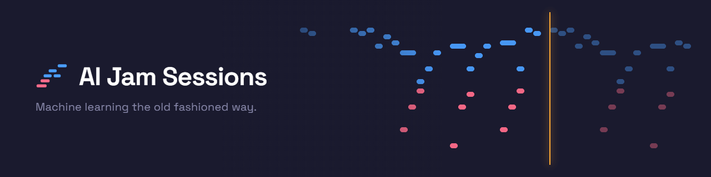
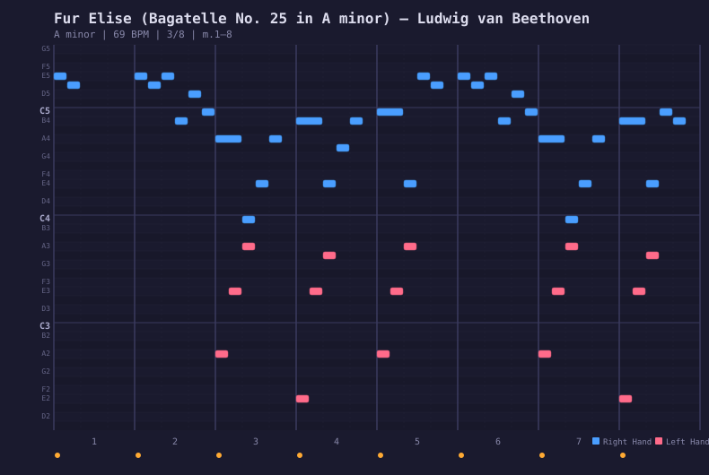
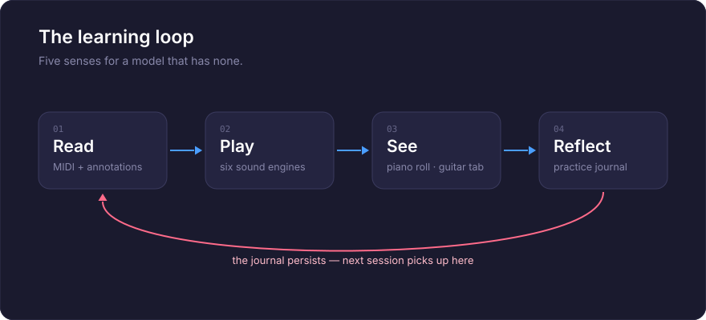

<p align="center">
  <a href="README.ja.md">日本語</a> | <a href="README.md">English</a> | <a href="README.es.md">Español</a> | <a href="README.fr.md">Français</a> | <a href="README.hi.md">हिन्दी</a> | <a href="README.it.md">Italiano</a> | <a href="README.pt-BR.md">Português (BR)</a>
</p>

<p align="center">
  
</p>

<p align="center">
  <em>Machine Learning the Old Fashioned Way</em>
</p>

<p align="center">
  An MCP server that teaches AI to play piano and guitar — and sing.<br/>
  109 annotated songs across 12 genres. Six sound engines. Interactive guitar tablature.<br/>
  A browser cockpit with vocal synthesizer. A practice journal that remembers everything.
</p>

<p align="center">
  <a href="https://github.com/mcp-tool-shop-org/ai-jam-sessions/actions/workflows/ci.yml"></a>
  <a href="https://codecov.io/gh/mcp-tool-shop-org/ai-jam-sessions"></a>
  <a href="https://www.npmjs.com/package/@mcptoolshop/ai-jam-sessions"></a>
  <a href="https://github.com/mcp-tool-shop-org/ai-jam-sessions"></a>
  <a href="https://github.com/mcp-tool-shop-org/ai-jam-sessions"></a>
  <a href="datasets/jam-actions-v0-public/README.md"></a>
  <a href="https://doi.org/10.5281/zenodo.20279918"></a>
</p>

---

## 先听：三首赞美诗，伴随着节奏而唱

**《奇异恩典、美丽的美国和共和国战歌》（https://mcp-tool-shop-org.github.io/ai-jam-sessions/#listen）**，
每一节歌词都由合成音以钢琴伴奏的形式演唱。主页播放这些歌曲，并配有 3D 乐谱，乐谱会随着歌声和歌词的演唱而同步显示。

每个乐曲都是由 16 个基于乐谱的演唱片段组合而成：
- 每个乐句一个片段，由本地听众和音高跟踪器选择；
- 通过时间扭曲将其放置在乐谱上，因此乐句内的任何部分都不会被剪切；
- 由两个计时乐器和两个音高跟踪器进行检查；
- 通过听觉进行确认，所有问题都会在听觉评论中标记，并追溯到其原因。

在每首歌曲之前都会进行声音检查，以测量声音的时间特征，并说明该歌曲需要多少个片段。

制作过程：[手册 → 演唱](https://mcp-tool-shop-org.github.io/ai-jam-sessions/handbook/vocals/)。

| | 奇异恩典 | 美丽的美国 | 《共和国战歌》 |
|---|---|---|---|
| 歌词与乐谱在 40 毫秒内的同步 | 107/112 | 217/224 | 285/414 |
| 音符与乐谱在 50 厘音内的同步 | 135/140 | 218/224 | 368/424 |

《共和国战歌》中快速的附点音符，其节奏由歌手自行掌握，这也是大部分节奏偏差的来源。

声音是合成的：[SoulX-Singer](https://github.com/Soul-AILab/SoulX-Singer)（Apache-2.0），具有独特的音色示例，不模仿任何真实的歌手。钢琴伴奏是为本项目而创作的，由Kimi-K3创作，并献给公共领域（CC0）。这三首赞美诗均属于公共领域。

## 这是什么？

一台钢琴和一把吉他，AI学习如何演奏。不是合成器，也不是 MIDI 库——而是一种教学乐器。

大型语言模型可以阅读和书写文本，但它无法像我们一样体验音乐。它没有耳朵，没有手指，也没有肌肉记忆。AI 音乐即兴创作通过赋予模型实际可用的感官，弥合了这一差距：

- **阅读**——带有深入音乐注释的真实 MIDI 乐谱。不是手写的近似值——而是经过解析、分析和解释。
- **听觉**——六个音频引擎（振荡器钢琴、采样钢琴、人声样本、物理人声声道、加法人声合成器、物理建模吉他），通过您的扬声器播放，使房间里的人成为 AI 的耳朵。现在，该模型也拥有自己的耳朵，而且是双重的：它可以事后测量录音（参见[听](#listening）），并且可以在音乐播放时观察乐队（参见[现场合奏](#the-live-ensemble））。
- **视觉**——一个钢琴卷帘，以 SVG 形式呈现所演奏的内容，模型可以读取并验证。一个交互式吉他谱编辑器。一个浏览器控制面板，具有视觉键盘、双模式音符编辑器和调音实验室。
- **记忆**——一个练习日志，可以跨会话保存，因此学习会随着时间的推移而积累。
- **演唱**——具有 20 种人声预设的人声声道合成，从歌剧女高音到电子合唱。带有音阶、轮廓和音节叙述的合唱模式。以及在钢琴时钟上演唱的完整歌曲：一种基于歌曲编排的、由歌曲编排驱动的、逐乐句从多个录音中组装，并在时间（40 毫秒）和音高（50 分）上进行门控的、以乐谱为条件的歌手——参见[演唱](#唱歌)。

现在，这 109 首歌曲中的每一首都已完全注释——包括历史背景、逐小节的结构分析、关键时刻、教学目标和表演技巧，涵盖所有 12 种流派。早期版本的 README 中提到，原始歌曲“正在等待人工智能吸收模式、演奏音乐并编写自己的注释”。这正是发生的事情：注释是由人工智能根据每首歌曲的确定性分析（和弦、重复结构、乐段边界、经过内容验证的调性）编写的，并由质量标准进行筛选，然后以对抗的方式逐条进行事实核查——所有测量数字、和弦窗口和结构计数都经过验证，以确保与实际 MIDI 相符，然后才发布。

基于这项工作，我们还发布了**[jam-actions-v0](#训练数据集)**——一个包含 57 个多轮 MCP 工具使用轨迹的公共数据集，这些轨迹基于真实的古典钢琴。它教会大型语言模型进行*基于符号音乐的实际工具使用*，而不仅仅是文本生成，并附带一个 7 轴发布门，用于区分“传递证据”和“因为任务很简单而通过”。有关完整信息，请参见下面的[训练数据集](#训练数据集)。

## 正在收听

很长一段时间，这个服务器可以发出声音，但无法对其进行分析。 模型播放，人类聆听，然后模型根据他们的反馈进行调整。 现在，这个差距已经弥合。

将其指向一个 WAV 文件，它会测量其中的内容。 不是通过查看图像并进行猜测，而是通过将信号传递到与它已经用于乐谱中的工具相同的工具中：

- **`analyze_audio`**——起音、音高轮廓和音量。音高以音名和半音偏差的形式返回，而不是原始频率。音量是指现在的实际数值：BS.1770-4 集成响度（LUFS）、样本峰值（dBFS）和剪切样本计数，以及一个完整性测试，用于报告掉落和噪声爆发——这是渲染质量保证中“咔嗒声和杂音”的部分。一个“平衡”部分显示能量的分布，从超低音到高音：每个频段相对于粉红噪声的份额、亮度和倾斜度。
- **`transcribe_audio`**——将录音转换为音符：音高、起始时间、持续时间和每个音符与标准音高的距离。
- **`score_audio_take`**——通过“耳朵”对库中的歌曲进行性能评分。它转录录音，将其与乐谱匹配，并报告哪些音符演奏正确，哪些音符偏离，以及哪些音符遗漏。然后，`view_scored_piano_roll`将结果绘制在乐谱上，就像它对捕获的 MIDI 录音一样。这就是对真实乐器、演唱录音或任何没有 MIDI 录音进行评分的方式。
- **`view_spectrogram`**——查看声音。一个恒定 Q 频谱图，左侧边缘有一架钢琴键盘，因此可以一目了然地读取音高，并且可以在请求时将歌曲的预期音符绘制在上面。
- **`check_loop_seam`**——判断循环渲染，判断循环连接处：波形在推断尾部斜率后的步骤、连接处的脉冲状能量以及跨接缝的音量变化。一个相位完美的循环即使原始边界样本发生跳跃，也能呈现出清晰的效果。
- **`compare_balance`**——将渲染的音色与已知正确的参考音色进行比较，按频段进行比较（dB）。一个应该与它的同类音色相似的提示音，一个应该与它所替换的录音匹配的重新渲染。响度会被抵消，因此只比较音色。

**它不会告诉你什么。** 这张图用于确定*哪里*出了问题；每个数字都来自信号处理，而不是来自读取图像的模型。转录器一次处理一行，因此，如果同时出现多个音符或完整的混音，它会产生一个看似正确但实际上是错误的结果，并且会明确指出这一点。目前，音高检测的准确率约为 F1 0.88，因此，“遗漏”的音符可能指的是转录器未能检测到的音符，而不是你没有演奏的音符——这些工具会在各自的输出中明确说明这一点，而不是将其隐藏起来。

整个表面都是无依赖的：转换、音高跟踪器、起始音检测器、WAV 解码器和 PNG 编码器都包含在这个存储库中，并且它们在 Node 和浏览器中产生相同的数字。

## 现场合奏

“聆听”功能会在录音完成后对其进行评估。 这是另一部分：询问每种乐器*现在*正在做什么，即在演奏过程中。

```
ensemble_now()
```

它会回答每种乐器保持的音符、每个音符的持续时间，以及整个合奏中组合成的和弦。 在二重奏中，两个声音会分别报告，因此你可以看到钢琴保持着一个三和弦，而合成器在其上方演奏旋律。

### 两个通道，而且廉价的通道是准确的通道

这是值得理解的部分，因为它决定了应该信任哪个数字。

**意图——每个引擎被告知要播放的内容。** 当模型是演奏者时，这不是一个估计值。 钢琴和弦不是要进行乐谱转录的内容；它是发送的三组音符。 这些音符是准确的、独立的和即时的。

**声学——实际发出的声音。** 每个引擎都可以将其输出传递到一个私有分析总线，因此每种乐器都在源头进行测量，没有任何分离和歧义。 这个通道是**验证，而不是发现**：它是你了解一个声音是否偏离了时序、一个片段是否被截断，或者一个引擎是否在仍然发送音符时停止播放的方式。

当两者不一致时，这实际上是关于渲染的事实，而不是对音符的更正。

### 它需要多少资源

观察一种乐器大约需要**每个音频回调 9 微秒**，而 42.67 毫秒的音频块大约占音频预算的 0.02%，并且在零样本丢失的情况下进行测量。 没有附加观察者的乐器根本不需要任何资源。

### 它不会告诉你什么

声学通道存在延迟，并且会说明延迟了多少：大约 23 毫秒用于音高，70 毫秒用于确认的起始音，因为在音频到达之前，无法确认起始音。 接近该边缘的起始音会被保留，而不是报告，然后稍后被撤回。

声学跟踪器一次处理一行，因此它不会命名和弦中的音符——并且它不会假装这样做。 它无法解析的和弦是其已知的局限性，而不是一个发现，并且合奏会对此保持沉默，而不是在钢琴演奏每个和弦时发出警告。

## 钢琴卷帘

钢琴卷帘是 AI 观察音乐的方式。它将任何歌曲渲染为 SVG——蓝色表示右手，珊瑚色表示左手，并带有节拍网格、动态和小节边界：

<p align="center">
  
</p>

<p align="center"><em>Für Elise, measures 1–8 — the E5-D#5 trill in blue, bass accompaniment in coral</em></p>

两种颜色模式：**手**（蓝色/珊瑚色）或**音级**（色谱彩虹——每个 C 都是红色，每个 F# 都是青色）。SVG 格式意味着模型可以同时查看图像并读取标记，以验证音高、节奏和手部独立性。

## 控制面板

一个基于浏览器的作曲工作室，位于此存储库中，地址为[`apps/cockpit`](apps/cockpit），并且可以在**[mcp-tool-shop-org.github.io/ai-jam-sessions/cockpit](https://mcp-tool-shop-org.github.io/ai-jam-sessions/cockpit/)**上实时运行。没有插件，没有 DAW，不需要安装；所有内容都保留在您的浏览器中（您的工作会自动保存到本地）。您更喜欢对其进行修改吗？

```bash
cd apps/cockpit && npm install && npm run dev   # Vite dev server, opens in your browser
```

- **默认情况下，采用采样的大型音乐厅钢琴**——该软件内置了一个精简的 Salamander Grand 音色包（90 个 OGG 文件，8 MB），在您首次使用时加载，并通过与合成音色相同的输出链播放；在加载之前（或离线状态下），经过调整的振荡器钢琴音色会无缝衔接。音色由 [Alexander Holm](https://freepats.zenvoid.org/Piano/acoustic-grand-piano.html) 提供，CC-BY 3.0。
- **面板模式——聆听室**——对作曲引擎的音色进行盲选双向 A/B 试听，使用真实的库中的旋律：响度匹配的音频片段通过真实的音色路径进行离线渲染，随机播放的试听，并带有隐藏的最低标准试听，采用 Bradley-Terry 排名和 Bootstrap 置信区间，以及诚实的结果（在每个音色对达到其投票预算之前，结果为“临时”；当最低标准无法达到时，结果为“无法解释”）。第二个子模式使用本地 LLM 评判者运行相同的排名，并提供两种运行方式的历史记录和一个比较视图（Kendall τ + 引擎排名匹配），以确定廉价的代理音色是否能够准确反映人类的真实感受。
- **精确的节拍同步**——音符以音乐时间为基础，因此 BPM 控制实际上会重新调整播放时间；一个点击即可定位的时间标尺，可以通过拖动来设置**循环区域**；自动滚动功能会跟随播放头移动。
- **录音模式**——播放 QWERTY 键盘、屏幕键盘或 Web MIDI 设备，音符将被记录到乐谱中：1 小节的预留时间，循环周期内的循环器式重录（或替换模式），原始的演奏时间在量化视图下得到保留，每次演奏都是一个可撤销的单元。
- **完整的撤销/重做**——包括“清除”和“导入”在内的所有编辑操作都可以撤销（Ctrl+Z），拖动操作会合并成真实编辑器的方式。
- **多选 + 剪贴板**——在“选择/绘制”工具之间切换，进行区域选择，使用平台标准的修饰键点击，复制/剪切/粘贴到播放头位置，复制。
- **触控 + 可访问性**——每个表面的指针事件都带有捕获功能，点击即可重新定位，作为非拖动操作的替代方案，键盘音符编辑，色彩盲安全的分层乐谱。
- **双模式钢琴卷帘**——在乐器模式（半音音阶颜色）和人声模式（音符按元音形状着色：/a/ /e/ /i/ /o/ /u/）之间切换。
- **虚拟键盘**——从 C4 开始，包含两个八度音阶，映射到您的 QWERTY 键盘。点击或输入。
- **20 个音色预设**——15 个 Kokoro 映射的音色（Aoede、Heart、Jessica、Sky、Eric、Fenrir、Liam、Onyx、Alice、Emma、Isabella、George、Lewis，以及合唱和合成人声），4 个音轨映射的音色，以及一个合成合唱部分。
- **10 个乐器预设**——6 个服务器端钢琴音色，以及合成垫音、管风琴、铃铛和弦乐。
- **音符检查器**——点击任何音符以编辑力度、元音和柔和度。
- **7 种调音系统**——平均律、纯律（大调/小调）、毕达哥拉斯音阶、四分音差平均律、韦克迈斯特 III 调式，或自定义半音偏移。可调节的 A4 参考音（392–494 Hz）。
- **调音审核**——频率表、间隔测试器，带有节拍频率分析，以及调音导出/导入。
- **乐谱导入/导出**——将整个乐谱序列化为 JSON 格式，然后加载回来。
- **LLM 接口 API**——`window.__cockpit` 暴露 `exportScore()`、`importScore()`、`addNote()`、`play()`、`stop()`、`panic()`、`setMode()` 和 `getScore()`，以便 LLM 可以以编程方式进行作曲、编排和播放。

## 学习循环

<p align="center">
  
</p>

## 歌曲库

12 个流派中的 109 首带有注释的歌曲，由真实的 MIDI 文件构建而成。每个流派都有一首深度注释的范例——包含历史背景、逐小节的和谐分析、关键时刻、教学目标和演奏技巧（包括人声指导）。这些范例作为模板：AI 研究其中一个，然后注释其余的。民谣范例是 **《美国之美》**（Samuel A. Ward，1882 年，公共领域）：一首 F 大调圣歌，在此仓库中编排，旋律为 F4–C5。

**哪些内容会随软件一起提供，哪些内容需要您自行获取。** 注释由我们提供，并与每首歌曲一起提供。在构建库时，MIDI 文件是从公共 MIDI 网站下载的，并且对每个文件的来源进行了审核（[`docs/findings/library-provenance-audit.md`](docs/findings/library-provenance-audit.md)），结果表明，只有 14 个下载的文件包含允许重新分发的许可证——Bernd Krueger 的 piano-midi.de 编曲（CC-BY-SA-3.0-DE）和 Mutopia Project 的公共领域排版。这 14 个文件包含在 npm 包中。其余 94 个下载的文件不包含：它们的 `.json` 会随软件一起提供，并带有 `provenance` 块，其中包含来源、条款和文件的 SHA-256，并且 `ai-jam-sessions library fetch --accept-source-terms` 会从发布该文件的网站下载每个文件，并按照该网站的条款进行操作，拒绝任何哈希值与用于验证注释的文件不匹配的文件。有 12 个文件最终被发现与它们的名称不符，因此被隔离，这就是为什么下载的库中有 108 首歌曲，而不是早期版本中声称的 120 首歌曲。**《美国之美》**是第 109 首歌曲，也是软件包中包含的第 15 个 MIDI 文件：该编曲是在这里完成的，并献给公共领域。2.6.0 之前的版本包含了所有 120 个 MIDI 文件；这是一个错误，并且在此处进行了更正，而不是简单地掩盖。

| 流派 | 范例 | 调 | 它教授的内容 |
|-------|----------|-----|-----------------|
| 蓝调 | 《The Thrill Is Gone》（B.B. King） | B 小调 | 小调蓝调形式、呼应式、在节拍之后演奏 |
| 古典 | 《致爱丽丝》（贝多芬） | A 小调 | 回旋曲形式、触觉差异、踏板技巧 |
| 电影 | 《另一个夏天的圆舞曲》（Tiersen） | E 小调 | 琶音纹理、没有和声变化时的动态架构 |
| 民谣 | 《美国之美》（沃德） | F 大调 | 主音-属音圣歌和声、爱国主义的乐句、旋律为 F4–C5 |
| 爵士 | 《秋叶》（Kosma） | G 小调 | ii-V-I 进程、引导音、摇摆八分音符、无根音和弦 |
| 拉丁 | 《伊帕内玛的女孩》（Jobim） | F 大调 | 波萨诺瓦节奏、半音调式，人声克制 |
| 新时代 | 《你心中的河流》（Yiruma） | 大调 | I-V-vi-IV 和弦进行，流畅的琶音，自由的节奏 |
| 流行乐 | 《想象》（列侬） | C 大调 | 琶音伴奏，克制，真挚的歌声 |
| 拉格泰姆 | 《娱乐者》（乔普林） | C 大调 | “咚-啪”低音，切分音，多乐段结构，节奏控制 |
| 节奏布鲁斯（R&B） | 《迷信》（史蒂夫·旺达） | 降E 小调 | 16 分音符的放克节奏，打击乐键盘，幽灵音符 |
| 摇滚乐 | 《你的歌》（埃尔顿·约翰） | 降E 大调 | 钢琴叙事性旋律，转位，对话式的演唱 |
| 灵魂乐 | 《依靠我》（比尔·威瑟斯） | C 大调 | 音阶旋律，福音伴奏，呼应 |

歌曲的进展是从 **原始**（仅 MIDI）→ **注释** → **完成**（完全可播放，具有音乐语言）。人工智能通过研究歌曲并编写带有 `annotate_song` 的注释来推广歌曲。

## 声音引擎

六个引擎，以及一个分层组合器，可以同时运行任意两个引擎：

| 引擎 | 类型 | 声音效果 |
|--------|------|---------------------|
| **Oscillator Piano** | 加法合成 | 具有锤击噪音、非谐性、速度控制的亮度、48 声部的复音、立体声成像的多谐波钢琴。零依赖。 |
| **Sample Piano** | 样本播放 | 萨拉曼德大钢琴——真正的声音。**每当安装一个音色包时，它都是默认引擎**（`samples/AccurateSalamander` 或 `AI_JAM_SAMPLES_DIR`）；npm tarball 保持无样本状态，因此您需要提供 [Salamander](https://freepats.zenvoid.org/Piano/acoustic-grand-piano.html) 的下载。浏览器控制面板自带一个精简的 8 MB 音色包（90 个 OGG 文件，CC-BY 3.0 Alexander Holm）——在网络上无需任何设置。 |
| **Vocal (Sample)** | 音高偏移样本 | 具有滑音和连音模式的持续元音。 |
| **Vocal Tract** | 物理模型 | 粉红长号——通过 44 个单元的数字波导传递的低频声门波形。四个预设：女高音、中音、男高音、男低音。 |
| **Vocal Synth** | 加法合成 | 15 个 Kokoro 声音预设，具有音色塑形、柔和度、颤音。确定性（基于种子随机数生成器）。 |
| **Guitar** | 加法合成 | 物理建模的拨弦乐器——4 个预设（钢弦原声吉他、尼龙古典吉他、爵士拱顶吉他、十二弦吉他），8 种调弦，17 个可调节的参数。 |
| **Layered** | 组合器 | 组合两个引擎，并将每个 MIDI 事件都发送到这两个引擎——钢琴+合成器、人声+合成器等。 |

### 键盘音色

六个可调节的钢琴音色，每个音色都可以单独调节参数（亮度、衰减、锤击硬度、失谐、立体声宽度等）：

| 音色 | 特点 |
|-------|-----------|
| 音乐会大钢琴 | 丰富、饱满、古典 |
| 立式钢琴 | 温暖、亲切、民谣 |
| 电钢琴 | 丝滑、爵士、芬达（Fender Rhodes）音色 |
| 酒吧钢琴 | 失谐、拉格泰姆、沙龙 |
| 音乐盒 | 水晶般、空灵 |
| 明亮大钢琴 | 清晰、现代、流行 |

### 吉他音色

四个吉他音色预设，具有物理建模的弦合成，每个音色都有 17 个可调节的参数（亮度、琴体共鸣、拨弦位置、弦阻尼等）：

| 音色 | 特点 |
|-------|-----------|
| 钢弦原声吉他 | 明亮、平衡、经典原声 |
| 尼龙古典吉他 | 温暖、柔和、圆润 |
| 爵士拱顶吉他 | 柔和、木质、干净 |
| 十二弦吉他 | 闪烁、双音、合唱效果 |

## 练习日志

每次练习后，服务器都会记录发生的事情——哪首歌曲、速度、多少小节、持续时间。人工智能会添加自己的想法：它注意到什么、它识别出什么模式、接下来应该尝试什么。

```markdown
---
### 14:32 — Autumn Leaves
**jazz** | intermediate | G minor | 69 BPM × 0.7 | 32/32 measures | 45s

The ii-V-I in bars 5-8 (Cm7-F7-BbMaj7) is the same gravity as the V-i
in The Thrill Is Gone, just in major. Blues and jazz share more than the
genre labels suggest.

Next: try at full speed. Compare the Ipanema bridge modulation with this.
---
```

每天一个 Markdown 文件，存储在 `~/.ai-jam-sessions/journal/` 中。人类可读，仅追加。在下一次练习中，人工智能会读取其日志并从上次停止的地方继续。

## 训练数据集

**jam-actions-v0**——一个公共数据集，包含基于古典钢琴 MIDI 的多轮 MCP 工具使用轨迹。该数据集基于此服务器所使用的库构建，它教会大型语言模型如何对符号音乐进行 **基于实际的工具使用**——而不仅仅是文本生成。

每个记录都将一个 4 小节的乐句窗口与一个带注释的教学目标和一个 *目标轨迹* 配对——一个逐轮会话，其中助手使用上述 MCP 工具（`get_events_in_measure`、`get_events_in_hand`、`count_distinct_pitch_classes` 以及其余 9 个 MIDI 检查器工具）来读取、分析和讨论乐句。

| | |
|---|---|
| 版本 | **0.6.0（2026-09-25）——修正版本**（见下文） |
| 记录 | 57（公共子集）：训练 45 个，保留 12 个用于测试（`clair-de-lune`） |
| 乐曲 | 4 首古典钢琴作品：巴赫 BWV 846、莫扎特 K. 545 I、贝多芬《致爱丽丝》、德彪西《月光》。 |
| 原始 MIDI | piano-midi.de——Bernd Krueger 编曲，每个文件都带有 Krueger 自己的版权声明。 |
| 许可 | CC-BY-SA-3.0-DE（编曲），用于公共领域的作品。 |
| 位置 | [`mcp-tool-shop/jam-actions-v0`](https://huggingface.co/datasets/mcp-tool-shop/jam-actions-v0) on Hugging Face and on Zenodo; DOIs and citation in the [dataset card](datasets/jam-actions-v0-public/README.md) and [`CITATION.cff`](datasets/jam-actions-v0-public/CITATION.cff) |

**0.6.0 版本的修正。** 0.4.x 和 0.5.x 版本共包含 8 个作品中的 115 条记录，所有作品均归功于 Bernd Krueger。这些署名信息已与 piano-midi.de 网站上的作曲家页面进行了核对，而不是与文件本身进行核对。在对 MIDI 字节中的歌曲库进行审核时，发现其中四首歌曲——肖邦的《夜曲》Op. 9 No. 2 和《前奏曲》Op. 28 No. 4、贝多芬的《悲怆》第二乐章以及舒曼的《梦幻曲》——实际上是从 midiworld.com 和 bitmidi.com 网站上获取的文件构建而成，且没有明确的改编许可。这 58 条记录以逐音符的方式包含了这些改编内容，因此 0.6.0 版本将其删除。剩余的 57 条记录与 0.5.0 版本完全相同。请勿重新分发早期版本中已删除的记录。完整的说明请参见 [`docs/findings/published-dataset-licence-audit.md`](docs/findings/published-dataset-licence-audit.md)。

**证据验证机制。** 打包程序现在会重新读取每首歌曲的库来源信息——该信息是从 MIDI 字节中重新推导出来的——并拒绝任何歌曲没有可重新分发的改编许可，或者其源文件哈希值与已验证的文件不同的记录。它采用“安全失败”的策略。测试会针对每个已提交的已发布软件包重新运行相同的检查，因此后续的来源信息更改会导致已发布软件包的构建结果显示为红色。

**质量评估——7 轴发布验证机制。** 数据集的发布验证机制区分了基于证据的通过和基于上限饱和的通过。轴 1-6 是阻碍性因素（绝对下限、边际复合、工具使用率、工具使用后修正、误解计数、分层下限）；轴 7 是已报告与未报告的比较。其记录的验证结果是在 0.4.x 和 0.5.x 版本的 115 条记录上进行测量的，并且可以从标签 `jam-actions-v0-0.5.0-cut-2026-07-11` 中重现；这些结果尚未在 0.6.0 版本上重新测量。

**可重复性。** 任何平台上的新贡献者（Windows 原生、macOS、Linux、WSL）都可以验证软件包并重新构建它：

```bash
git clone https://github.com/mcp-tool-shop-org/ai-jam-sessions.git
cd ai-jam-sessions && pnpm install
pnpm exec tsx scripts/verify-public-package-checksums.ts                        # every file accounted for
pnpm exec tsx scripts/package-jam-actions-public.ts --today 2026-09-25 --dry-run # evidence gate runs first
pnpm build && pnpm exec tsx scripts/verify-public-package-execution.ts
# → "VERDICT: PASS" — every frozen tool call replays live (needs an audio device)
```

`.gitattributes` 为 `*.sha256` 和公共数据集树设置了 LF 行尾，以便校验和验证器在所有平台上都能正常工作。

**微调历史。** 数据集的主张已通过预先注册的微调进行测试，并与密封的基准进行比较。**v0**（仅 78 个 jam 轨迹）返回了诚实的否定结果（[报告](docs/finetune-arc-eval-report.md））；**v1** 提高了基于工具的质量评估 +0.202，但未达到其预先注册的指标，只多出了一次配对胜（[报告](docs/finetune-arc-v1-eval-report.md））；**B-1** 重新测试了冻结的 v1 适配器，使用了 36 条记录：0.678 → 0.890，与预先设定的 24/34 指标相比，获得了 29/36 次配对胜（[报告](docs/finetune-arc-v2-b1-eval-report.md））。这些测量结果按记录的方式保留。**适配器本身已被删除**：它们的训练数据包括来自已删除的四首歌曲的记录，因此不能在当前数据集的条款下提供。仅使用已获得许可的材料进行训练的适配器会与 `jam-actions-v1` 数据集一起发布。

> MIDI 编曲由 Bernd Krueger (piano-midi.de) 创作，并获得了 CC-BY-SA-3.0-DE 许可。注释、轨迹和评估工件由 AI Jam Sessions 团队制作，并以相同的许可发布，以确保从头到尾的共享许可链。**许可边界：**仓库的 MIT 许可涵盖代码；所有 `datasets/` 中的内容均为 CC-BY-SA-3.0-DE。在 `datasets/jam-actions-v0/` 中的工作语料库还包含未发布的一些记录：两部作品的来源从未得到验证（萨蒂的《吉姆诺佩迪》No. 1，德彪西的《阿拉伯舞曲》No. 1）以及 0.6.0 版本中删除的四首歌曲——请参见 [`datasets/jam-actions-v0/PROVENANCE-NOTE.md`](datasets/jam-actions-v0/PROVENANCE-NOTE.md)。

### 声学语料库

**jam-actions-acoustic-v0**——与上述轨迹相对，是在**音频**而非符号音乐上进行的。72 条记录，每条记录都将一个经过故意扰动的公共领域乐句的合成渲染与分析工具实际返回的验证结果配对，因此每个标签都与乐器本身进行检查，而不仅仅是与自身进行检查。

| | |
|---|---|
| 版本 | 1.1.0 (2026-09-25)——删除了 1.0.x 版本中的 36 条《梦幻曲》记录，因为其源文件没有明确的改编许可。 |
| 记录 | 72——2 个乐句（巴赫，《致爱丽丝》）× 9 种扰动类型 × 4 个目标音符 |
| 保留 | 按**乐句**（《致爱丽丝》）划分，而不是按录音划分，因此，同一旋律的扰动版本不会泄露。 |
| 类别 | 匹配、音高失败/警告、时序失败/通过、遗漏、额外、音调稳定的颤音、无需评估的静音 |
| 音频 | 无分发——每条记录都包含一个确定性的配方以及它产生的波形的 SHA-256。 |
| 模式 | `jam-actions-acoustic-v0/1.0.0` |

这九个类别中的两个存在，是因为一个简单的模型会自信且错误地回答它们：一个颤音音符，其正确的判断是*音调稳定*，以及静音，其正确的判断是*无需评估*。 决定性结果所依赖的每个阈值都复制到录音中，因为它们在构建过程中都发生过一次变化。

该语料库可以从这个仓库中重现。重新生成它会生成所有 79 个已发布的 文件和一个字节完全相同的 `checksums.sha256`，并且一个测试会精确地验证这一点，而无需写入已发布的树。

**一个需要通过测量而不是假设来确定的注意事项。** 每条记录都包含 `wav_sha256`，即其配方产生的波形的哈希值，并且渲染器会为每个样本调用 `Math.pow` 和 `Math.sin` 一次。两者都不需要正确地进行四舍五入，并且 V8 的结果在 Node 22 和 Node 24 之间发生了变化：在原始语料库评估的 27,869 个不同的 `Math.pow(2, x)` 参数中，有 253 个返回不同的双精度值。其中大部分在 16 位量化下都会消失，但**2 条中的 72 条记录**——都是《致爱丽丝》的 `extra` 扰动，其旋律位于半音比例本身不同的音高上——在 Node 24 上哈希值不同。每条记录的每个其他字段都可以在任何引擎上重现，并且仓库会分别测试这两个声明。如果您重新渲染并看到这两个不匹配，那是因为这个原因，而不是下载损坏。使波形具有可移植性意味着替换超越数，这将改变每个哈希值，因此需要一个新的模式版本。

### 构建你自己的

语料库运行的基础设施可供您进行自己的实验。
[`experiments/_template/`](experiments/_template/) 是您可以复制的一个工作示例：声明一个任务，您将获得 SFT 格式、每类评分、针对您声明的验证集进行简单的基准测试，以及检查以确保没有保留单元跨越分割。

[协议](experiments/_template/README.md) 是值得阅读的部分。真实值是可以构建的，而不是手动编写的，标签会针对工具测量的结果进行验证，您会根据泄漏单元进行分割，并且您会报告基准和基础模型以及任何结果。
每条规则都需要付出一定的学习成本。

## 安装

```bash
npm install -g @mcptoolshop/ai-jam-sessions
```

需要 **Node.js 22+**（v2.0.0 通过 `node-web-audio-api` 2.0 提高了最低要求）。不需要 MIDI 驱动程序、虚拟端口或外部软件。

### Claude Desktop / Claude Code

```json
{
  "mcpServers": {
    "ai_jam_sessions": {
      "command": "npx",
      "args": ["-y", "-p", "@mcptoolshop/ai-jam-sessions", "ai-jam-sessions-mcp"]
    }
  }
}
```

### Docker

每次发布还会发布 `ghcr.io/mcp-tool-shop-org/ai-jam-sessions`，这是一个精简的镜像，它在 stdio 上运行 MCP 服务器。需要了解的一件事是 `/data` 是内存：日志、服务器状态、用户歌曲以及任何获取的 MIDI 文件都存储在那里，因此请挂载一个卷，否则容器会崩溃。

```json
{
  "mcpServers": {
    "ai_jam_sessions": {
      "command": "docker",
      "args": ["run", "--rm", "-i", "-v", "ai-jam-data:/data", "ghcr.io/mcp-tool-shop-org/ai-jam-sessions"]
    }
  }
}
```

该镜像包含 14 个可重新分发的 MIDI 文件；在容器内运行 `library fetch --accept-source-terms` 后，会将其他 94 个文件放入卷中。`docker compose up` 对命名卷执行相同的操作，而 `--profile ollama` 则添加了一个 Ollama 辅助容器。详细信息、镜像内的 CLI 以及故意不包含的内容：[docs/docker.md](docs/docker.md)。在 Ollama 中运行经过微调的评分器，并衡量 4 位基模型的成本：[docs/ollama-adapters.md](docs/ollama-adapters.md)。

## MCP 工具

八个类别中的 56 个工具和 4 个提示模板：

### 学习

| 工具 | 它的作用 |
|------|--------------|
| `list_songs` | 按流派、难度或关键字浏览 |
| `song_info` | 完整的音乐分析——结构、关键时刻、教学目标、风格技巧 |
| `registry_stats` | 整个库的统计数据：总歌曲数、流派、难度 |
| `list_measures` | 每个小节的音符、力度和教学注释 |
| `teaching_note` | 深入研究单个小节——指法、力度、上下文 |
| `suggest_song` | 基于流派、难度以及您已演奏的内容进行推荐 |
| `practice_setup` | 推荐速度、模式、音色设置以及歌曲的 CLI 命令 |
| `compare_songs` | 跨流派的模式识别——关键关系、音高/音程相似性、共享形式、教学联系 |
| `annotation_progress` | 跟踪整个库的注释质量——评分、等级和改进建议 |
| `server_info` | 服务器版本、库统计信息、引擎列表、活动会话 |

### 播放

| 工具 | 它的作用 |
|------|--------------|
| `play_song` | 通过扬声器播放——库中的歌曲或原始 .mid 文件。四种引擎（钢琴、人声、声道、吉他），任何速度、模式、小节范围——以及一个带有预数拍的节拍器和一个 `record` 标志，用于捕获会话以进行评分。合成器和分层引擎仅通过 CLI 使用。 |
| `stop_playback` | 停止 |
| `pause_playback` | 暂停或恢复 |
| `set_speed` | 在播放过程中更改速度（0.1 倍 – 4.0 倍） |
| `playback_status` | 实时快照：当前小节、速度、速度、键盘音色、状态 |
| `view_piano_roll` | 以 SVG 格式渲染（手部颜色或音高类色调彩虹） |
| `score_performance` | 对 MIDI 伴奏进行评分——音高准确性、时机、完整性，并提供分级反馈 |
| `mute_hand` | 在练习期间静音或取消静音左/右手——一次隔离一只手 |
| `detect_chord` | 从当前正在播放的 MIDI 音符集合中命名和弦（例如，`[60,64,67]` → C） |
| `preview_teaching_cues` | 在播放之前查看所有教学注释和关键时刻 |

### 练习

| 工具 | 它的作用 |
|------|--------------|
| `practice_loop` | 真正的老师会布置的练习：循环播放第 5-8 小节，速度放慢，并且只有在*干净*地完成一次后，速度才会增加（+5%），每次播放都会被记录、评分和总结。 |
| `practice_status` | 练习的进度：当前播放次数、速度以及上次播放的每个小节的诊断 |
| `score_last_take` | 对最近记录的播放进行评分——音高准确性、时机、完整性、每个音符的结论 |
| `view_scored_piano_roll` | 每个老师都会使用的标记评分：钢琴卷轴叠加在每个音符的结论上，使用一种对色盲友好的调色板（纯色 = 正确，虚线 = 时机，✕ = 遗漏） |

### 唱歌

| 工具 | 它的作用 |
|------|--------------|
| `sing_along` | 可演唱的文本——音名、唱名、轮廓或音节。可以带伴奏，也可以不带。 |
| `ai_jam_sessions` | 生成即兴演奏简报——和弦进行、旋律轮廓和风格提示，用于重新诠释 |
| `verify_harmony` | 制作者循环的验证门：平台自身的确定性工具会检查提出的重新和声，以验证其是否符合要求——和弦保真度（和弦引擎必须检测到每个预期的和弦）、旋律和谐（音/张力/半音）、低音声部进行、调性成员 |
| `auto_reharmonize` | 制作者循环（一次性）：本地模型提出重新和声，`verify_harmony` 的确定性门检查每个音色，选择最佳的 n 个，直到返回经过验证的诠释 |
| `compose_panel` | 对任何歌曲运行声部进行作曲面板：四个系统实现伴奏，盲目跨家族的 LLM 裁判对其进行排名，Bradley-Terry 聚合——并具有一个判别阈值门，该门会使无法解释的运行无效（仅方向信号，绝不提供质量分数）。运行时间长达几分钟，并在运行过程中流式传输进度通知。 |

**一首完整的歌曲，按时间顺序：人声路线。**任何歌曲都可以包含一首真实的演唱人声，并将其与钢琴匹配。
- **时钟。**一个评分时钟（`scripts/build-score-clock.mjs`）从歌曲的编排中推导出每个音节的音高、起始时间和持续时间，并将其与播放器的自己的时间线对齐。
- **声音检查。**在渲染歌曲之前，同一个人声会以歌曲的速度（`scripts/soundcheck.py`）演唱一个包含十六个单词的校准短语。其时序特征，包括每个辅音组以及长音与短音的对比，表明歌曲需要多少次尝试，以及哪些单词存在风险，然后再花费任何 GPU 时间来处理歌曲本身。
- **歌手。**一个受评分约束的歌手（[SoulX-Singer](https://github.com/Soul-AILab/SoulX-Singer)，Apache-2.0）从该时钟渲染十六次尝试，可以是本地的，也可以通过 offrig 在租用的 GPU 上进行。
- **选择。**`scripts/sing_clock.py --by-phrase --warp` 为每个乐句选择一次尝试。本地听者的转录和 FCPE 音高决定，并将乐句时间扭曲到评分上。
- **门。****时序：**一个能量检测器，通过歌唱强制对齐器进行交叉检查，将每个元音放在 40 毫秒以内。**音高：**FCPE，并由 pYIN 重新读取其标记的内容，将每个音符放在 50 仙以内。
- **耳朵。**聆听审查（`scripts/review_marks.py`）允许用户在听到任何错误时按下 **M**，并提供类别和注释。该报告将每个标记追溯到其尝试、连接和门，并根据评论者的级别对其进行加权：听者的耳朵确定*哪里*听起来不对，而命名*是什么*则更侧重于训练。它以本地聆听页面和驾驶舱中的审查模式运行，并具有保存的会话和每个片段的统一响度。路线、杠杆和收据：[手册 → 人声](https://mcp-tool-shop-org.github.io/ai-jam-sessions/handbook/vocals/)，[`docs/vocal-clock.md`](docs/vocal-clock.md）；研究背景：[`docs/vocal-singing-study-2026-09.md`](docs/vocal-singing-study-2026-09.md）。

### 吉他

| 工具 | 它的作用 |
|------|--------------|
| `view_guitar_tab` | 将交互式吉他谱渲染为 HTML——点击编辑、播放光标、键盘快捷键 |
| `list_guitar_voices` | 可用的吉他音色预设 |
| `list_guitar_tunings` | 可用的吉他调音系统（标准、降 D 调、G 大调、DADGAD 等） |
| `tune_guitar` | 调整任何吉他音色的任何参数。设置将跨会话保存。 |
| `get_guitar_config` | 当前吉他音色配置与工厂默认设置的对比 |
| `reset_guitar` | 将吉他音色重置为工厂默认设置 |

### 构建

| 工具 | 它的作用 |
|------|--------------|
| `add_song` | 添加一首新的歌曲，格式为 JSON |
| `import_midi` | 导入带有元数据的 .mid 文件 |
| `annotate_song` | 为原始歌曲编写音乐语言，并将其提升为可用的状态 |
| `save_practice_note` | 带有自动捕获的会话数据的日志条目 |
| `read_practice_journal` | 加载最近的条目以提供上下文 |
| `list_keyboards` | 可用的键盘音色 |
| `tune_keyboard` | 调整任何键盘音色的任何参数。设置将跨会话保存。 |
| `get_keyboard_config` | 当前配置与工厂默认设置的对比 |
| `reset_keyboard` | 将键盘音色重置为工厂默认设置 |
| `score_annotation` | 乐谱注释质量，涵盖 5 个维度——完整性、深度、具体性、教学价值、词汇 |
| `validate_song_entry` | 在添加歌曲之前，根据模式验证歌曲 JSON |
| `transpose_song` | 将歌曲向上或向下半音转调——新的调性、新的音符 |
| `list_sections` | 查看歌曲的结构部分（引子、主歌、副歌等） |
| `add_section` | 为歌曲添加一个部分标记，以便进行结构导航 |

### 评分

| 工具 | 它的作用 |
|------|--------------|
| `score_performance` | 对 MIDI 伴奏与库中的歌曲进行评分——包括音高、时机、完整性，并提供分级反馈。 |
| `score_annotation` | 对 5 个维度的注释质量进行评分。 |

### 收听

测量录制的音频。单音：它们一次只遵循一条音轨，因此和弦或完整的混音会产生确凿的无意义结果。每个数字都来自信号处理，而不是来自模型读取图像。

| 工具 | 它的作用 |
|------|--------------|
| `analyze_audio` | 测量 WAV 文件——起始时间、音高轮廓（以音符名称和半音为单位）、响度（BS.1770-4 LUFS、峰值 dBFS、削波样本）、按频段划分的频谱平衡，以及完整性测试（静音、噪声爆发、咔嗒声） |
| `transcribe_audio` | 将单音录音转换为音符，并显示每个音符与标准音高的偏差。省略跟踪器无法跟踪的音符，而不是猜测。 |
| `score_audio_take` | 通过听觉对演奏进行评分，然后将结果传递给 `view_scored_piano_roll`。 |
| `view_spectrogram` | 查看声音——在钢琴键盘轴上显示恒 Q 频谱图，可以选择性地叠加预期的音符。默认情况下，会隐藏视觉信息。 |
| `check_loop_seam` | 判断一个循环的结尾如何回到其开始——外推波形步长、连接处的爆发能量、跨越它的电平变化 |
| `compare_balance` | 在dB中，将渲染图像的色调平衡与参考图像进行逐个频带的比较，同时考虑亮度和倾斜度的变化。响度会相互抵消。 |
| `ensemble_now` | 在演奏过程中，每种乐器**当前**正在演奏的内容。音符来自发送的内容，因此是精确的，而不是估计的。 |

### MCP 提示

用于结构化教学工作流程的四个提示模板：

| 提示 | 它的作用 |
|--------|--------------|
| `annotate_song` | 引导式注释工作流程——研究一个范例，为原始歌曲编写音乐语言 |
| `practice_plan` | 基于流派、难度和目标构建结构化的练习计划 |
| `performance_review` | 回顾一个已完成的会话——哪些方面做得好，接下来应该关注哪些方面 |
| `maker_loop` | 完成整个创作流程——提出一个重新配器的方案，使用平台的确定性工具进行验证，然后添加并播放经过验证的结果 |

## CLI

```
ai-jam-sessions list [--genre <genre>] [--difficulty <level>]
ai-jam-sessions play <song-id> [--speed <mult>] [--mode <mode>] [--engine <piano|vocal|tract|synth|guitar|piano+synth|guitar+synth>] [--metronome] [--count-in <bars>] [--record]
ai-jam-sessions practice <song-id> --measures <start-end> [--start-speed <pct>] [--target <pct>] [--step <pct>]
ai-jam-sessions sing <song-id> [--with-piano] [--engine <engine>]
ai-jam-sessions view <song-id> [--measures <start-end>] [--out <file.svg>]
ai-jam-sessions view-guitar <song-id> [--measures <start-end>] [--tuning <tuning>]
ai-jam-sessions info <song-id>
ai-jam-sessions tune <keyboard-id> [--param value ...] [--reset] [--show]
ai-jam-sessions tune-guitar <voice-id> [--param value ...] [--reset] [--show]
ai-jam-sessions keyboards
ai-jam-sessions guitars
ai-jam-sessions stats
ai-jam-sessions library
ai-jam-sessions ports
ai-jam-sessions help
ai-jam-sessions --version
```

## 状态

**v2.9.0：三首赞美诗，配以真实的钢琴伴奏。**《奇异恩典》、《美国之美》和《战歌》都配以为每首赞美诗编写的钢琴伴奏，每首伴奏都有自己的节奏和结构，并且乐句的结尾会持续到下一个乐句。现在默认情况下会运行一个门限器，它捕获了《战歌》中几乎静音的音节，并重新发布了该版本。控制台现在具有一个“聆听”回顾模式。请参阅 [CHANGELOG](CHANGELOG.md)。

**v2.8.0：两首赞美诗，已演唱。**《奇异恩典》和《美国之美》都完整地演唱了，包括每一节，都以钢琴的节奏进行：总共 16 次演奏，每次演奏一个乐句，调整乐句的位置，使用两件乐器的时序和音高门限器，最后由一个人进行聆听。这两首歌曲都通过了听觉测试，并且[登录页面](https://mcp-tool-shop-org.github.io/ai-jam-sessions/)以它们为特色。库中的《美国之美》现在是 Ward 自己的 Materna 旋律。请参阅 [CHANGELOG](CHANGELOG.md)。

**v2.7.0——《美国之美》。**库中包含 109 首带有注释的歌曲。其中 15 个 MIDI 文件是随附的；94 个文件仍然从其来源进行获取。新的歌曲是公共领域的乐曲，由本仓库制作（旋律由 Samuel A. Ward 创作，1882 年），为 F 大调，并且是民间范例。一个 SoulX-Singer 路由演唱了这首歌曲：时序和音高门限器通过测试，并且登录页面保留了三个音高警告。请参阅 [CHANGELOG](CHANGELOG.md)。

**v2.6.0——停止发布未经授权的歌曲**（请参阅 [CHANGELOG](CHANGELOG.md)）。
对歌曲库中的每个文件进行来源审计，发现 108 个 MIDI 乐曲中，有 14 个乐曲的许可允许重新分发，而 94 个乐曲不允许重新分发——并且有 12 个文件与文件名不符。现在，每首歌曲都带有基于证据的 `provenance` 块（来源 URL、网站条款、作曲家作为文件所有者的版权事件名称、SHA-256、标题判决）；这 12 个文件被隔离；npm 包包含这 14 个文件，并标记其余文件为“未获取”，并且 `ai-jam-sessions library fetch --accept-source-terms` 从发布该文件的网站下载每个文件，并遵守该网站的条款，拒绝任何哈希值不再匹配的文件。早期版本发布了所有 120 个文件，并且在 npm 上已弃用。相同的审计将 jam-actions-v1 数据集重置为 11 首乐曲，这些乐曲的伴奏已得到验证（三首 Krueger CC-BY-SA-3.0-DE，八首 Mutopia Public Domain）；该语料库、其近门限探测以及找到所示作品目标的训练弧——一个 3B 秩 16 LoRA，在未更改的配方中，从一个先验类别开始，54/54 个保留样本和 72/72 个接近门限，一旦助手编写了比较的数字——都位于仓库中，地址为 `datasets/` 和 `experiments/coverage-v1-sft/`，并将发布到 Hugging Face 和 Zenodo，以供经过验证的语料库使用。此外，在本版本中：`scorePerformance` 限制了调用者门限处的正确窗口，因此 40 毫秒的默认规则就是确切的验证窗口。

此前在 v2.5.0 版本中——该版本允许模型“观看”乐队演奏。
`ensemble_now` 报告了每种乐器在音乐播放期间所做的事情：每个乐器的持续音符、每个音符的持续时间以及组合和弦。它在两个通道上运行，其中廉价的通道是准确的通道——当此服务器执行时，它确切地知道它发送了什么，因此和弦是三个音符，而不是转录问题；而一个单独的声学传感器会在源头对每个引擎进行测量，以进行验证。测得的成本约为 **每音频回调 9 微秒**；延迟是明确说明的，而不是暗示的（~23 毫秒音高，~70 毫秒确认的起始时间）；并且限制已记录，因为它们是可以操作的——该跟踪器是单音的，分层子项是单独跟踪的，而不是作为混合进行跟踪，并且没有声学传感器的乐器不是静音乐器。
在同一个版本中，数据集机制被转化为一个契约，任何人都可以对其进行声明，并提供了一个可用的模板，因此用户可以构建自己的语料库，并使用相同的规则训练自己的适配器。在此过程中，声学语料库的可重复性门被发现涵盖了其 115 个已发布路径中的 109 个，并且它遗漏的六个路径中的三个根本没有由生成器发出——重新生成会删除它们。现在，完全重新生成可以逐字节地再现每个文件和校验和清单。实时界面是 **54 个工具和 4 个提示模板**，共有 **3,389 个测试通过，165 个文件（1 个跳过）**。

此前在 v2.4.0 版本中——该版本让模型“拥有”了耳朵。四个工具弥合了音频渲染和音频分析之间的差距：`analyze_audio` 用于检测起始时间、音高轮廓和音量；
`transcribe_audio` 用于将单音记录转换为音符；`score_audio_take` 用于通过听觉对演奏进行评分，并将结果传递给现有的钢琴乐谱，而乐谱保持不变；以及 `view_spectrogram` 用于在恒定 Q 值、钢琴键盘轴上查看声音。所有这些都是无依赖性的信号处理，以这种代码库中的形式编写——它拥有自己的 FFT、窗口、梅尔和恒定 Q 变换、起始时间检测和音高跟踪——因为模型不能可靠地“目视”图像，并且确定性查询比用于具有精确答案的问题的推理更好。该版本还发布了 **jam-actions-acoustic-v0**，即 108 个可构建的“黄金记录”，记录了工具在音频上的使用情况。

此前在 v2.3.0 版本中——该版本让乐器学会了在节拍上唱歌（参见 [CHANGELOG](CHANGELOG.md)）。现在，任何库中的歌曲都可以包含一首真实的歌曲，并且该歌曲会与钢琴乐谱对齐：一个 **节拍时钟** 从歌曲的 MIDI 中提取每个音节的音高、起始时间和持续时间，并将其与播放器的自己的时间线对齐；一个本地的、Apache-2.0 许可的、基于乐谱的歌手（[SoulX-Singer](https://github.com/Soul-AILab/SoulX-Singer)）会根据它进行演唱；并且有两个门在任何内容被视为混合之前对其进行测量——时间（每个元音与乐谱的偏差在 40 毫秒以内）和音高（每个音符与乐谱的偏差在 50 塞特以内）。已发布的《奇异恩典》版本显示，最差时间偏差为 6 毫秒，全局音高偏差为 -2.7 塞特，并且已提交了相关记录；登录页面将其作为真实状态呈现，并且剩余的缺陷已命名（即开头的拼接部分）。该方法、其杠杆以及每个选择背后的研究（五个研究方向，已引用）都包含在 [手册](https://mcp-tool-shop-org.github.io/ai-jam-sessions/handbook/vocals/) 和 [`docs/`](docs/) 中。实时界面保持不变，为 **49 个工具和 4 个提示模板**，共有 **3,080 个测试通过（1 个跳过）**，以及人声乐器的 pytest 测试套件。**发布状态：**已发布——[`@mcptoolshop/ai-jam-sessions@2.3.0`](https://www.npmjs.com/package/@mcptoolshop/ai-jam-sessions) 在 npm 上，已证明其来源。

此前在 v2.2.0 版本中——该版本让乐器“拥有”了真实的耳朵和一个听音室。驾驶舱中的默认钢琴现在是一个 **采样 Concert Grand**——一个经过修剪的 Salamander 音色包，它会在您进行第一次操作时加载，并在准备就绪之前回退到经过调整的振荡器合成器——并且服务器会在安装完整的音色包时自动选择采样引擎。在其之上是 **作曲面板**：一个盲测、响度匹配的 A/B 听音室，其中人类会对作曲引擎的音色与理论上有效和理论上无效的基准进行排名（Bradley-Terry 算法，带有 bootstrap 置信区间，一种类似 MUSHRA 风格的区分阈值，PROVISIONAL 和 UNINTERPRETABLE 作为第一类结果），旁边还有一个本地模型面板，该面板使用跨家族的 LLM 裁判运行相同的排名，以及一个比较视图（Kendall τ），该视图询问廉价的代理是否跟踪了人类的真实结果。

在同一个版本中，还包含了一个为面板提供服务的作曲引擎（`src/compose/`：一个具有命名风格预设的确定性声部进行门，基于构建的音色规范，一次一个乐器的细化器），以及一次完整的健康检查（修复了 45 个问题——安全性、人性化的字符串、保留外观的视觉修改），Satie 和 Debussy 库条目已从已记录的 Mutopia 公有领域字节中重新获取，并且进行了一次“陌生人测试”强化：描述性验证错误、结构化的 `{code, message, hint}` 错误信封、精选的 tarball、长时间工具的进度通知以及 CLI 错误语法。该版本以 [`@mcptoolshop/ai-jam-sessions@2.2.0`](https://www.npmjs.com/package/@mcptoolshop/ai-jam-sessions) 的形式发布，包含 49 个工具、4 个提示模板和 3,033 个测试。

此前在 v2.1.0 版本中——该版本让分析师成为了一个 **创作者**。创作者循环以产品形式发布：一个模型会提出对任何库中歌曲的重新配乐建议，并且平台自身的确定性工具会对该建议进行验证——和弦引擎必须确认每个预期的音色（`verify_harmony`），每个旋律音符都会根据新的和声进行标记，并且只有经过验证的解释才会继续进行 `add_song` → `play_song` → `view_piano_roll`。通过构建进行验证的生成——没有评分标准，也没有自我评分；与编写即兴演奏简报的 `inferChord` 相同，它也是裁判。`maker_loop` 提示模板会执行整个循环。

此前在 v2.0.0 版本中——该版本证明了数据集的有效性。**重大更新：Node.js 的最低版本现在为 22**（`node-web-audio-api` 2.0）；工具本身没有变化——六个音效引擎、47 个 MCP 工具、3 个提示模板，以及一个**完全注释的库：涵盖 12 个流派的 120/120 首歌曲**（本版本中，12 个关键字段已更正为基于内容检测的键）。教学循环已形成完整的闭环：节拍器带倒计时 → 实时录音 → 每音符评分 → 标记后的钢琴乐谱 → 练习循环，只有在干净地完成乐段后才会提高速度。浏览器界面是一个真正的作曲工具——精确的节拍控制，带循环区域、录音激活、完整的撤销/重做、多选和剪贴板、触摸支持——[可在网络上使用](https://mcp-tool-shop-org.github.io/ai-jam-sessions/cockpit/)。

同时发布 **[jam-actions-v0](#训练数据集)**——一个包含 57 个记录的训练数据集，用于对古典钢琴上的多轮 MCP 工具使用进行跟踪，具有 7 轴发布门控、冷启动可重复性以及完整的 Zenodo + CITATION.cff 元数据（CC-BY-SA-3.0-DE），镜像在 [Hugging Face](https://huggingface.co/datasets/mcp-tool-shop/jam-actions-v0) 上，并且现在包含**双向的经过验证的微调结果**：一个诚实的负面结果（v0）和一个经过预注册约束的正向结果，该结果只差一个配对胜局就达到了自身的胜利标准（v1）——请参阅[微调结果](#训练数据集)。此版本还修复了巴赫乐曲的原始数据（工作集修订 r001/r002，并附有勘误表），此前 v1 流水线的执行门控捕获了已发布的窗口，该窗口超出了 BWV 846 实际的 62 小节。MCP 服务器 + 界面 + 数据集打包器 + 评估框架 + 发布门控验证器共通过 2506 个测试。所有 MIDI 文件都已包含，每首歌曲都可以用于教学，并且该学习语料库也随之提供。

## 安全与隐私

**涉及的数据：** 歌曲库（JSON + MIDI）、用户歌曲目录（`~/.ai-jam-sessions/songs/`）、吉他调音配置、练习日志条目、本地音频输出设备。

**未涉及的数据（默认路径）：** MCP 服务器和 CLI 不会进行任何网络调用，不会读取任何凭据，也不会触及用户歌曲目录之外的任何系统文件。不会收集或发送任何遥测数据。与软件包一起提供的**可选数据集/评估工具**（`scripts/run-llm-eval.ts`，来源验证器）是一个例外：当您明确调用它时，它可以调用 LLM API（从您的环境中读取 `ANTHROPIC_API_KEY`，但绝不会存储它）并获取来源 URL。`scripts/arrange-hymn.ts`，它委托创作一首赞美诗的钢琴编曲，在您运行它时会调用 OpenRouter，并使用 `OPENROUTER_API_KEY` 记录成本。它绝不会作为服务器、CLI 或安装的一部分运行。

**权限：** MCP 服务器仅使用 stdio 传输（不使用 HTTP）。CLI 访问本地文件系统和音频设备。请参阅 [SECURITY.md](SECURITY.md) 以获取完整的策略。

## 许可

MIT 许可
